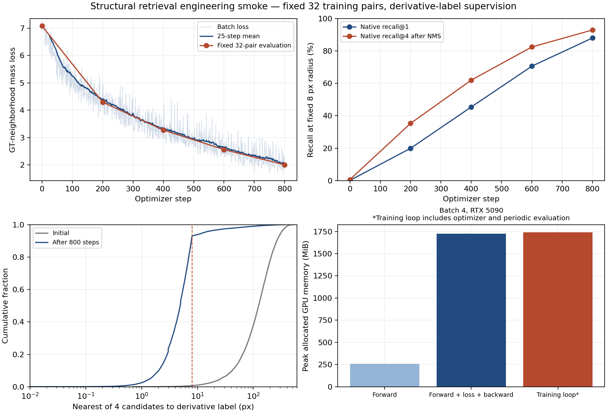

# 双轨实施报告

## 当前结果

轨道 B 的结构检索工程冒烟测试通过。轨道 A 已核对 GDROS 官方发布入口、当前网盘目录和本地包哈希，但父场景映射、灰度化/预对齐流程及底图监督精度仍未恢复。正式训练路线选择转向原始 WHU 的可追溯重建，当前派生包继续用于固定小样本工程诊断。

本报告的检索结果均相对于派生包中的 metadata 标签计算，不能据此认定光学与原始 SAR 已精确对齐，也不能用于解释真实配准精度或泛化能力。

## 轨道 A 的证据

### 发布来源和本地文件身份

GDROS 官方仓库所有者为 `Zi-Xuan-Sun`，README 的 WHU 下载入口指向百度公开分享。核查固定的官方代码提交为 `ee6b6216fe780bc03bfb4759ae094daa0cfddc60`。当前分享目录为 `/GDROS/whu_opt_sar512`，列出的 `training.zip`、`testing.zip` 名称和字节数与服务器文件完全一致。相关目录结构也与 README 的四类文件一致。来源归属有这些相互吻合的证据，发布者独立内容摘要认证仍未完成。[GDROS 官方说明](https://github.com/Zi-Xuan-Sun/GDROS/blob/ee6b6216fe780bc03bfb4759ae094daa0cfddc60/README.md) · [官方 README 链接的下载页](https://pan.baidu.com/s/17dNYVhNObbVjgcY2SmlM-w?pwd=ukpw)

| 包 | 字节数 | 本地 SHA-256 |
| --- | --- | --- |
| testing.zip | 1970629045 | `7c658901f6aed4ecd988c198edc6d79fd5775b5441fb04cf8ed7a8997c21a49f` |
| training.zip | 15817443135 | `548f1fbc77345d061b287c2d8e857387137288053a17488adf05def8f9b8b71c` |

本次 SHA-256 与服务器 2026-09-06 的上传审计记录一致，确认了本地文件的持续身份。百度返回的 `md5` 字段包含非十六进制字符，本报告将其保存为平台不透明标识，未将其当作可核对的 MD5。全部来源核查、目录快照和哈希保存在 `provenance/`。

### 生成过程

| 环节 | 已核实的内容 | 仍未核实的内容 |
| --- | --- | --- |
| 原始影像 → 单波段底图 | 当前光学和 SAR 均为 512×512 uint8 灰度 | RGB/NIR 的选波段/灰度化公式、拉伸、缩放、预对齐方法 |
| SAR 合成扰动 | `datum[4]` 是扰动前 SAR，`datum[2]` 是正向仿射 | 作者生成程序及其随机种子 |
| 四类文件关系 | `datum[0]` 两通道分别等于 optical 和 warped SAR；flow 与 metadata 正向位移一致 | 四类文件的实际写盘先后顺序 |
| crop 和 split | 包内为 5600 training、700 testing，ID 在各 split 内局部编号 | 父影像 ID、裁剪窗口、重叠量及划分随机种子 |

前一阶段全量验证了嵌入图像与 TIFF、flow 与仿射 metadata 的一致性，并在 12 个样本上检验了原 SAR → 扰动 SAR 的图像重建。这些是内容关系验证。可推导的依赖关系是“已有单波段底图 → SAR 仿射扰动 → warped SAR/flow/metadata”，实际执行及写盘顺序尚不可恢复。

官方仓库中的 `core/datasets.py` 是已有文件的读取器，灰度输入会被复制为三通道。该操作发生于读取阶段，不能用于证明发布包最初如何由 RGB/NIR 转为单波段。所检查的官方源码没有原始影像裁剪、灰度化或预对齐生成入口。[官方读取代码](https://github.com/Zi-Xuan-Sun/GDROS/blob/ee6b6216fe780bc03bfb4759ae094daa0cfddc60/core/datasets.py)

GDROS 原文描述 5600 训练、700 验证、700 测试，共 7000 对。当前官方分享目录只列出 training/testing 两个 ZIP，现有 ZIP 索引没有独立验证目录。论文描述与当前发布文件之间的对应关系尚未恢复，不能据此断言当前包缺少 700 对，也不能把文中对底图精度的表述作为本地精度证明。[GDROS 原文数据准备段](https://arxiv.org/html/2511.00598v1)

### 精确重复与近重复

全部 6300 个样本分别对光学原像素、扰动前 SAR 原像素及二者联合计算 SHA-256，检出精确重复组 0 个。近重复筛查使用 63 位 DCT 感知哈希进行全体紧阈值筛查，并为每个测试裁块检索训练侧最接近的三个候选，按既定阈值留下 30 对。30 对均经过同模态 SIFT、仿射 RANSAC、重叠支持及像素相关验证，本次未确认跨 split 的近重复。

近重复确认要求至少 20 个内点、内点比例 ≥0.5、源侧凸包覆盖 ≥10%、重叠支持 ≥25%、相关系数 ≥0.85、内点中位重投影误差 ≤2 像素。该筛查会遗漏部分裁剪、尺度和外观变化下的共同内容。

检出重复可以发现部分泄漏，没有检出不能证明地理独立。分散编号不能代替父场景信息。当前无法从上述结果恢复完整父场景分组。

### 正式数据路线

当前派生包的来源线索已经收窄到 GDROS 公开发布，但分组和底图精度仍缺少关键证据，因此本次不将其选为正式精配准训练来源。代码中的 `configs/data_route.json` 记录了该决定。

正式路线选择原始 WHU-OPT-SAR 的可追溯重建，先保留原始父影像 ID 和空间元数据，再按父影像分组划分及记录 crop footprints。原始数据清单和独立控制点残差仍需落实，当前状态为 `training_ready=false`。若训练来源需要预对齐，应把拟合点与独立质控检查点分开，并明确伪标签身份。[WHU 原版发布](https://github.com/AmberHen/WHU-OPT-SAR-dataset)

SOPatch 保留为备选。SOMA 原文明确采用 SOPatch 提供的 finely registered SEN1-2，以区别于非严格对齐的原始 SEN1-2。[SOMA 数据集段](https://arxiv.org/html/2511.13168v1)

另从 DH-Net 的 SOPatch 评估说明找到了可列目录的分享，其中有 `Image/SEN1-2.zip`（1,288,995,743 字节）和 `Patch/SEN1-2.zip`（1,111,176,893 字节）。两类包需要区分。此次只完成发布目录可访问性核查，下载解码、与 SOMA 实际文件的同一性、父场景分组和独立残差均未确认，尚未落实为替代训练集。SOPatch 原论文为 Xu 等发表于 2023 年的《SAR-optical feature matching: A large-scale patch dataset and a deep local descriptor》。[SOPatch 原论文](https://doi.org/10.1016/j.jag.2023.103433) · [本次使用的二级下载入口](https://github.com/Bend1031/DH-net#evaluation-on-sopatch)

## 轨道 B 的工程实现

网络使用模态独立的单波段输入适配器和共享结构编码器，输出归一化的 `[B,128,64,64]` 描述子。576 个固定源点对全部 4096 个目标位置计算结构分数，在稠密分数上训练 GT 邻域概率质量，随后用无梯度空间 NMS 保留每个源点 4 个候选。

三个 2×2 平均池化和对称 stride-1 卷积使特征网格中心为原图的 `8*i+3.5`，与统一半像素采样约定相符。

| 设置 | 本次取值 |
| --- | --- |
| 数据 | 固定种子 20261125，从现有 5600 训练样本中选 32 对 |
| 额外随机几何增强 | 关闭 |
| 单独开发集 | 未建立，本次只检验同一小样本的拟合 |
| 700 测试样本 | 仅轨道 A 读取作数据核查，轨道 B 未使用 |
| 标签 | 已验证的 `datum[2]`，按光学底图网格 → 扰动 SAR 网格解释 |
| 参数量 | 485,536 |
| 训练 | AdamW，学习率 3e-4，weight decay 1e-4，batch 4，800 步 |
| 正邻域 | 固定欧氏半径 8 个原图像素，即一个粗网格单位 |
| 召回阈值 | 同样固定为 8 像素 |
| NMS | 半径 24 个原图像素，4 个候选 |
| 测量设备 | zzvr GPU 4，RTX 5090，PyTorch 2.11.0+cu128 |

正邻域半径由粗检索的工程任务定义固定，整个训练中未放宽，也不能用它解释未知底图误差。候选提取函数只接收分数、目标位置和物理支持掩码，不注入 GT 候选。

支持掩码来自仿射标签与原图像素范围，零像素保留其正常像素身份。32 对共有 18432 个源查询，其中 14842 个有有效监督，3590 个因 GT 位于图外而屏蔽，真实小样本中没有出现空正邻域。另以单元测试覆盖了空正邻域、无有效目标、部分候选不足和全空监督的处理。

### 拟合结果

| 指标 | 初始化 | 800 步后 |
| --- | --- | --- |
| 全部固定样本的质量损失 | 7.0817 | 2.0020 |
| 原生召回@1 | 0.14% | 88.05% |
| 原生召回@4（空间 NMS） | 0.67% | 92.98% |

下表距离是最近候选到派生标签位置的距离，单位为原图像素。

| 分位数 | 初始化 | 800 步后 |
| --- | --- | --- |
| 0% | 0.714 | 0.003 |
| 25% | 74.781 | 3.122 |
| 50% | 124.262 | 4.910 |
| 75% | 189.232 | 6.597 |
| 90% | 263.009 | 7.771 |
| 95% | 313.231 | 12.449 |
| 100% | 525.454 | 365.009 |

损失下降约 71.7%，候选在固定样本上向派生标签集中。仍存在较大的尾部错误，最终最大距离为 365.0 像素。



### 非有限值、梯度和运行开销

所有训练步检查描述子、完整分数、损失及梯度有限性，未检出非有限值。光学适配器、SAR 适配器和共享编码器在第 1 步及第 800 步均具有有效非零梯度。27 项自动测试通过，其中包括原有几何/数据测试和本次新增的结构检索、监督与 NMS 边界测试。

| 操作 | 耗时 | 峰值 allocated 显存 |
| --- | --- | --- |
| batch 4 前向 | 4.17 ms / batch | 259.1 MiB |
| batch 4 前向＋损失＋反向 | 12.13 ms / batch | 1726.5 MiB |
| 实际 800 步训练循环 | 17.34 s | 1739.3 MiB |

前两项使用驻留 GPU 的输入，预热 3 次、测量 10 次，排除数据加载、NMS 和 optimizer.step。实际训练循环包含 optimizer.step、有限值检查、日志及周期评估。allocated 与 reserved 数值均完整保存在 `performance.json`。

“损失明显下降”在本次验收记录中具体检查为固定样本全量损失至少降低一半，同时检查召回提升和中位距离减小。该阈值是工程验收取值。全部验收项通过，结果不构成底图真实精度或泛化证据。

## 复现和文件

```bash
ssh zzvr
cd /mnt/sda/zhushihao/Semantically-guided-disambiguation-matching
export PYTHONPATH=.
PYTEST_DISABLE_PLUGIN_AUTOLOAD=1 .venv/bin/python -m pytest -q
.venv/bin/python scripts/check_duplicates.py --config configs/zzvr.json
# 重跑训练时，在配置中指定新的 output 目录，以保留原日志。
.venv/bin/python scripts/train_structure_smoke.py --config configs/structure_smoke.json
.venv/bin/python scripts/summarize_dual_track.py
```

`provenance/` 保存来源、ZIP 哈希、像素哈希及近重复候选核验。`structure_smoke/` 保存固定样本清单、每步损失、原生召回、距离全集、源点—候选—标签图、梯度和显存耗时记录。模型 checkpoint 保存在服务器 `reports/structure_smoke_20261125/last.pt`。
