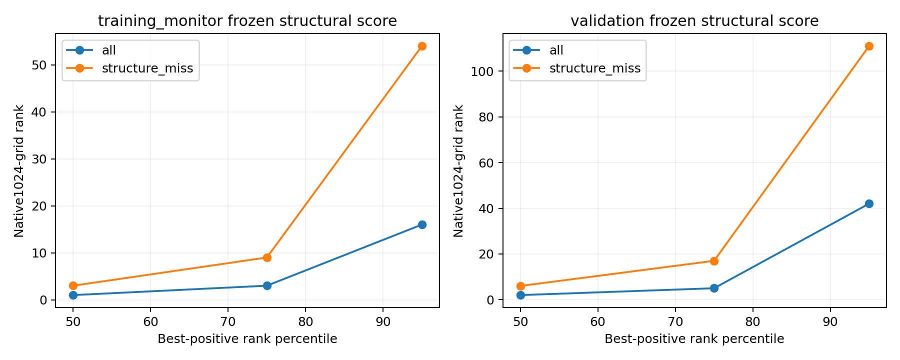
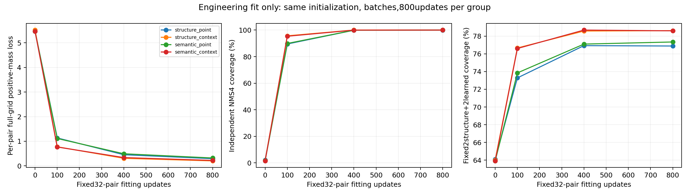

# 冻结前端、等容量上下文描述子：第一份交付

已在zzvr完成纯结构同口径排名、四组前向与单测、固定32对小样本拟合。四组均完成预先固定的800步，损失下降、正位置排名与独立NMS四峰覆盖响应，两侧头均有有效梯度。**阶段A/B的工程链路通过；尚未执行阶段C，不能据此认证未见family上的收益或语义的独立价值。**

OS最终测试1,696对及UBCv2官方测试池1,625对继续封存。排名与距离均相对于现有底图加合成变换标签；来源组隔离不等于地理独立。

## 1. 先补齐纯结构起点

在训练任何新描述子之前，复用第30轮结构模型、固定952对训练监测集及952对验证集。每个集合各有116,953个有效查询；验证含238个family。候选、有效性和距离数组与上一轮逐元素一致。

| 集合／查询组 | 查询数 | 最佳正名次 中位／P75／P95 | 原生@1 | 独立NMS四峰@4 |
| --- | ---: | ---: | ---: | ---: |
| 训练监测／全部 | 116953 | 1／3／16 | 61.6282% | 70.1145% |
| 训练监测／原4结构漏检 | 34952 | 3／9／54 | 0.0000% | 0.0000% |
| 验证／全部 | 116953 | 2／5／42 | 47.8337% | 60.1284% |
| 验证／原4结构漏检 | 46631 | 6／17／111 | 0.0000% | 0.0000% |

P为GT周围8个原图像素内的有效目标网格，比较全部有效1024位置，沿用1e-6平局容差。报告同时保存乐观／保守名次区间；本表四行的两端分位数相同。NMS采用既有顺序argmax与24 px排除半径，排名的平局判断不冒充候选排序证据。漏检组由原4结构结果固定定义。

**纯结构验证中位名次为2，漏检组为6。旧语义的125→119只是在语义两支之间的比较，不能解释为优于纯结构。**



## 2. 四组实现与冻结审计

- 输入保持原生256；结构网格32×32、144源点、1024目标位置。四组均全网格余弦评分，不限于旧四候选，不与结构分数相加。
- 冻结第30轮结构前端及运行统计、DINOv2 ViT-S/14、32原型及教师缓存；SAR语义头固定KL续训终点总10,000步，未使用KL＋corr分支。冻结文件与内存状态前后校验一致。
- 光学及SAR各有独立640→256→128 MLP（GELU、输出L2），每组共393,984个可训练参数；组间初始化权重完全相同，两模态参数独立。仅新头更新，四个AdamW状态从空开始。
- 无语义组使用同一冻结32×128行正交投影；有语义组使用冻结原型分布。逐点组把中心块重复四次；上下文组用中心、3×3、5×5、9×9掩码均值。
- 每位置先归一化F/E，在各自网格池化；再分别采样各尺度的F/E，分别L2归一化、拼接，最后进入非线性MLP。没有先过MLP再插值，没有在前向读取GT。
- 无效位置及图外不参与池化，中心无效置零，部分邻域仍可计算。每尺度有效比例独立归档，不作为网络输入，也不解释为SAR物理可见性。
- 损失为两次稳定logsumexp之差，tau=0.1；每对先平均有效查询再平均有效图像对。无有效查询时跳过优化器更新；不加入KL或其他损失。

投影种子：`2026112709`；矩阵SHA-256：`a0dbc3741b35542d5cae60d38cad55eec238d3977676775f2089112926718e2f`；行正交最大误差：`1.19e-07`。

结构checkpoint SHA-256：`40aefd473566fa5c14557b9d9198bf26e8b2b753b35cb435bda589b28b6f19bc`。

SAR KL10k checkpoint SHA-256：`ccaa7a081c9b22a66a816eab6256e630645962b42e7ef86a6d1c65dae306256f`。

沿用教师版本：官方DINOv2源码7764ea0f912e53c92e82eb78a2a1631e92725fc8，灰度复制三通道，252输入，ImageNet归一化，18×18 patch token，不使用CLS；token中心到原图为(u+0.5)×256/18−0.5，结构中心为8k+3.5。教师和原型来源详见既有os_semantic_routing归档。

语义组的既有成本另计：冻结DINO特征缓存及训练family原型拟合，SAR头原KL 5,000步＋KL续训5,000步（总10,000步）。历史首段KL记录157.56秒；后续两分支合计329.54秒，未将其冒称为KL单支耗时。这些均不含完整教师准备成本，也不计入本轮四组新头的800步预算；因此等参数量和等新增更新预算不等于相同总预训练成本。

## 3. 单测与重载

**88项测试全部通过**，其中新增9项上下文测试覆盖边界常量保持、掩码外值不影响有效池化、独立手算、中心重复不读取邻域、连续坐标采样、独立损失公式、空监督、投影及等参数量、冻结统计与双侧梯度、GT变化不影响前向等要求。27条既有警告来自无地理参考的测试栅格。

额外重载检查逐项验证：32对×四组的MLP前采样块哈希一致，四组初始权重一致，800次AdamW计数一致，最终全部指标及候选数组精确复现，原结构监测／验证数组与既有基线一致。见verification/verification_summary.json。

复现细节：新描述子头在eval()+no_grad下保留原评估时的requires_grad标志。把新头额外设成requires_grad=False会触发不同浮点计算路径，曾使一个逐点组独立候选槽位发生近似并列变化，覆盖未变；现已匹配原路径并通过精确核验。冻结前端和SAR语义头始终requires_grad=False。该修正没有改权重、NMS或平局规则。

## 4. 固定32对小样本拟合

从训练集固定抽32个family、每个1对，关闭额外随机几何变换，使用原生配对及名义恒等底图标签；不认证原始底图绝对精度。批量16，四组共享样本顺序及初始化，均800步，评价点0/100/400/800。AdamW：lr=1e-3恒定、weight_decay=1e-4、betas=(0.9,0.999)、梯度裁剪1.0。没有根据验证表现调整设置。

| 组别 | 起始→终点损失 | 终点正名次 中位／P75／P95 | 独立最高分覆盖 | 独立NMS四峰覆盖 | 2结构＋2新描述子@4 |
| --- | ---: | ---: | ---: | ---: | ---: |
| 结构逐点 | 5.4648→0.2936 | 1／1／1 | 99.8915% | 99.9783% | 76.8880% |
| 结构上下文 | 5.5157→0.2034 | 1／1／1 | 100.0000% | 100.0000% | 78.6241% |
| 语义逐点 | 5.4630→0.3217 | 1／1／1 | 99.9132% | 100.0000% | 77.3438% |
| 语义上下文 | 5.4645→0.2233 | 1／1／1 | 100.0000% | 100.0000% | 78.6024% |

小样本共4,608个有效查询；其原4结构@1=55.8160%、@4=69.0972%，与固定扰动验证的60.1284%不属于同一评估集合。全部四组在原结构漏检子组上的终点正名次中位/P75/P95也均为1/1/1。



| 相对该32对的4结构 | 新增 | 丢失 | 净增 | 结构漏检补救率 | Δ@4的family配对95%区间（百分点） |
| --- | ---: | ---: | ---: | ---: | ---: |
| 结构逐点 | 371 | 12 | 359 | 26.0534% | [4.9479, 11.1985] |
| 结构上下文 | 441 | 2 | 439 | 30.9691% | [6.5104, 13.0648] |
| 语义逐点 | 384 | 4 | 380 | 26.9663% | [5.4465, 11.5451] |
| 语义上下文 | 440 | 2 | 438 | 30.8989% | [6.4887, 12.9997] |

区间按32个已用于拟合的family成对重采样2,000次；它只描述训练样本内差异，不能作为独立验证或重复种子证据。逐对／family／查询记录均已保存。

终点两侧描述子平均空间方差约0.88–0.97，平均非对角余弦约0.02–0.12；没有出现全图同描述子的塌缩。第1/100/800步双侧头全部参数梯度有限且非零，800步中无非有限损失。

### 为什么独立四峰接近100%，合并路径却只有77%–79%？

固定前2个结构峰按原24 px规则先抑制目标网格。对这32对恒等扰动样本，原结构漏检1,424个查询中，有944个的整个8 px正集合都已被结构前缀抑制；此时任何补充描述子都无法再选入正位置。考虑前缀已命中的查询后，该2＋2协议的几何可达上限为**79.5139%**，当前上下文两组约78.6%，接近这个上限。

这仅是本次恒等扰动训练子集的后验诊断：GT只用于计算可达性，没有进入候选选择。不能把79.5%当作正式验证的上限，也未据此改变合并／NMS规则。既有扰动验证上的语义丢失问题不能由本次训练子集的前缀限制直接解释。

## 5. 当前能回答什么

| 问题 | 当前证据 |
| --- | --- |
| 结构上下文是否有效？ | 小样本响应较快，终点损失较低；独立检索已接近饱和，尚无未见family证据。 |
| 语义上下文是否优于语义逐点？ | 小样本优化更快、损失更低；仍需相同正式预算比较。 |
| 语义是否超出结构上下文？ | 当前无法支持。两上下文组已接近相同拟合水平，不能用此子集证明语义独立贡献。 |

同尺寸方形邻域不具备仿射不变性；本次恒等扰动拟合只验证实现和优化链路。三个池化窗口对应8 px网格上的24/40/72 px名义网格单元范围，结构特征本身感受野另计；没有方向布局或完整关系建模。正式阶段仍须按旋转、尺度及边界有效比例分组，不能把当前响应外推到大变换。

## 6. 正式阶段状态与复现

**第一份交付范围到阶段A/B。阶段C尚未启动**。配对种子已预登记为2026112706、2026112707、2026112708，每组每种子5,000步，从新头及新AdamW开始，恢复现有训练增强；先完成首种子的全部四组并核验，再补齐另两种子的全部四组。过程点仅诊断，固定终点评价。不能从小样本checkpoint接着训练充当正式重启。

正式结论仍需四组间配对比较，并检验相对原4结构新增是否稳定超过丢失。只改善排名或训练拟合，均不满足进入关系模块的条件。

服务器目录：`/mnt/sda/zhushihao/Semantically-guided-disambiguation-matching`。服务器输出：`reports/os_context_descriptor_stageAB_20261127`。四个smoke checkpoint保留在该目录的checkpoints/，其SHA-256见implementation_environment.json；原始数据、教师缓存、模型大权重不提交GitHub。

执行环境：Python 3.10.20 / PyTorch 2.11.0+cu128 / NVIDIA GeForce RTX 5090，cuda:6。拟合循环及其过程评价合计30.82秒，峰值已分配显存612.15 MiB；该计时不含前置纯结构评估、缓存准备与单测，不能当作正式训练总耗时。

```bash
cd /mnt/sda/zhushihao/Semantically-guided-disambiguation-matching
export PYTHONPATH=.
# 新运行必须设置新的output，脚本拒绝覆盖现有结果。
.venv/bin/python scripts/run_os_context_stageAB.py --config configs/os_context_descriptor.json
.venv/bin/python scripts/summarize_os_context_stageAB.py --config configs/os_context_descriptor.json
.venv/bin/python scripts/verify_os_context_stageAB.py --config configs/os_context_descriptor.json
PYTEST_DISABLE_PLUGIN_AUTOLOAD=1 .venv/bin/python -m pytest -q
```

核心归档：preregistered_protocol.json、pure_structure_baseline_ranks.csv、four_group_start_audit.json、fixed_training_samples.jsonl、shared_smoke_schedule.jsonl、four_group_small_fit_history.csv、smoke_gradient_checks.json、small_fit_prefix_geometry.json、verification/verification_summary.json，以及baseline/、smoke/内逐对、family和查询记录。
