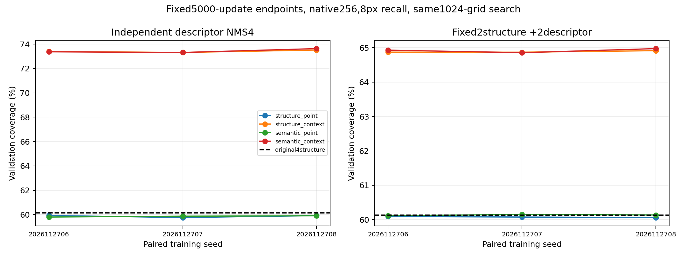
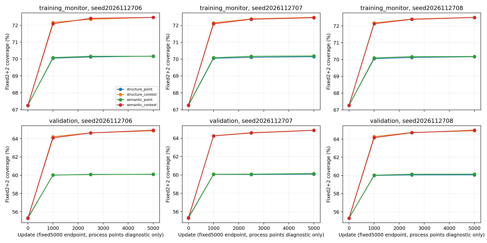

# 冻结前端上下文描述子：正式三配对种子结果

四组均重新初始化描述子头和AdamW；先完成首个配对种子的全部四组5,000次更新并通过工程核验，再完成另外两种子的全部四组。终点固定5,000步，没有按验证选步数或按收益追加种子。OS最终测试与UBCv2测试池继续封存。

**本轮结论：上下文的三种子对照均为正，尚未证实语义在结构上下文之外的稳定额外贡献。** 结构上下文的2＋2相对原4结构三个种子平均增加4.7549个百分点，语义上下文增加4.7897个百分点；语义上下文－结构上下文仅为+0.0348±0.0420个百分点（均值±训练种子样本标准差），三个种子中2正、1负，3/3个种子的family配对95%区间跨0。

本轮分开考察上下文效果、语义额外贡献和实际四候选净收益。指标相对合成标签，来源family隔离不等于地理独立。

## 1. 冻结条件与执行审计

第30轮结构前端、运行统计、DINO教师及32原型、KL续训终点总10,000步SAR语义头全部冻结。输入原生256，32×32目标网格、144源点，8 px正集合与召回门槛、24 px顺序NMS不变。每组393,984个新头参数，两模态各独立640→256→128 MLP；相同配对种子内四组初始权重完全一致，单次数据读取／增强／冻结前端输出共享。无语义组沿用同一冻结行正交结构投影。

AdamW lr=1e-3恒定、weight_decay=1e-4、betas=(0.9,0.999)、梯度裁剪1.0，batch=16，保留epoch末尾短批；损失为tau=0.1全有效1024网格正邻域概率质量，每对先平均有效查询。四组不加入其他损失，不融合结构分数。数据随机排列使用各配对种子；样本/epoch增强种子沿用原数据链，因此种子间只改变初始化和样本顺序，不额外改增强范围。

过程评价固定0/1,000/2,500/5,000步，每次使用原952对训练监测集和952对验证集；各自116,953有效查询，验证238个family。固定原结构漏检组为验证46,631查询，训练监测34,952查询，所有模型/种子共用。排名保留1e-6平局的乐观/保守两端，NMS规则保持既有实现。

| 种子 | GPU | 每组成功更新 | 尝试/跳过批次 | 含过程评价耗时(s) | 峰值已分配显存(MiB) |
| --- | ---: | ---: | ---: | ---: | ---: |
| 2026112706 | 6 | 5000 | 5000 / 0 | 1921.6 | 424.8 |
| 2026112707 | 1 | 5000 | 5000 / 0 | 873.8 | 425.0 |
| 2026112708 | 1 | 5000 | 5000 / 0 | 895.0 | 424.2 |

上述耗时不含进程初始化与数据/教师审计；共享GPU负载会影响时间。语义组另有既有DINO缓存/原型拟合及SAR头10,000步训练成本，本轮等新增预算不等于相同总预训练成本。

## 2. 验证终点：全部查询与固定结构漏检组

原结构验证正名次中位/P75/P95为2/5/42；固定结构漏检组6/17/111。原4结构@1=47.8337%、@4=60.1284%，每个种子、每个过程点的结构候选/距离/有效查询均精确核对旧基线。

| 种子 | 组别 | 全部正名次 中位/P75/P95 | 漏检组正名次 中位/P75/P95 | 独立四峰 全部/漏检组 | 2＋2@4 | 新增/丢失 | 补救率 |
| --- | --- | ---: | ---: | ---: | ---: | ---: | ---: |
| 2026112706 | 结构逐点 | 2/5/41 | 5/17/107 | 59.9275% / 11.8805% | 60.0917% | 1074/1117 | 2.3032% |
| 2026112706 | 结构上下文 | 1/2/9 | 2/4/18 | 73.3927% / 50.2477% | 64.8696% | 6581/1036 | 14.1129% |
| 2026112706 | 语义逐点 | 2/5/41 | 5/16/106 | 59.8001% / 11.5846% | 60.1147% | 1079/1095 | 2.3139% |
| 2026112706 | 语义上下文 | 1/2/9 | 2/4/18 | 73.3696% / 49.9517% | 64.9278% | 6636/1023 | 14.2309% |
| 2026112707 | 结构逐点 | 2/5/42 | 6/17/109 | 59.7582% / 11.8505% | 60.0763% | 1087/1148 | 2.3311% |
| 2026112707 | 结构上下文 | 1/2/9 | 2/4/19 | 73.3175% / 50.1791% | 64.8679% | 6577/1034 | 14.1044% |
| 2026112707 | 语义逐点 | 2/5/41 | 5/16/106 | 59.8711% / 11.9105% | 60.1515% | 1136/1109 | 2.4361% |
| 2026112707 | 语义上下文 | 1/2/9 | 2/4/18 | 73.3158% / 49.6837% | 64.8543% | 6529/1002 | 14.0014% |
| 2026112708 | 结构逐点 | 2/5/42 | 5/17/107 | 59.9215% / 11.9684% | 60.0617% | 1069/1147 | 2.2925% |
| 2026112708 | 结构上下文 | 1/2/9 | 2/4/19 | 73.5159% / 50.1533% | 64.9124% | 6604/1009 | 14.1623% |
| 2026112708 | 语义逐点 | 2/5/41 | 5/16/105 | 59.9027% / 11.6553% | 60.1370% | 1087/1077 | 2.3311% |
| 2026112708 | 语义上下文 | 1/2/9 | 2/4/18 | 73.6321% / 50.1212% | 64.9723% | 6656/991 | 14.2738% |

完整CSV另列训练监测、独立最高分覆盖、最近候选距离中位/P95，以及平局保守排名。漏检组的2＋2覆盖即补救率，其相对结构丢失必为0，不把这一条件子组当作总体净收益。



## 3. 三种收益分开比较

下表为每个训练种子内的验证family配对95%重采样区间，单位为百分点。每次整family重采样并保留查询配对，2,000次，按查询总数加权。区间条件于本训练种子，不估计训练随机性。

| 种子 | 比较 | 独立四峰Δ [family区间] | 2＋2Δ [family区间] | 2＋2配对新增/丢失 |
| --- | --- | ---: | ---: | ---: |
| 2026112706 | 结构上下文－结构逐点 | +13.4652 [+12.9742, +13.9603] | +4.7780 [+4.4163, +5.1836] | 6630/1042 |
| 2026112706 | 语义上下文－语义逐点 | +13.5696 [+13.1107, +14.0596] | +4.8130 [+4.4508, +5.2221] | 6663/1034 |
| 2026112706 | 语义上下文－结构上下文 | -0.0231 [-0.1867, +0.1341] | +0.0581 [-0.0275, +0.1386] | 1073/1005 |
| 2026112706 | 语义逐点－结构逐点 | -0.1274 [-0.2821, +0.0376] | +0.0231 [-0.0426, +0.0879] | 801/774 |
| 2026112706 | 结构逐点－原4结构 | -0.2009 [-0.4073, -0.0017] | -0.0368 [-0.1224, +0.0504] | 1074/1117 |
| 2026112706 | 结构上下文－原4结构 | +13.2643 [+12.7719, +13.7734] | +4.7412 [+4.3756, +5.1569] | 6581/1036 |
| 2026112706 | 语义逐点－原4结构 | -0.3283 [-0.5247, -0.1331] | -0.0137 [-0.0950, +0.0682] | 1079/1095 |
| 2026112706 | 语义上下文－原4结构 | +13.2412 [+12.7387, +13.7616] | +4.7994 [+4.4247, +5.2102] | 6636/1023 |
| 2026112707 | 结构上下文－结构逐点 | +13.5593 [+13.0440, +14.0769] | +4.7917 [+4.4260, +5.1823] | 6608/1004 |
| 2026112707 | 语义上下文－语义逐点 | +13.4447 [+12.9621, +13.9167] | +4.7027 [+4.3390, +5.0935] | 6513/1013 |
| 2026112707 | 语义上下文－结构上下文 | -0.0017 [-0.1578, +0.1533] | -0.0137 [-0.0901, +0.0642] | 1070/1086 |
| 2026112707 | 语义逐点－结构逐点 | +0.1129 [-0.0369, +0.2694] | +0.0752 [+0.0094, +0.1429] | 815/727 |
| 2026112707 | 结构逐点－原4结构 | -0.3702 [-0.5867, -0.1688] | -0.0522 [-0.1362, +0.0401] | 1087/1148 |
| 2026112707 | 结构上下文－原4结构 | +13.1891 [+12.6710, +13.7098] | +4.7395 [+4.3677, +5.1433] | 6577/1034 |
| 2026112707 | 语义逐点－原4结构 | -0.2574 [-0.4793, -0.0392] | +0.0231 [-0.0580, +0.1113] | 1136/1109 |
| 2026112707 | 语义上下文－原4结构 | +13.1873 [+12.6896, +13.6995] | +4.7258 [+4.3688, +5.1200] | 6529/1002 |
| 2026112708 | 结构上下文－结构逐点 | +13.5943 [+13.1296, +14.0901] | +4.8507 [+4.4783, +5.2547] | 6653/980 |
| 2026112708 | 语义上下文－语义逐点 | +13.7294 [+13.2147, +14.2522] | +4.8353 [+4.4661, +5.2357] | 6652/997 |
| 2026112708 | 语义上下文－结构上下文 | +0.1163 [-0.0435, +0.2823] | +0.0599 [-0.0215, +0.1390] | 1091/1021 |
| 2026112708 | 语义逐点－结构逐点 | -0.0188 [-0.1821, +0.1367] | +0.0752 [+0.0085, +0.1390] | 847/759 |
| 2026112708 | 结构逐点－原4结构 | -0.2069 [-0.4084, -0.0095] | -0.0667 [-0.1458, +0.0197] | 1069/1147 |
| 2026112708 | 结构上下文－原4结构 | +13.3874 [+12.8814, +13.9017] | +4.7840 [+4.4126, +5.1853] | 6604/1009 |
| 2026112708 | 语义逐点－原4结构 | -0.2257 [-0.4096, -0.0425] | +0.0086 [-0.0789, +0.0922] | 1087/1077 |
| 2026112708 | 语义上下文－原4结构 | +13.5037 [+12.9918, +14.0298] | +4.8438 [+4.4685, +5.2595] | 6656/991 |

独立检索比较与2＋2比较分列：后者保留前2结构峰并按原24 px排重补峰，收益受同一结构前缀约束。不能把不同候选协议混为同一个指标。

## 4. 训练随机性：三个种子的单独值、均值与样本标准差

| 验证指标／比较 | 三种子值（按登记顺序，%或百分点） | 均值 | 样本标准差 |
| --- | --- | ---: | ---: |
| 结构逐点 2＋2@4 | 60.0917, 60.0763, 60.0617 | 60.0766 | 0.0150 |
| 结构上下文 2＋2@4 | 64.8696, 64.8679, 64.9124 | 64.8833 | 0.0252 |
| 语义逐点 2＋2@4 | 60.1147, 60.1515, 60.1370 | 60.1344 | 0.0185 |
| 语义上下文 2＋2@4 | 64.9278, 64.8543, 64.9723 | 64.9181 | 0.0596 |
| 结构上下文－结构逐点 | 4.7780, 4.7917, 4.8507 | 4.8068 | 0.0386 |
| 语义上下文－语义逐点 | 4.8130, 4.7027, 4.8353 | 4.7837 | 0.0710 |
| 语义上下文－结构上下文 | 0.0581, -0.0137, 0.0599 | 0.0348 | 0.0420 |
| 语义逐点－结构逐点 | 0.0231, 0.0752, 0.0752 | 0.0579 | 0.0301 |
| 结构逐点－原4结构 | -0.0368, -0.0522, -0.0667 | -0.0519 | 0.0150 |
| 结构上下文－原4结构 | 4.7412, 4.7395, 4.7840 | 4.7549 | 0.0252 |
| 语义逐点－原4结构 | -0.0137, 0.0231, 0.0086 | 0.0060 | 0.0185 |
| 语义上下文－原4结构 | 4.7994, 4.7258, 4.8438 | 4.7897 | 0.0596 |

三个训练种子是有限重复，均值±样本标准差只描述实际三次运行；不把family区间替代这一层变动，也不从三次重复构造过强总体置信结论。



## 5. 上下文的几何限制

geometry_strata.csv按绝对旋转[0,5)、[5,10)、[10,15)、[15,20)度，尺度偏离，以及源/GT目标9×9窗口有效比例的较小值分组。GT目标位置只用于诊断分组，没有在前向对齐窗口或搬运光学信息。正方形均值窗口并不仿射不变，当前生成器仅含旋转、均匀尺度和平移，不包含各向异性变换，不能宣称已验证各向异性鲁棒性。

| 验证分组（3种子均值） | 每种子查询数 | 组别 | 独立四峰 | 2＋2@4 | 相对4结构Δ（百分点） |
| --- | ---: | --- | ---: | ---: | ---: |
| absolute_rotation_degrees [0,5) | 31800 | 结构逐点 | 59.3564% | 59.7065% | -0.0105 |
| absolute_rotation_degrees [0,5) | 31800 | 结构上下文 | 72.8658% | 64.2956% | +4.5786 |
| absolute_rotation_degrees [0,5) | 31800 | 语义逐点 | 59.2893% | 59.7547% | +0.0377 |
| absolute_rotation_degrees [0,5) | 31800 | 语义上下文 | 72.7778% | 64.3669% | +4.6499 |
| absolute_rotation_degrees [5,10) | 28741 | 结构逐点 | 60.3760% | 60.5047% | -0.0568 |
| absolute_rotation_degrees [5,10) | 28741 | 结构上下文 | 74.1322% | 65.3990% | +4.8375 |
| absolute_rotation_degrees [5,10) | 28741 | 语义逐点 | 60.2774% | 60.5592% | -0.0023 |
| absolute_rotation_degrees [5,10) | 28741 | 语义上下文 | 74.3178% | 65.4675% | +4.9059 |
| absolute_rotation_degrees [10,15) | 26902 | 结构逐点 | 61.6646% | 62.0474% | -0.0558 |
| absolute_rotation_degrees [10,15) | 26902 | 结构上下文 | 75.6164% | 67.0409% | +4.9377 |
| absolute_rotation_degrees [10,15) | 26902 | 语义逐点 | 61.7451% | 62.1081% | +0.0050 |
| absolute_rotation_degrees [10,15) | 26902 | 语义上下文 | 75.6065% | 66.9839% | +4.8807 |
| absolute_rotation_degrees [15,20) | 29510 | 结构逐点 | 58.2910% | 58.2616% | -0.0881 |
| absolute_rotation_degrees [15,20) | 29510 | 结构上下文 | 71.2764% | 63.0476% | +4.6978 |
| absolute_rotation_degrees [15,20) | 29510 | 语义逐点 | 58.3418% | 58.3305% | -0.0192 |
| absolute_rotation_degrees [15,20) | 29510 | 语义上下文 | 71.3205% | 63.0939% | +4.7442 |
| absolute_scale_deviation [0,0.03) | 35586 | 结构逐点 | 60.5884% | 60.7627% | -0.0787 |
| absolute_scale_deviation [0,0.03) | 35586 | 结构上下文 | 75.1738% | 65.9979% | +5.1565 |
| absolute_scale_deviation [0,0.03) | 35586 | 语义逐点 | 60.5809% | 60.8413% | +0.0000 |
| absolute_scale_deviation [0,0.03) | 35586 | 语义上下文 | 75.1157% | 65.9848% | +5.1434 |
| absolute_scale_deviation [0.03,0.07) | 45830 | 结构逐点 | 59.0334% | 59.2043% | -0.1062 |
| absolute_scale_deviation [0.03,0.07) | 45830 | 结构上下文 | 72.8431% | 64.1632% | +4.8527 |
| absolute_scale_deviation [0.03,0.07) | 45830 | 语义逐点 | 58.9374% | 59.2458% | -0.0647 |
| absolute_scale_deviation [0.03,0.07) | 45830 | 语义上下文 | 72.8795% | 64.2199% | +4.9094 |
| absolute_scale_deviation [0.07,0.1) | 35537 | 结构逐点 | 60.2264% | 60.5144% | +0.0450 |
| absolute_scale_deviation [0.07,0.1) | 35537 | 结构上下文 | 72.3706% | 64.6960% | +4.2266 |
| absolute_scale_deviation [0.07,0.1) | 35537 | 语义逐点 | 60.3212% | 60.5725% | +0.1032 |
| absolute_scale_deviation [0.07,0.1) | 35537 | 语义上下文 | 72.4822% | 64.7504% | +4.2810 |
| min_source_targetGT_window9_valid_fraction [0,0.5) | 5942 | 结构逐点 | 86.5814% | 86.8002% | -0.0898 |
| min_source_targetGT_window9_valid_fraction [0,0.5) | 5942 | 结构上下文 | 89.8295% | 87.3724% | +0.4824 |
| min_source_targetGT_window9_valid_fraction [0,0.5) | 5942 | 语义逐点 | 86.7385% | 86.8394% | -0.0505 |
| min_source_targetGT_window9_valid_fraction [0,0.5) | 5942 | 语义上下文 | 89.9080% | 87.4116% | +0.5217 |
| min_source_targetGT_window9_valid_fraction [0.5,0.75) | 27128 | 结构逐点 | 66.2649% | 66.5241% | -0.0602 |
| min_source_targetGT_window9_valid_fraction [0.5,0.75) | 27128 | 结构上下文 | 74.8366% | 68.3034% | +1.7190 |
| min_source_targetGT_window9_valid_fraction [0.5,0.75) | 27128 | 语义逐点 | 66.5155% | 66.6101% | +0.0258 |
| min_source_targetGT_window9_valid_fraction [0.5,0.75) | 27128 | 语义上下文 | 74.6695% | 68.2997% | +1.7153 |
| min_source_targetGT_window9_valid_fraction [0.75,0.999999) | 27251 | 结构逐点 | 66.2569% | 66.2520% | -0.1712 |
| min_source_targetGT_window9_valid_fraction [0.75,0.999999) | 27251 | 结构上下文 | 76.6431% | 69.2183% | +2.7950 |
| min_source_targetGT_window9_valid_fraction [0.75,0.999999) | 27251 | 语义逐点 | 66.1590% | 66.2728% | -0.1505 |
| min_source_targetGT_window9_valid_fraction [0.75,0.999999) | 27251 | 语义上下文 | 76.6394% | 69.2904% | +2.8672 |
| min_source_targetGT_window9_valid_fraction [0.999999,1.000001) | 56632 | 结构逐点 | 50.9288% | 51.2125% | +0.0135 |
| min_source_targetGT_window9_valid_fraction [0.999999,1.000001) | 56632 | 结构上下文 | 69.4454% | 58.7995% | +7.6005 |
| min_source_targetGT_window9_valid_fraction [0.999999,1.000001) | 56632 | 语义逐点 | 50.8164% | 51.2767% | +0.0777 |
| min_source_targetGT_window9_valid_fraction [0.999999,1.000001) | 56632 | 语义上下文 | 69.5820% | 58.8342% | +7.6353 |

边界与内部需分开判断：结构上下文在有效比例<0.5的5,942个查询上平均+0.4824个百分点，在近完整窗口的56,632个查询上平均+7.6005个百分点。不同组的地物、基线难度和剩余提升空间不同；这些是配对描述性结果，不能单独归因为窗口仿射变化。

## 6. 结论的判据

- 结构上下文－结构逐点：三个种子中3/3个2＋2差值为正，均值+4.8068个百分点，范围[+4.7780, +4.8507]。
- 语义上下文－语义逐点：三个种子中3/3个2＋2差值为正，均值+4.7837个百分点，范围[+4.7027, +4.8353]。
- 语义上下文－结构上下文：三个种子中2/3个2＋2差值为正，均值+0.0348个百分点，范围[-0.0137, +0.0599]。
- 语义逐点－结构逐点：三个种子中3/3个2＋2差值为正，均值+0.0579个百分点，范围[+0.0231, +0.0752]。
- 结构逐点－原4结构：三个种子中0/3个2＋2差值为正，均值-0.0519个百分点，范围[-0.0667, -0.0368]。
- 结构上下文－原4结构：三个种子中3/3个2＋2差值为正，均值+4.7549个百分点，范围[+4.7395, +4.7840]。
- 语义逐点－原4结构：三个种子中2/3个2＋2差值为正，均值+0.0060个百分点，范围[-0.0137, +0.0231]。
- 语义上下文－原4结构：三个种子中3/3个2＋2差值为正，均值+4.7897个百分点，范围[+4.7258, +4.8438]。

应结合上面的上下文对照、语义额外贡献对照、实际净覆盖及family区间作结论，不用训练损失或排名单项宣布成功；本轮不接后续关系模块。

91项单测通过。独立结果核验复算60行终点指标和192项配对比较，并检查候选预算/去重、三种子初始权重差异、冻结前端一致性、启动源码中数值训练循环一致。各seed工程验收还完整复放epoch采样计划，并重载四个终点头对两种固定评估集的前32对逐项复现候选/排名/距离。

完整交付：endpoint_metrics_all_seeds.csv；paired_comparisons.json/.csv；paired_family_changes.csv；training_seed_variability.json；geometry_strata.csv；各seed目录的共享批次计划、冻结前后校验、逐步训练日志、0/1000/2500/5000逐对/family/查询评价和工程核验。大权重留在zzvr，各最终checkpoint哈希在各seed/completion.json。GitHub归档包含终点查询数组及全周期汇总，18份过程查询大数组完整保存在zzvr和本地outputs，路径及校验值见publication_index.json。

```bash
export PYTHONPATH=.
.venv/bin/python scripts/train_os_context_formal.py --seed 2026112706
.venv/bin/python scripts/train_os_context_formal.py --seed 2026112706 --verify
# 首种子工程核验通过后，依次对2707和2708重复训练与--verify。
.venv/bin/python scripts/summarize_os_context_formal.py
```
