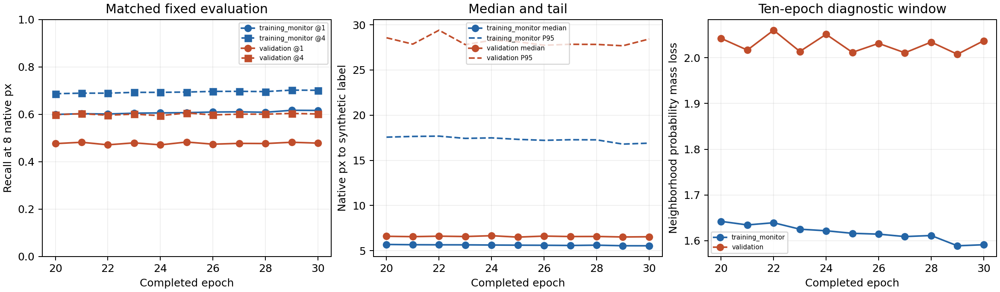
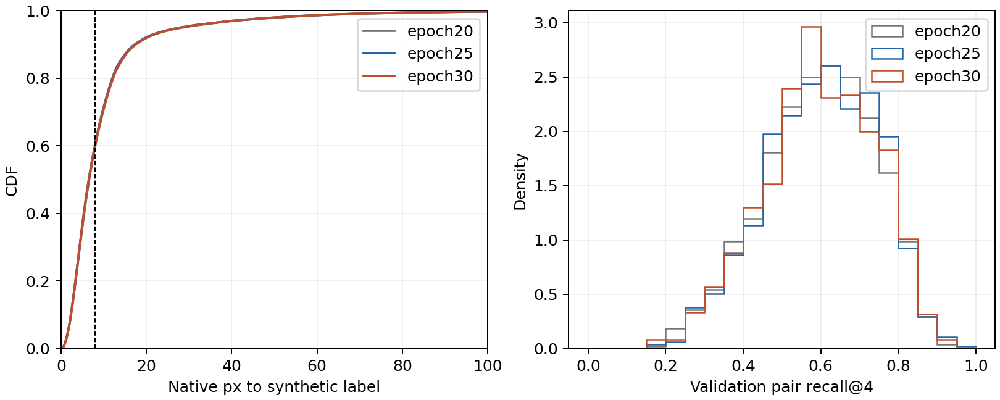
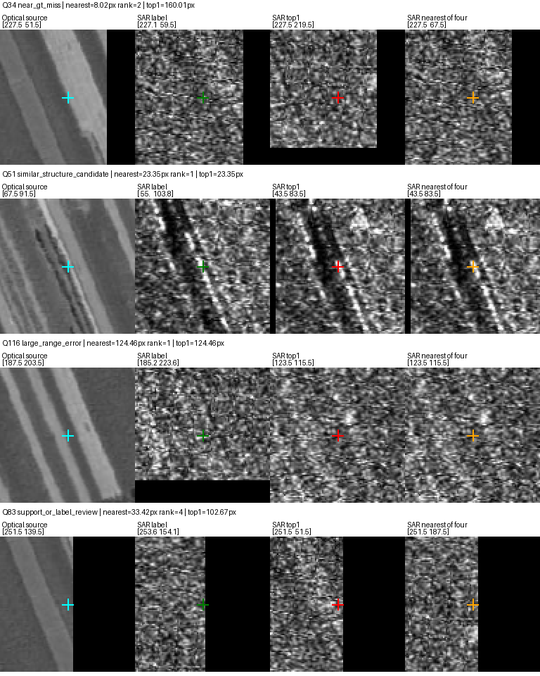
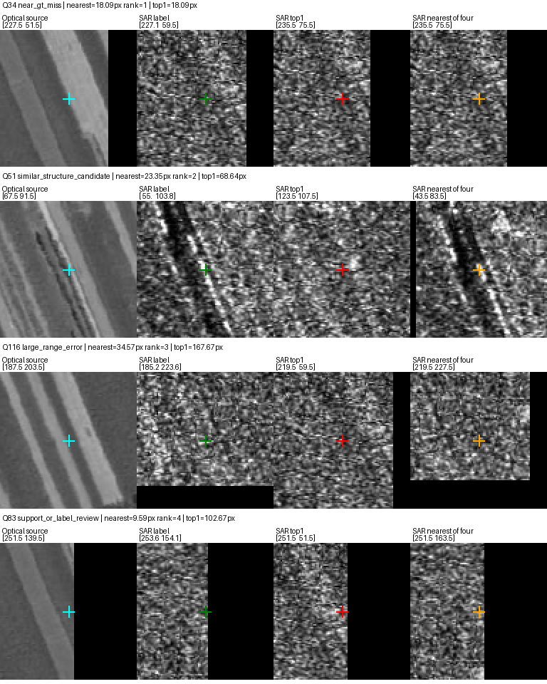

# 第20—30轮：统一诊断、优化器续接与固定失败分析

三项任务已完成。上一轮表中的训练召回来自**固定扰动训练视图、eval()模式**，并非在线随机增强；在线随机增强用于训练损失。本轮进一步冻结952对训练监测样本，与原952对验证使用完全相同的仿射矩阵集合，再从第20轮模型和AdamW状态续训10轮。

验证收益较小且有波动，不能宣称已收敛，也不预判错误都能由语义解决。全部距离相对于发布者对齐底图假设加合成仿射解释；来源组隔离不等于地理独立认证。OS最终测试、UBCv2均未运行模型。

**一、上一轮指标来源及本轮控制**

原`epoch20_training_metrics.json`来自7,912对训练影像的`fixed_view()`，调用`evaluate_family()`时先执行`model.eval()`。扰动来自固定evaluation_seed，不随epoch变化。在线训练损失则在`model.train()`和逐epoch重采样仿射下产生，是另一种口径。来源、文件摘要与代码入口见[old_metric_source_audit.json](old_metric_source_audit.json)。

原训练与验证采用相同扰动范围，但具体矩阵集合和样本数不同，不能将原差距全部因果解释为泛化差距。本轮采用更严格的控制：

| 控制项 | 固定训练监测 | 固定验证 |
| --- | --- | --- |
| 样本/family数 | 952/238，每组4对 | 952/238，每组4对 |
| 选择 | 固定seed从正式训练family抽取，不按模型分数筛选 | 保留原验证样本，不换样本 |
| 最初32对覆盖 | 只有5个样本ID来自该集合，其余947对不是该小样本集合 | 与训练family不交叉 |
| 扰动 | 第i对复用验证第i对的矩阵、参数和种子 | 原计划字节不变 |
| 模式、输入 | eval()；原生256单波段 | 相同 |
| 源点、候选 | 固定144源点、1024目标位置、NMS24 px、4候选 | 相同 |
| 监督和召回 | 正邻域8 px、召回门槛8原生px | 相同 |
| 有效性 | 原生范围与完整双线性支持；零值不自动无效 | 相同 |

selection_seed=2026112603。训练监测第i对与验证第i对的仿射完全相同，只匹配增强条件，不表示两张原始图像有对应关系。两侧每轮各有116,953个有效源点，20,135个GT图外源点被屏蔽，逐对有效源点数和屏蔽计数也完全相同。空正邻域、无效源及图内GT支持无效均为0。第20轮验证重评完整复现上一轮的损失、召回、距离及屏蔽计数。

文件：[monitor_samples.jsonl](monitor_samples.jsonl)、[monitor_transforms.jsonl.gz](monitor_transforms.jsonl.gz)、[validation_samples.jsonl](validation_samples.jsonl)、[validation_transforms.jsonl.gz](validation_transforms.jsonl.gz)、[monitor_freeze.json](monitor_freeze.json)。[matched_control_checks.json](verification/matched_control_checks.json)核验全部11轮控制条件。

新的监测子集和扰动不同于上一轮7,912对全训练固定视图，不能把新旧训练数值直接解释为学习进步。本轮只在同一监测计划的20/25/30轮之间比较。

**二、模型、优化器与学习率续接**

原第20轮`last.pt`的SHA-256为`83c31e333ccc5aa049e778c99753647604b5a6ca2c53cdf719899d2d1c89e476`。权重、AdamW一阶/二阶动量、步数、参数组全部加载，恢复前后优化器摘要完全相同，不是仅加载权重后重新初始化优化器。[resume_audit.json](resume_audit.json)保留摘要和设置。

原训练没有学习率调度器，checkpoint中也没有scheduler状态；第20轮实际学习率仍为3e-4。本轮保持该常数续接，没有近零学习率续训，也没有重启调度器。原7,912对训练样本、batch4、AdamW、weight_decay1e-4、梯度裁剪1.0、温度0.1、正邻域8 px、NMS24 px、4候选、损失、编码器和仿射范围全部不变。只追加第21—30轮，共19,780次更新，所有Adam步数从39,560变为59,340。

旧checkpoint没有保存DataLoader/global RNG状态。按原seed、batch及PyTorch DataLoader，在只有索引的数据上重放20个完整epoch，恢复采样器generator；单元测试核对了之后的采样顺序。网络无dropout，训练仿射由sample_id/epoch哈希确定，不依赖global RNG。旧global RNG的缺失已记录，不声称逐比特重建未保存的反事实轨迹。第25/30轮新checkpoint保存optimizer、loader、Torch、CUDA、NumPy、Python RNG状态。

[preregistered_diagnostic.json](preregistered_diagnostic.json)预先固定10轮预算。源码及原封存文件不变的证据见[unchanged_code_and_sealed_pools.json](verification/unchanged_code_and_sealed_pools.json)。

**三、统一口径下的20/25/30轮结果**

以下均在eval()下使用固定样本和固定扰动。每侧每轮为952对、238个family、116,953个有效源点。召回为查询点加权指标，距离为最近原生候选到合成标签的位置误差。

| epoch | 集合 | 召回@1 | 召回@4 | 中位距离 | P95距离 | 有效源点 |
| --- | --- | ---: | ---: | ---: | ---: | ---: |
| 20 | 训练监测 | 59.95% | 68.67% | 5.69 px | 17.57 px | 116,953 |
| 20 | 验证 | 47.63% | 59.83% | 6.59 px | 28.57 px | 116,953 |
| 25 | 训练监测 | 60.69% | 69.38% | 5.61 px | 17.32 px | 116,953 |
| 25 | 验证 | 48.30% | 60.56% | 6.50 px | 28.13 px | 116,953 |
| 30 | 训练监测 | 61.63% | 70.11% | 5.54 px | 16.90 px | 116,953 |
| 30 | 验证 | 47.83% | 60.13% | 6.54 px | 28.43 px | 116,953 |

20→30轮，监测recall@4增加约1.44个百分点，验证仅增加约0.30个百分点；验证25轮高于30轮，整个窗口约59.41%–60.56%，存在波动。监测—验证recall@4差从8.85扩大至9.99个百分点。验证P95仅从28.57变为28.43 px，改善有限。

这说明本诊断窗口没有出现与训练监测同步的稳定验证增长，不证明已经收敛，也不能由单条轨迹确定瓶颈必然是优化或语义。匹配仿射后，图像内容、来源和底图残余对应误差仍有差异，差值不等于已完成因果分解的“纯泛化差距”。没有按25轮或测试结果重新选择配置。

**逐对及family汇总**

[every_epoch_comparison.csv](every_epoch_comparison.csv)包含20至30每轮的召回@1/@4、中位数/P95/P99、有效源点数及逐对宏平均。[epoch20_25_30_comparison.csv](epoch20_25_30_comparison.csv)是指定三个epoch的对照；[family_epoch_comparison.csv](family_epoch_comparison.csv)包含family宏平均和尾部。

| epoch | 集合 | family等权平均@1 | family等权平均@4 | family @4的P5/P95 |
| --- | --- | ---: | ---: | ---: |
| 20 | 训练监测 | 59.83% | 68.57% | 46.95% / 83.74% |
| 20 | 验证 | 47.51% | 59.71% | 43.99% / 72.89% |
| 25 | 训练监测 | 60.58% | 69.28% | 48.38% / 83.50% |
| 25 | 验证 | 48.18% | 60.46% | 44.68% / 74.64% |
| 30 | 训练监测 | 61.52% | 70.01% | 50.24% / 83.24% |
| 30 | 验证 | 47.73% | 60.02% | 45.62% / 72.80% |

每轮保存`run/epochNN_{training_monitor,validation}_per_pair.csv`和`_per_family.csv`，含有效源点数、召回、距离中位数/P95等。family内先合并有效查询，再对family等权统计。示例：[30轮验证逐对](run/epoch30_validation_per_pair.csv)、[30轮验证逐family](run/epoch30_validation_per_family.csv)、[30轮监测逐对](run/epoch30_training_monitor_per_pair.csv)、[30轮监测逐family](run/epoch30_training_monitor_per_family.csv)。

同名`_distances.npz`保存sample_id、family_id、top1/最近候选距离及supervised布尔mask。无监督槽位填0，必须结合mask读取，不能混入距离分布。模型输出、实际监督距离和梯度均通过有限值检查。





**四、固定验证失败批次与判断依据**

沿用上一轮6个验证失败pair：81、796、206、927、557、634。pair集合在续训前冻结；第20轮重评时固定24个查询，第25/30轮只跟踪相同pair/query_id，不重新挑选最差样本。一个图像对可包含多类错误，因此分类单位是源查询，pair采用多标签。每类6例来自审查设计，不是全验证集的错误发生率。

分类依据仅来自第20轮几何和固定图像，后续变化单列。没有按表现差删除查询或图像对。

| 类别 | 第20轮依据 | 判读边界 |
| --- | --- | --- |
| 1. 接近GT但未命中 | 最近候选8.02–8.32 px，刚超过固定8 px | 相对于合成标签可确定；部分top1仍远达120–160 px，接近标签的是后排候选，不能都解释成仅差精定位 |
| 2. 相似结构或重复边界别处 | 最近误差23.35–34.02 px；可见重复田块、条带或弱纹理 | 外观歧义是与图像一致的假设，也可能沿同一边界滑动；散斑下不能独立确认同一物理结构 |
| 3. 大范围错误 | 4候选中最近仍65.71–134.54 px | 相对标签是明确大范围检索错误，不能只用小幅精定位解释；不据此确定成因 |
| 4. 有效区域或标签待核查 | 源点/标签靠边，距实际支持边界约1–2 px | 边界上下文不完整；当前未发现图外GT、无效源或图内GT支持错误。没有确认mask bug或标签错，原底图精度也未获认证 |

类别4保留“边界敏感/对应待审”的标记，不将“靠边且表现差”直接当成错标签。没有改成腐蚀掩码，也没有扩大8 px门槛。观察者为Codex同一观察者复核，不是独立人工控制点认证。

逐查询依据、坐标、距离、候选排序、置信状态见[fixed_failure_review.csv](fixed_failure_review.csv)和[fixed_failure_review.json](fixed_failure_review.json)。固定ID与筛查规则见[fixed_failure_queries.json](fixed_failure_queries.json)，终期核对摘要见[failure_query_freeze.json](failure_query_freeze.json)。

下图四列为光学源、SAR标签、SAR top1和4候选中最近者。围绕原生坐标取96像素窗口后作显示放大；越界补黑仅用于展示，不改变模型输入或有效性。



首行最近候选仅8.02 px，但top1为160.01 px，体现了近邻覆盖和排序两个层次，不能只给整对影像一个原因标签。

| 第20轮审查类型 | 案例数 | epoch20命中@4 | epoch25命中@4 | epoch30命中@4 |
| --- | ---: | ---: | ---: | ---: |
| 接近GT未命中 | 6 | 0 | 2 | 1 |
| 相似结构/边界别处 | 6 | 0 | 0 | 1 |
| 大范围错误 | 6 | 0 | 0 | 0 |
| 边界/标签待核查 | 6 | 0 | 2 | 3 |

一些案例变好，一些退化；六例大范围错误最近距离中位数从112.29降到88.96 px，仍全部未命中。边界审查中3例在未改掩码、标签或架构时命中，也不支持事先把它们认定为数据错误。本轮没有证明语义会解决这些问题，相似田块之间也未必能仅靠类别语义区分。

跨epoch完整记录：[fixed_failure_tracking.csv](fixed_failure_tracking.csv)、[fixed_failure_category_progress.csv](fixed_failure_category_progress.csv)。三轮相同案例图保留在`failure_review_cards/epoch{20,25,30}_*.png`。



**五、验证、封存与复现**

新增4项测试覆盖采样器20轮重放、优化器动量/步数摘要、跨family固定监测不随epoch变化、family汇总仅统计有效源点。全部54项测试通过，原网络和几何/掩码/候选代码哈希不变，Black与compileall通过。

终期重载30轮checkpoint，训练监测和验证的点级、逐对、family结果全部精确复现。原20轮checkpoint、来源组及验证计划未变，见[final_reload_verification.json](verification/final_reload_verification.json)。状态见[completion.json](run/completion.json)、[gradient_checks.json](run/gradient_checks.json)，环境与源码摘要见[implementation_environment.json](implementation_environment.json)。

本轮约609秒包含10轮训练及各轮固定诊断，不含开始前的数据加载；显存峰值约408.16 MiB。OS最终测试1,696对、UBCv2测试池1,625对均未模型评估；UBCv2原清单、政策、排除表、池和回执哈希均保持一致。WHU继续暂停重建。

25/30轮checkpoint及optimizer/RNG状态位于服务器`reports/os_continuation_diagnostic_20261126/run/epoch25.pt`、`epoch30.pt`，`last.pt`为30轮。Git归档代码、诊断记录、压缩清单、距离数组和预览，不上传权重及原始数据集。

```bash
cd /mnt/sda/zhushihao/Semantically-guided-disambiguation-matching
export PYTHONPATH=.
# 已存在输出会拒绝覆盖，新运行须更换output并固定计划。
.venv/bin/python scripts/continue_os_diagnostic.py --config configs/os_continuation_diagnostic.json
.venv/bin/python scripts/review_fixed_os_failures.py --config configs/os_continuation_diagnostic.json
.venv/bin/python scripts/summarize_os_continuation.py --config configs/os_continuation_diagnostic.json
.venv/bin/python scripts/verify_os_continuation.py --config configs/os_continuation_diagnostic.json
PYTEST_DISABLE_PLUGIN_AUTOLOAD=1 .venv/bin/python -m pytest -q
```
