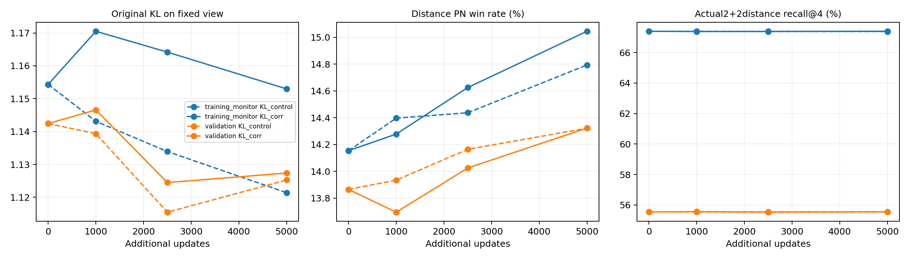
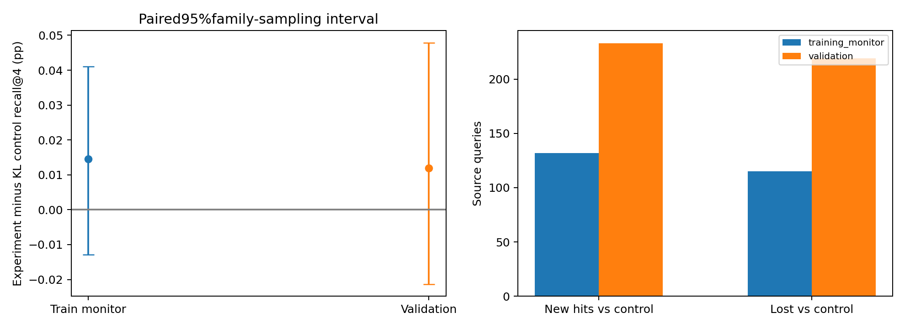
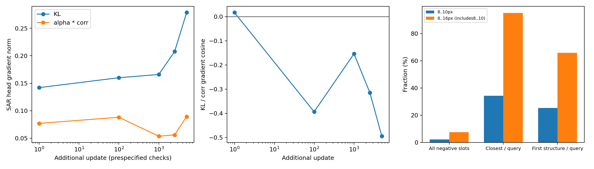

# 等预算两支续训：原KL与KL＋对应判别目标

本轮完整完成训练冒烟、锁定超参数、两支各追加5000步、固定检查点评估与最终权重重载核验。**新增目标有效降低了对应判别损失并改变了分数，但没有显示验证集最佳正胜最高难负的明确提升，也没有可靠的实际4候选净覆盖收益。**

最终验证KL对照/实验的正负胜率为14.3211%/14.3220%，实际@4为55.5462%/55.5582%。实验比对照新增233个命中、丢失219个，净多14个，即+0.01197个百分点；family配对95%区间为[−0.02133,+0.04788]个百分点，跨0。原4结构仍为60.1284%，实验相对它净少5,345个命中，不能宣布成功。

**唯一实验变量与完整恢复**

| 设置 | 对照支KL_control | 实验支KL_corr |
| --- | --- | --- |
| 起点 | 原5000步KL训练的SAR头 | 完全相同 |
| 优化器 | 原AdamW全部moments、步数、参数组恢复 | 完全相同，不重置 |
| 目标 | 原KL | 原KL＋alpha*corr |
| 追加更新 | 固定5000步 | 固定5000步 |
| 训练数据、顺序、增强、批量 | 同一个冻结批次计划 | 完全相同，共用本步输入及结构输出 |
| lr/scheduler | 原常数1e-3，无scheduler | 相同 |
| 可更新参数 | 20,640参数SAR头 | 同架构、同容量 |

起点checkpoint为服务器`reports/os_semantic_routing_20261126/training/semantic_head.pt`，SHA-256 `3f4c346c035eae7149c8f3a33fd43b1ab7420ae126e508b80df0819d0dbd2d4c`。两支初始权重和优化器内容摘要精确一致，见[branch_start_restore_audit.json](branch_start_restore_audit.json)。优化器起始步数5000，结束均为10000；没有仅加载权重后悄悄重置动量。

原checkpoint停在第11次数据遍历已消费50个batch处，每遍495批。利用原sampler_seed从索引数据重放5000步，采样器generator与checkpoint逐字节相同，再保留剩余部分遍历而非从头开启新遍历。后5000批的索引、sample_id、augmentation_epoch和每个样本transform_seed预先冻结在[shared_batch_schedule.jsonl.gz](shared_batch_schedule.jsonl.gz)，摘要及第21遍结束位置见[sampler_resume_audit.json](sampler_resume_audit.json)。两支在同一循环中共用该batch的图像、结构描述子、GT有效性和难负集合，从机制上避免数据顺序或增强差异。

输入仍为原生OS256单波段、原uint8/127.5−1归一化；训练全部7,912对，batch16（每遍尾批8对）、原±20°旋转、0.9–1.1尺度、±16 px平移、原sample/epoch随机算法均保持。AdamW weight_decay1e-4、梯度裁剪1.0不变。原第30轮结构前端和运行状态始终eval()/requires_grad=False，DINO、32个原型、T_sem=0.05和光学teacher缓存生成链冻结。结构模型没有running-stat更新；只有同一架构SAR头的参数和Adam状态变化。

**KL不变，新增项另行定义**

原`distillation_loss`函数未修改：同一144源点，以连续GT位置T(x)双线性采样SAR概率，采样后按原规则恢复通道和为1，与停止梯度的光学teacher q_o(x)计算KL，仅统计既有supervised有效查询。没有将KL替换成网格分类，或换一批KL源点。

新增corr使用同一训练查询上的P：GT位置8 px内的原有效目标网格；N：P外由冻结结构分数贪心提取至多16个24 px空间分离峰。语义头不参与负例选择，同一图像/仿射下N确定；跨epoch原有随机几何变化可改变图像及N，并不表示学生在线挖掘。两支每步得到同一个N，没有跨图负例。

```text
s(x,y) = −0.5*||q_o(x)−q_s(y)||²
corr(x) = logsumexp over(P unionN)[s/tau] − logsumexp overP[s/tau]
KL_control = KL
KL_corr    = KL + alpha*corr
```

采用稳定logsumexp。首先只选P非空、N非空且原supervised有效的行，再计算logsumexp，避免全mask行在autograd产生NaN；空P/N分别记录、跳过新增项，绝不补无效点。teacher、P/N位置和结构分数停止梯度，但P和N位置的SAR概率均通过距离分数获得梯度。全套测试直接检验两侧梯度及未被选位置的零梯度。

整个5000步共有9,827,980个有效训练查询出现次数，KL与corr一致；原始全部查询中P空1,297,161次、N空0、N不足16为0、原有效性排除1,680,500次。上述P空计数来自未应用原supervised前的全部源点，不是从有效KL查询中再删除的样本；其余未监督原因沿用原规则。计数逐步保存且两支相同，不把重复增强出现次数当独立影像数量。

候选评价也统一使用相同的负半平方距离，始终全1024目标网格、24 px NMS、固定前2结构峰再补2语义峰、4候选/8 px召回。没有将距离接入结构融合或调整lambda。独立语义4峰只作排序参照，不替代实际2+2指标。

**仅训练数据的校准、冒烟与锁定**

固定seed2026112703从32个不同训练family各抽1对，使用固定第11遍仿射，未加载验证样本做校准：

- tau由起点距离分数在每查询P∪N内的标准差中位数确定，限于[0.005,0.1]；结果为 **0.01988354**，没有触及界限。
- alpha由起点两个16对batch的SAR头梯度RMS范数确定，使加权corr梯度RMS为KL的50%，限于[0.001,10]；结果为 **0.34117967**，没有触及界限。
- KL梯度RMS=0.170330，corr梯度RMS=0.249620，初始加权比值=0.5。该规则事先固定，没有试多个超参数再按验证选择。

从原头及Adam状态做100步KL＋corr训练冒烟，固定32对上KL由1.0835降至0.9758，corr由1.9921降至1.7474，PN胜率由14.35%升至19.38%，Delta中位由-0.012246变为-0.009616。两项梯度均非零、有限且抵达头全部参数；两个校准批次的梯度余弦约−0.1416与+0.1284，已经出现局部冲突。

随后丢弃冒烟权重和动量，两支重新恢复同一正式5000步checkpoint。超参数、预算、评估时点与样本计划在任何正式验证结果前写入[locked_protocol.json](locked_protocol.json)，[train_only_calibration.json](train_only_calibration.json)与[smoke_response.json](smoke_response.json)记录实际选择依据及响应。冒烟不是第三条正式训练支，也没有用冒烟更新为实验额外预热。

**正式固定评估轨迹**

原952对训练监测和952对验证、各238个family及116,953个有效源查询保持不变；评估eval()/batch4，固定源点、扰动、掩码和种子。追加0/1000/2500/5000步都评估两支，不按验证选最优终点；本轮正式结论使用预定5000步结束状态。

| 追加步数 | 分支 | 验证KL | 验证corr | PN最佳正胜最高负 | 实际@4 |
| --- | --- | ---: | ---: | ---: | ---: |
| 0 | 原KL续训 | 1.1424 | 2.0449 | 13.8645% | 55.5480% |
| 0 | KL＋对应判别 | 1.1424 | 2.0449 | 13.8645% | 55.5480% |
| 1000 | 原KL续训 | 1.1394 | 2.0632 | 13.9338% | 55.5497% |
| 1000 | KL＋对应判别 | 1.1466 | 1.8876 | 13.6944% | 55.5633% |
| 2500 | 原KL续训 | 1.1155 | 2.0828 | 14.1638% | 55.5283% |
| 2500 | KL＋对应判别 | 1.1245 | 1.8821 | 14.0244% | 55.5505% |
| 5000 | 原KL续训 | 1.1253 | 2.0728 | 14.3211% | 55.5462% |
| 5000 | KL＋对应判别 | 1.1274 | 1.8791 | 14.3220% | 55.5582% |

起点两支逐查询一致，并精确复现上一轮距离评分的PN分差及实际候选，避免把接入代码变化当成学习效果。原KL值在本轮统一batch4下产生，和此前batch16 KL小数差异不解释为训练进步；同一轮两支口径一致。



**结束状态：排序与损失**

| 集合 | 分支 | KL | corr | PN胜率 | C全网格正名次中位/P95 | 独立语义NMS4覆盖 |
| --- | --- | ---: | ---: | ---: | --- | ---: |
| 训练监测 | 原KL续训 | 1.1214 | 2.1900 | 14.7931% | 116 / 654 | 5.8083% |
| 训练监测 | KL＋对应判别 | 1.1530 | 1.8462 | 15.0445% | 111 / 633 | 6.0922% |
| 验证 | 原KL续训 | 1.1253 | 2.0728 | 14.3211% | 125 / 668 | 5.3945% |
| 验证 | KL＋对应判别 | 1.1274 | 1.8791 | 14.3220% | 119 / 654 | 5.7134% |

实验降低了corr，并使验证Delta中位由对照−0.014349变为−0.010398，全网格正名次中位125→119/P95 668→654；独立语义NMS4覆盖5.3945%→5.7134%。但PN胜率只相差1个有效查询，即+0.000855个百分点，配对95%区间[−0.17717,+0.17233]个百分点跨0，未显示正邻域胜过最高结构难负的明确改善。

corr目标聚合全部P概率质量，不等于最大正分数胜过最大负分数；本轮出现loss下降而PN胜率近似不变，是不同统计对象的实际差异，不能只看训练loss判断有效。

作为未训练的解析参照，若每个查询中所有P/N分数相同，corr为log((|P|+|N|)/|P|)，当前固定验证均值1.89792。实验最终1.87910接近该值而原起点为2.04494；这提醒损失可通过缩小分数差获得相当改善，不自动等于有用排序。此参照没有训练第三模型，也不是选择阈值，见[constant_score_reference.json](constant_score_reference.json)。

**固定候选预算的实际价值**

原4结构验证@4=60.1284%，训练监测=70.1145%，两支都保留相同前2结构峰。下表新增/丢失均相对原4结构；补救率分母固定为原结构漏检数：训练34,952、验证46,631。@1按设计保留结构top1，因此两支验证均47.8337%，训练均61.6282%。

| 集合 | 分支 | @4 | 新增命中vs结构 | 丢失vs结构 | 净变化vs结构 | 结构漏检补救率 | 最近距离中位/P95(px) |
| --- | --- | ---: | ---: | ---: | ---: | ---: | --- |
| 训练监测 | 原KL续训 | 67.3818% | 137 | 3,333 | -3,196 | 0.3920% | 5.7087 / 30.0134 |
| 训练监测 | KL＋对应判别 | 67.3963% | 148 | 3,327 | -3,179 | 0.4234% | 5.7084 / 30.0933 |
| 验证 | 原KL续训 | 55.5462% | 270 | 5,629 | -5,359 | 0.5790% | 7.0526 / 46.9467 |
| 验证 | KL＋对应判别 | 55.5582% | 252 | 5,597 | -5,345 | 0.5404% | 7.0510 / 47.3819 |

实验验证相对对照新增233、丢失219、净多14，@4增加0.01197个百分点。相对原4结构，实验仍丢5,597、只新增252，净少5,345。仅以原5000步模型对比实验会把额外更新的影响混入，本轮以等预算KL续训作为主要对照。

**按同源组配对变化与区间**

每次对整个family有放回抽样，重复2,000次、seed2026112704；两支使用同一组被抽中的family，合并有效源查询计数后再计算召回与差值，避免把查询当独立场景。

| 集合 | 实验新增vs对照 | 实验丢失vs对照 | 净变化 | 实验−对照@4的95%区间（百分点） | family改善/退化/不变 |
| --- | ---: | ---: | ---: | --- | --- |
| 训练监测 | 132 | 115 | +17 | [-0.01289, 0.04103] | 55 / 47 / 136 |
| 验证 | 233 | 219 | +14 | [-0.02133, 0.04788] | 71 / 72 / 95 |

验证family为71组改善、72组退化、95组不变，区间跨0；训练监测也跨0。因此本轮没有获得可靠的实际覆盖改善。独立语义NMS4的验证实验−对照增加0.31893个百分点，family区间[0.19917,0.43711]个百分点；这仍是中间参照，不能替代实际2+2覆盖。

分组与family记录仍保留原起点定义的结构漏检、旧点积新增、旧点积丢失等查询，见两套`*_fixed_groups.json`，没有因表现差删除图像或改组。所有区间条件于当前一个训练种子与来源组划分，不包含训练种子变化或未知地理相关性，也不声称地理独立泛化。



**梯度冲突、分布变化与边界负例**

预定更新1/100/1000/2500/5000步分别检查两项对整个SAR头的梯度。实验支加权corr/KL范数比约0.542、0.551、0.323、0.270、0.321，均非零，未在这些检查点完全压倒KL。对应梯度余弦为+0.0171、−0.3935、−0.1536、−0.3143、−0.4948；后4个检查批次出现方向冲突。**这是5次稀疏批次诊断，不是全训练过程80%冲突的估计。**

最终实验SAR预测更软：验证平均熵3.0764 nats，对照2.9958；图内空间概率RMS中位0.02252，对照0.02769。与corr接近等分数参照、间隔缩小一起看，结果与较平滑输出带来loss下降的可能性一致，但不足以把成因认证为全图塌缩。头仍有空间变化，完整软/硬占用及熵按检查点保存。

负例边界必须区分两个分母。正式训练共157,247,680个有效负例槽位，仅7.5984%处于(8,16] px，其中(8,10]约2.14%。但完整重放5000个结构批次后发现：

| 统计对象 | 位于(8,10]的比例 | 位于(8,16]的比例 | 距离中位/P95(px) |
| --- | ---: | ---: | --- |
| 全部负例槽位 | 2.1415% | 7.5984% | 详见槽位直方图 |
| 每查询最近的结构难负 | 34.2634% | **95.1664%** | 10.9344 / 15.9077 |
| 每查询结构最高分的首个难负 | 25.2801% | **65.8286%** | 12.6217 / 114.3632 |

所以不能用7.60%的槽位占比断言边界负例不重要：绝大多数训练查询确实有一个靠近8 px邻域的负位置。这里是9,827,980次有效查询出现，不是独立样本；多次增强重复计数。完整重放的负例索引摘要与正式训练逐字节一致，证明观察的是实际共享的N，而非另一批审计负例。

这些负例按定义是P外位置错误，未必是语义类别错误；局部邻近位置或相似区域可能被光学教师要求相近分布，而corr要求它们分开。当前边界分布与梯度负余弦表明这种张力需要关注，但不证明负例标注错误，也不将全部效果归于冲突。本轮严格保持P/N和8 px规则，**没有扩大半径、移除近负例或改权重重跑**。



**对本轮问题的判断**

新增对应约束可训练、两侧SAR输出获得有效梯度，并显著降低自身目标；但在当前表示、头容量、固定τ/α和5000步预算下，没有显示未见family上的PN胜率或实际4候选覆盖的可靠收益。它改善了部分平均间隔、全网格排名和独立语义候选覆盖，但主验收量并未同步改善。不能只因loss下降认定目标有效，也不能由单种权重/单种子负结果否定所有对应判别目标。

本轮没有再改原型、温度、相似度、头容量、冻结范围、lambda、掩码或候选规则；未以验证收益反复调权。用户提及的DINO-Tracker仅可作为目标设计参照，本次实现和结论不依赖其视频跟踪结果证明光学–SAR任务有效。

**核验、交付与复现**

全套**79项测试通过**，新增6项测试覆盖稳定logsumexp概率质量、P/N两侧梯度方向、teacher停止梯度、空集合零梯度/无NaN、冻结结构负例选择、部分epoch采样器顺序恢复、两支独立恢复AdamW状态且更新互不污染。旧KL、模型/几何与数据代码未修改，compileall通过。

终期重新加载两支权重及原冻结结构，在两套固定集合的点级、逐对、family汇总与原生候选数组均精确复现。独立重放5000批索引及全部增强种子、核对优化器总步数、初始模型/动量一致、旧P/N在所有评估检查点不变。完整凭证见[verification_summary.json](verification/verification_summary.json)、[测试日志](tests/pytest.log)。

原checkpoint、结构、DINO/原型/缓存、旧源码、固定监测与验证计划及封存测试池文件前后哈希一致，见[frozen_provenance_before.json](frozen_provenance_before.json)、[frozen_provenance_after.json](frozen_provenance_after.json)。OS最终测试1,696对和UBCv2测试池1,625对均未运行模型。数据与标签仍仅支持相对于名义底图对应加合成扰动的解释，不认证现实可见性、原生精配准精度或地理独立性。

- [锁定协议](locked_protocol.json)、[训练集校准](train_only_calibration.json)、[冒烟响应](smoke_response.json)
- [初始模型/优化器恢复凭证](branch_start_restore_audit.json)、[采样器续接凭证](sampler_resume_audit.json)、[共享批次计划压缩清单](shared_batch_schedule.jsonl.gz)
- [固定检查点历史表](objective_continuation_history.csv)
- [验证最终配对比较及区间](validation_final_comparison.json)、[训练监测最终比较](training_monitor_final_comparison.json)
- [最终逐family配对表](paired_family_final.csv)、[验证旧固定查询组](validation_fixed_groups.json)
- [梯度范数与冲突](component_gradient_diagnostics.csv)、[负例槽位距离](negative_distance_training.json)、[逐查询边界审计](negative_boundary_query_audit.json)
- [验证最终逐查询](evaluation/step05000_validation_queries.npz)、[验证最终逐图像对](evaluation/step05000_validation_per_pair.csv)、[验证最终逐family](evaluation/step05000_validation_per_family.csv)
- [训练日志压缩文件](training/training.jsonl.gz)、[环境与源码哈希](implementation_environment.json)、[完成回执](completion.json)

所有0/1000/2500/5000步、训练监测/验证的逐查询、逐对、family文件均在`evaluation/`，读取必须应用supervised和corr_eligible mask。原始权重、优化器/RNG及采样器状态留在服务器，不上传原数据。最终两支checkpoint为`reports/os_correspondence_objective_20261127/training/KL_control_last.pt`和`KL_corr_last.pt`，SHA-256分别为`ccaa7a081c9b22a66a816eab6256e630645962b42e7ef86a6d1c65dae306256f`和`c32cf77aa533e4e8007d253ffff5ac71a5a52ae612d91b394b82ea46d823739f`。

本轮两支训练及固定检查点评估合计约329.54秒、显存峰值309.92 MiB，不含准备/冒烟、读取哈希、完整负例重放、终期核验及报告。均为单机现有zzvr环境，未新增依赖。

```bash
cd /mnt/sda/zhushihao/Semantically-guided-disambiguation-matching
export PYTHONPATH=.
# 准备只用训练数据校准/冒烟，锁定后正式两支重新恢复原checkpoint。
# 新实验必须使用新output；已有准备/正式训练目录拒绝覆盖。
.venv/bin/python scripts/train_os_correspondence_objective.py --phase prepare --config configs/os_correspondence_objective.json
.venv/bin/python scripts/train_os_correspondence_objective.py --phase train --config configs/os_correspondence_objective.json
.venv/bin/python scripts/audit_os_correspondence_negatives.py --config configs/os_correspondence_objective.json
.venv/bin/python scripts/summarize_os_correspondence_objective.py --config configs/os_correspondence_objective.json
.venv/bin/python scripts/verify_os_correspondence_objective.py --config configs/os_correspondence_objective.json
PYTEST_DISABLE_PLUGIN_AUTOLOAD=1 .venv/bin/python -m pytest -q
```
