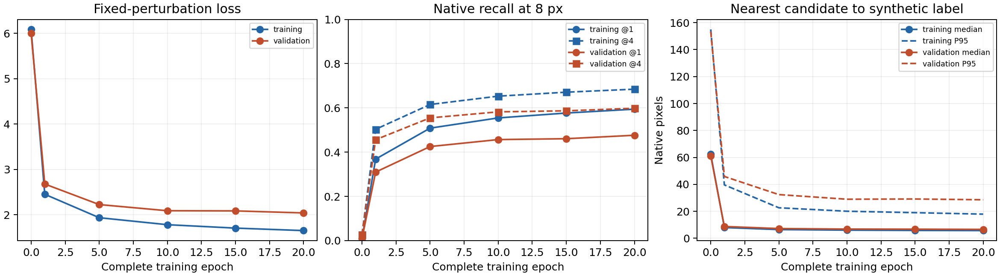
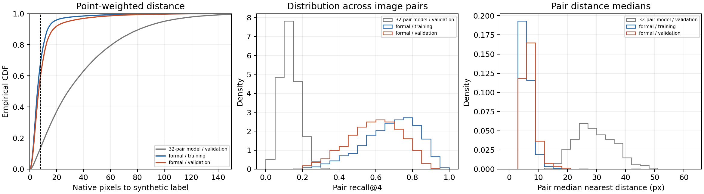
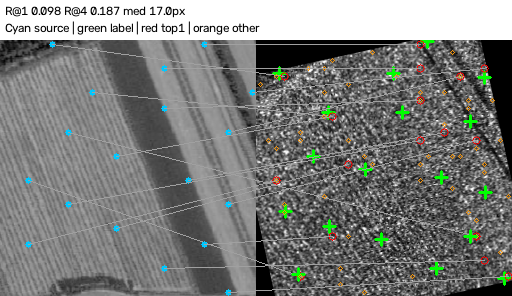
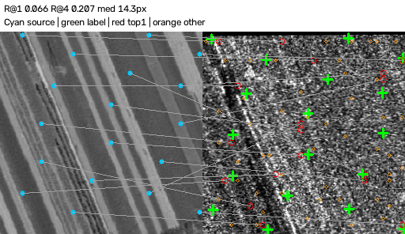
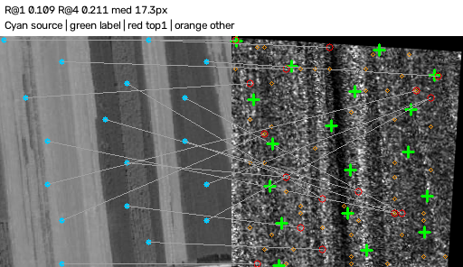

# OS来源组冻结与无语义基线

本轮按“同源关系合并 → 来源组冻结 → 原生256基线训练与验证”执行。没有加入DINO、关系图或精定位；最终测试封存，UBCv2不运行新模型。后续所有指标相对于发布者对齐底图假设加合成仿射解释。

已完成预先登记的20个完整epoch、39,560次更新；主报告为第20epoch的last.pt。完整重载验证通过，50项测试通过。验证属于**已恢复来源组隔离验证**，剩余空间关系未知，不称地理独立验证。

**来源组成与分组规则**

17,168对由旧OS原生256的10,692对、旧OS原生512的2,673对及OSDataset2.0新增13地区RGB512的3,803对构成。256和512不能相加为独立原始场景，也没有为匹配论文计数删除样本。全部原发布样本保留在来源清单中。

同一512母块、其256子块及精确重复副本按连通分量合并；同时使用非恒定单模态精确像素一致关系做保守合并，防止仅一侧重复被拆开。264个子块的多个完全一致母块候选全部归入同一个family，不凭编号选择唯一物理来源。如果恢复到有证据支持的更大场景或空间交叠关联，则通过同一合并接口继续合组；当前没有恢复这种额外关联，不宣称地理独立。

| 划分 | 来源组数 | 原发布样本记录 | 本轮原生256去重样本 |
| --- | ---: | ---: | ---: |
| train | 1,976 | 10,055 | 7,912 |
| val | 238 | 1,190 | 952 |
| sealed test | 424 | 2,120 | 1,696 |
| quarantine | 3,803 | 3,803 | 0 |

35个组各有10条记录，2,603个组各有5条记录，3,803个新增地区组各有1条记录，共6,441组。一个普通来源组含1个512母块和4个256子块；重复或单侧等值关系会把多个母块及子块并入同组。训练代表按联合像素内容去重，不删除来源清单里的重复记录。

本轮保留原有官方样本fold作为单组归属依据，而非对全部样本随机拆分。已拟合32对所在31组全部强制归train。若一个未暴露组跨官方fold、缺少父图关联或输入不完整，则隔离；本次旧OS范围没有产生跨fold冲突。新增RGB512没有官方fold，且不属于固定原生256协议，全部隔离，不临时裁成256或转成灰度混入。单组只能属于一个划分。264处多母块候选均已进入同一个合并来源组及同一fold，因此保留并显式记录文件级歧义；若候选导致fold冲突且无已暴露锚点，则隔离。

**固定实验协议**

原生256单波段光学/SAR；保持当前128维共享结构编码器、144源查询×1024目标位置；每点4候选，8原生像素召回门槛，正邻域8像素，NMS24像素。没有插值放大输入。

正式基线从头训练，原学习率3e-4、AdamW、weight_decay1e-4、batch4，预先固定20个完整epoch。恢复训练阶段每epoch重新采样合成扰动，范围沿用上一轮旋转±20°、尺度0.9–1.1、x/y平移±16像素；源光学不变、SAR施加仿射，使用已有坐标更新函数。种子由master/sample/epoch确定，所有增强继承原family和split。双线性插值、常数0填充、全插值支持掩码，零灰度本身仍有效。

验证952对和全训练集诊断视图都采用独立固定evaluation_seed、逐样本固定参数和矩阵，不随epoch变化。训练、验证来源组不交叉；未读取封存测试图像进入模型。主报告使用预定第20epoch的last.pt；验证最优只作为次要检查点保留，不触及最终测试。

小样本checkpoint会先做同一952对隔离验证，用于检查训练—验证差距；正式基线不从它继续训练。失败图只用于描述，不用于删样本或更改配置。

**UBCv2相交风险**

此前88条记录是88对不同split影像足迹的正面积交集，不是88个独立城市或连通地理组。训练–验证26条、训练–测试26条、验证–测试36条；62条触及测试split，涉及冻结1,625对测试池中的16对样本，均在Jacksonville。相交区域按原生光学GeoTIFF相同UTM坐标系计算，边界相触不计；不代表它们一定来自同次采集或具有相同影像内容。

相交面积约467.24–30,687.69平方米，中位9,833.47平方米；占较小足迹的比例0.71%–46.83%，中位15.00%，P95为44.68%。25条不足10%，63条在10%–50%，没有达到50%的记录。IoU中位8.11%，最大30.57%。完整88条的两侧ID、split、城市、面积、两侧覆盖比例和IoU单独保存。

冻结测试池、排除表、政策、原始清单及冻结回执的前后SHA-256逐一一致。没有按这88条风险删除16对测试样本，也没有开展UBCv2模型推理；继续声明“前期已接触的跨域基准”，不称地理独立盲测。


**来源文件与冻结证据**

- [sample_manifest.jsonl.gz](sample_manifest.jsonl.gz)：17,168条，包含`sample_id/native_size/release_subset/parent_512_id/family_id/split/grouping_evidence`等字段；同时保留所有母块候选，无法唯一确定时`parent_512_id=null`，不虚构唯一来源。
- [sample_assignments.csv](sample_assignments.csv)：可直接筛选和检查的逐样本分组表。
- [families.jsonl.gz](families.jsonl.gz)、[family_splits.csv](family_splits.csv)：逐组成员、母块别名、已暴露32对锚点、原官方fold、最终归属及理由。
- [grouping_edges.jsonl.gz](grouping_edges.jsonl.gz)：逐条合并证据；[grouping_summary.json](grouping_summary.json)保留全部尺寸、目录及地区计数。
- [exposed32_augmentation_lineage.jsonl](exposed32_augmentation_lineage.jsonl)：此前32对合成版本与原始family的继承关系。
- [freeze_receipt.json](freeze_receipt.json)：来源清单、已拟合样本记录、已知交叠证据配置以及冻结划分的哈希；[独立检查记录](verification/family_freeze_checks.json)和[来源输入哈希核对](verification/source_input_hashes_verified.json)均通过。
- [native256_train.jsonl](native256_train.jsonl)、[native256_val.jsonl](native256_val.jsonl)、[native256_test.jsonl](native256_test.jsonl)：各fold的去重代表；test仅保存封存清单。

原始发布目录及尺寸组成与上一轮相同：`OSDataset2.0/Patch-level Subset/OSdataset/256/{train,val,test}`为8,044/952/1,696条；`.../512/{train,val,test}`为2,011/238/424条；新增13地区为American297、Argentina436、Australian341、Germany409、Japan313、Katar399、Malaysia263、Poland337、Russia257、Russia2 139、Russia3 96、Singapore183、Turkey333条。17,168是版本、尺度与目录混合的文件对总数，不是独立场景数。

**固定验证与训练增强的复现记录**

[preregistered_protocol.json](preregistered_protocol.json)在查看新验证结果前已冻结。没有依据小样本隔离验证的结果调整训练范围、学习率、网络、候选数或训练预算。

[frozen_validation.jsonl.gz](frozen_validation.jsonl.gz)保存952对的种子、仿射参数、矩阵及family；[frozen_train_evaluation.jsonl.gz](frozen_train_evaluation.jsonl.gz)保存7,912对训练域诊断视图的同类记录。训练召回并非最后一批随机增强的瞬时召回，而是在**原训练影像上的另一套固定扰动**评估；验证使用相同范围的固定扰动，图像来源组不同。

[augmentation_contract.json](augmentation_contract.json)明确master seed、样本ID、epoch和角色字符串的SHA256种子算法，记录`H=A_s @ B_nominal @ inverse(A_o)`、像素中心方向、插值、填充与有效支持。`B_nominal=I`是已配准底图假设，`A_o=I`，SAR侧每epoch使用不同`A_s`；无额外裁剪、缩放或翻转。每个增强保留来源family，不因随机变换生成新的划分身份。实现与依赖版本见[implementation_environment.json](run/implementation_environment.json)。

**小样本checkpoint的隔离诊断**

| 指标 | 原先32对训练视图 | 同源组隔离的952对验证 |
| --- | ---: | ---: |
| 原生召回@1 | 98.80% | 5.72% |
| 原生召回@4 | 99.19% | 13.62% |
| 最近候选距离中位数 | 4.68 px | 28.54 px |
| 最近候选距离P95 | 7.72 px | 99.77 px |

左栏沿用上一轮32对checkpoint及其原固定训练扰动记录；右栏使用本轮冻结验证扰动。这个落差表明原小样本高召回主要是拟合诊断，不能代表架构最终泛化水平。右栏逐对分布、距离数组和失败图保存在[small32_diagnostic](small32_diagnostic/small32_validation_metrics.json)。正式基线从随机初始化重新训练，未继承该checkpoint参数。

**正式训练划分基线：第20epoch**

| 指标 | 训练固定诊断视图（7,912对） | 来源组隔离验证（952对） |
| --- | ---: | ---: |
| 邻域概率质量损失 | 1.6536 | 2.0426 |
| 点加权原生召回@1 | 59.42% | 47.63% |
| 点加权原生召回@4 | 68.46% | 59.83% |
| 最近候选距离中位数 | 5.70 px | 6.59 px |
| 最近候选距离P90 | 13.36 px | 17.57 px |
| 最近候选距离P95 | 17.91 px | 28.57 px |
| 最近候选距离P99 | 50.56 px | 68.38 px |
| 最近候选距离最大值 | 199.48 px | 193.83 px |
| 有效监督源点 | 972,272 | 116,953 |
| GT图外源点 | 167,056 | 20,135 |

训练、验证都使用144个固定源位置/图像对，候选为4个，正确门槛8个原生像素；图外GT按既有定义屏蔽。空正邻域、无效源点、图内GT支持无效均为0，所有实际报告距离有限。候选仅来自稠密分数和物理支持，GT不注入候选，未按预测置信度筛选查询或删除图像对。

**按图像对汇总**时，先在每对的有效查询上计算recall，再对图像对等权统计；点加权指标则合并所有有效查询。两种口径均保存，避免有效源点数不一样时混淆。

| 逐图像对统计 | 训练 | 验证 |
| --- | ---: | ---: |
| 图像对等权平均recall@1 | 58.96% | 47.18% |
| 图像对等权平均recall@4 | 68.02% | 59.36% |
| 每对recall@4的P5 | 40.00% | 33.63% |
| 每对recall@4的P25 / 中位数 / P75 | 58.59% / 70.00% / 79.23% | 49.59% / 60.33% / 70.22% |
| 每对recall@4的P95 | 88.97% | 80.97% |
| recall@4低于50%的图像对 | 995 / 7,912（12.58%） | 243 / 952（25.53%） |
| 每对最近距离中位数的P95 | 9.58 px | 11.37 px |

训练—验证recall@4差约8.63个百分点；验证有明确长尾，不能只用中位数概括。正式基线在固定952对上的recall@4由小样本模型13.62%提高至59.83%，这个比较用于说明充分训练的重要性，不能与此前512实验直接归因为方法进步。第20epoch验证最优恰好也在本次固定检查点中最高，但主报告仍按预先登记的最后epoch，不依赖测试结果选择。

完整逐对记录：[训练CSV](run/epoch20_training_per_pair.csv)、[验证CSV](run/epoch20_validation_per_pair.csv)。原生距离与有效查询mask：[训练NPZ](run/epoch20_training_distances.npz)、[验证NPZ](run/epoch20_validation_distances.npz)，字段为`sample_id/family_id/first_distance_px/nearest_distance_px/supervised`；无监督槽位填0，必须结合`supervised`读取，不计入分布。模型输出、实际监督距离和梯度均完成有限值检查。





**典型失败图**

按验证recall@4最低、再按距离中位数最高排序，每个family最多取一对，固定选6对；仅用于事后描述，不用于删样本或更改配置。完整选择记录见[epoch20_validation_failures.json](run/epoch20_validation_failures.json)。

6例均可见重复农田条带、弱局部差异以及SAR散斑/响应与光学纹理的不同。若干top1落在相似田块或条带附近，增加到4候选仍未覆盖足够多标签邻域。这些是图像及预测的可见现象；没有独立点位审计，不能据此把误差全部归因于网络，也不能排除原底图残差贡献。

| 验证样本ID（256/val） | recall@1 / @4 | 最近距离中位数 | 最近距离P95 |
| --- | --- | ---: | ---: |
| 81 | 9.76% / 18.70% | 17.00 px | 113.56 px |
| 796 | 6.61% / 20.66% | 14.32 px | 44.82 px |
| 206 | 10.94% / 21.09% | 17.31 px | 69.01 px |
| 927 | 10.09% / 22.02% | 17.76 px | 74.26 px |
| 557 | 16.67% / 23.68% | 12.62 px | 38.11 px |
| 634 | 11.86% / 23.73% | 19.48 px | 67.42 px |

青色为光学源点，绿色为合成标签，红色为top1，橙色为其他候选。







剩余3例及训练失败图同样保留在`run/failures/`。

**UBCv2风险文件与冻结保持**

[all_88_overlap_edges.csv](ubcv2_risk/all_88_overlap_edges.csv)为完整88条记录，[risk_summary.json](ubcv2_risk/risk_summary.json)汇总split及程度，[unchanged_pool_verification.json](ubcv2_risk/unchanged_pool_verification.json)核对原5份文件前后完全相同。16个受交叠影响测试样本的完整ID已在风险摘要中列出，仍全部保留冻结池。

**运行、检查点和复现**

本次正式训练加定期评估约1,140.87秒，CUDA6/RTX5090，峰值分配显存约407.78 MiB；不含开始前数据加载和小样本诊断。所有相关模块取得有效梯度，未出现非有限前后向。[completion.json](run/completion.json)、[gradient_checks.json](run/gradient_checks.json)、[performance.json](run/performance.json)保存完整状态。

50项测试通过，覆盖同源关系传递合并、重复别名、多母块歧义、跨官方fold隔离、已暴露样本强制train、验证不可变、逐epoch确定性增强、原生掩码、测试封存读取保护、冻结文件篡改拒绝，以及逐对汇总保留无有效监督图像的行为。模型和已验证几何代码没有修改。最终checkpoint重载后验证损失、召回、距离尾部和逐对分布全部精确复现；验证扰动计划哈希与来源组冻结哈希保持不变，见[reload_verification.json](verification/reload_verification.json)。

主checkpoint保留在服务器`reports/os_family_baseline_20261126/run/last.pt`；次要验证最优为`best_validation.pt`，本轮同为epoch20。它们未上传Git。所有结果均相对于合成标签，不是实际精配准误差或1–2 px精度认证。OS最终测试1,696对未模型评估；UBCv2原测试池1,625对未模型评估、未改动。WHU继续暂停重建。

```bash
cd /mnt/sda/zhushihao/Semantically-guided-disambiguation-matching
export PYTHONPATH=.
# 冻结目录已存在时拒绝覆盖；新实验须更换config.output并重新登记。
.venv/bin/python scripts/freeze_os_families.py --config configs/os_family_baseline.json
.venv/bin/python scripts/verify_os_family_freeze.py
.venv/bin/python scripts/train_os_family_baseline.py --config configs/os_family_baseline.json
.venv/bin/python scripts/verify_os_family_baseline.py --config configs/os_family_baseline.json
.venv/bin/python scripts/summarize_os_family_baseline.py
# 风险记录只读原始UBC冻结材料，原池哈希必须保持一致。
.venv/bin/python scripts/record_ubc_overlap_risk.py
PYTEST_DISABLE_PLUGIN_AUTOLOAD=1 .venv/bin/python -m pytest -q
```

未压缩的来源清单、冻结变换计划和逐步日志保留在本地outputs及服务器reports；Git归档提供同内容的压缩版本、完整分组CSV、主要逐对指标、原生距离数组、失败图和验证证据。`sample_manifest.jsonl.gz`等可用`gzip -dk`恢复原文件。
