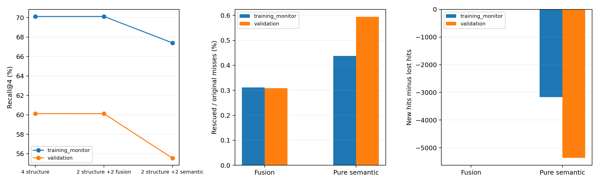
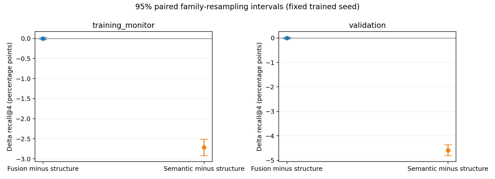

# 固定结构与语义头：纯语义补充的最小对照

已完成本轮三种固定模型推理对照，没有任何训练或参数搜索。**纯语义补充未提高覆盖，并在当前验证集上明显降低召回。** 验证@4从原结构60.1284%降至55.5385%；补救277个原未命中查询，丢失5,645个原命中查询，净少5,368个。

**固定模型与选峰规则**

沿用第30轮结构checkpoint及上一轮5000步SAR语义头，两个模型全参数冻结、eval()推理。源点、原生OS256、family划分、两个952对固定评估集合、原有扰动与有效性均未变化。推理batch4与原基线一致，每侧238个family、116,953个有效源查询；每侧20,135个GT图外查询按旧规则屏蔽，空正邻域、无效源点和图内GT支持无效均为0。

| 设置 | 保留部分 | 另外2个候选的排序分数 |
| --- | --- | --- |
| 原结构 | 原结构NMS前4峰 | 不额外替换 |
| 当前融合 | 原结构NMS前2峰 | S_str + lambda*(2*q_o^T*q_s−1)，沿用lambda=1 |
| 纯语义补充 | 相同原结构NMS前2峰 | **q_o(x_i)^T*q_s(y_j)**，不混入结构分数 |

纯语义分数一次计算为[B,144,1024]，每个源点覆盖全部1024个目标网格，使用与旧路径相同的target_valid屏蔽。先依序抑制前2个结构峰各24 px范围，再取语义全局最大值、抑制其24 px范围、取下一峰；没有结构top-k候选池、结构阈值或结构预筛。目标只有在原target_valid、前缀抑制或已选语义峰抑制下被排除。候选不足记−1/invalid，不用无效点补齐；本次实际未出现不足。候选总数固定4、召回门槛固定8原生像素，GT不进入候选接口。

本轮配置在推理前保存于[preregistered_protocol.json](preregistered_protocol.json)。原结构与当前融合的候选索引、有效性和逐查询距离均精确复现上一轮最终batch4输出；因此没有将模型或数值批量差异混入纯语义对照。

**召回、补救与丢失**

补救率的分母固定为**原结构@4未命中的有效查询数**：训练监测34,952个、验证46,631个。新增命中=原结构未命中且当前设置命中；丢失=原结构命中且当前设置未命中；净变化=新增−丢失。原结构行新增/丢失均为0仅表示相对自身的变化。

| 集合 | 设置 | 召回@4 | 新增命中 | 丢失命中 | 净变化 | 原结构未命中的补救率 |
| --- | --- | ---: | ---: | ---: | ---: | ---: |
| 训练监测 | 原结构4峰 | 70.1145% | 0 | 0 | +0 | 0.0000% |
| 训练监测 | 2结构＋2融合 | 70.1136% | 109 | 110 | -1 | 0.3119% |
| 训练监测 | 2结构＋2纯语义 | 67.4006% | 153 | 3,327 | -3,174 | 0.4377% |
| 验证 | 原结构4峰 | 60.1284% | 0 | 0 | +0 | 0.0000% |
| 验证 | 2结构＋2融合 | 60.1216% | 144 | 152 | -8 | 0.3088% |
| 验证 | 2结构＋2纯语义 | 55.5385% | 277 | 5,645 | -5,368 | 0.5940% |

验证原结构原有70,322个命中。纯语义丢失5,645个，占原命中的8.0274%；当前融合丢失152个，占0.2161%。所以虽然纯语义补救率从融合的0.3088%增至0.5940%，它牺牲了更多原结构第3/4峰带来的覆盖，净收益为负。两种补充均保留相同前2结构峰，全部方法的@1按设计相同。

作为集合重叠描述，验证中两种补充共同补救14个查询，仅融合补救130个，仅纯语义补救263个，其余46,224个原未命中查询均未被补救，详见[rescue_overlap.json](rescue_overlap.json)。这里没有合并候选或增加预算运行其他设置；不能把两种补救集合的并集当作一个已达到的4候选指标。

| 集合 | 设置 | 召回@1 | 最近候选距离中位数(px) | P95(px) |
| --- | --- | ---: | ---: | ---: |
| 训练监测 | 原结构4峰 | 61.6282% | 5.5380 | 16.9022 |
| 训练监测 | 2结构＋2融合 | 61.6282% | 5.5384 | 16.9033 |
| 训练监测 | 2结构＋2纯语义 | 61.6282% | 5.7080 | 30.0049 |
| 验证 | 原结构4峰 | 47.8337% | 6.5377 | 28.4306 |
| 验证 | 2结构＋2融合 | 47.8337% | 6.5372 | 28.5561 |
| 验证 | 2结构＋2纯语义 | 47.8337% | 7.0522 | 47.3288 |



**同源组配对变化与区间**

按family保留图像对与有效查询，先合并组内计数，再对238个完整family做有放回配对重采样，重复2,000次，seed=2026112612。每次重算查询加权召回差、补救率及丢失率，95%区间取2.5/97.5分位。下表的变化及区间单位为**百分点**。

| 集合 | 相对原结构 | @4变化 | family配对95%区间 | family改善/退化/不变 |
| --- | --- | ---: | --- | --- |
| 训练监测 | 2结构＋2融合 | -0.00086 | [-0.02727, 0.02566] | 59 / 54 / 125 |
| 训练监测 | 2结构＋2纯语义 | -2.71391 | [-2.92138, -2.50816] | 0 / 237 / 1 |
| 验证 | 2结构＋2融合 | -0.00684 | [-0.03675, 0.02305] | 63 / 69 / 106 |
| 验证 | 2结构＋2纯语义 | -4.58988 | [-4.81575, -4.36688] | 0 / 238 / 0 |

验证纯语义相对当前融合也下降4.58304个百分点，配对95%区间[−4.81152, −4.36190]个百分点。纯语义验证补救率95%区间为[0.52232%, 0.67221%]，丢失率95%区间为[7.56030%, 8.53773%]；当前融合的完整区间亦保存在summary内。

验证全部238个family净变化均为负；训练监测237个family下降、1个不变。当前模型与标签条件下，退化不只来自少数图像对。但是这些区间仅描述当前冻结训练种子、来源组和标签下的样本不确定性，不包含重新训练种子不确定性；已知同源组隔离不等于地理独立认证。



**对这个最小问题的判断**

纯语义全网格搜索确实找到部分不同于当前融合的补救位置，但277个新增命中远不足以抵消5,645个损失。当前冻结语义头的独立排序能力不足以在替换后保留结构覆盖，结果不支持用它作本轮的2个纯语义补充候选。

本轮已经排除了“纯语义分支仍被结构候选池提前截断”这一实现问题。它没有分别识别教师原型质量、SAR蒸馏精度、概率相似度定义各自贡献，也不证明所有潜在语义方法都无效。没有因为结果下降删除样本、修改候选数或门槛，没有重训、调lambda或增加其他网络模块。

**核验与交付**

新增4项测试包含：语义峰能来自结构最低分位置且不在结构前4候选中；补充路径与旧融合的顺序NMS一致；不足候选保持invalid；补救分母只统计原结构未命中的有效查询；整family重采样正确重算查询加权比率。全套**66项测试通过**，源码编译检查通过。

另取每侧固定顺序前4对、每对全部144个源查询，共1,152个查询，用独立NumPy实现从完整1024分数穷举顺序最大值与NMS，结果与纯语义候选索引全部精确一致。原始分数和前缀保存在两份full_grid_audit.npz，支持复查没有结构预筛。核验见[verification.json](verification.json)、[pytest.log](tests/pytest.log)。

结构checkpoint SHA-256：`40aefd473566fa5c14557b9d9198bf26e8b2b753b35cb435bda589b28b6f19bc`。语义头checkpoint SHA-256：`3f4c346c035eae7149c8f3a33fd43b1ab7420ae126e508b80df0819d0dbd2d4c`。教师、原型与缓存版本保持`d8067dd69c317587bfcf7514d9e60e5262d0fd64af5add13d7c45ea4b27e10af`。模型、语义头、原型缓存、旧几何/有效性代码、固定验证计划和UBCv2池文件均核对前后哈希一致，详见[frozen_provenance_before.json](frozen_provenance_before.json)、[frozen_provenance_after.json](frozen_provenance_after.json)。教师原型与上轮完整说明见[上轮报告](../os_semantic_routing_20261126/REPORT_zh.md)。

OS最终测试1,696对和UBCv2测试池1,625对保持封存，没有任何模型推理。全部距离与召回相对于底图名义对应加合成标签解释；本轮不是底图原生精度认证。

- [三设置汇总表](three_way_comparison.csv)
- [训练监测summary](training_monitor_summary.json)、[验证summary与全部区间](validation_summary.json)
- [验证逐图像对配对结果](validation_per_pair.csv)、[验证逐family配对结果](validation_per_family.csv)
- [训练监测逐图像对](training_monitor_per_pair.csv)、[训练监测逐family](training_monitor_per_family.csv)
- [验证逐查询候选与距离](validation_queries.npz)、[训练监测逐查询候选与距离](training_monitor_queries.npz)
- [验证全网格选峰审计](validation_full_grid_audit.npz)、[训练监测全网格审计](training_monitor_full_grid_audit.npz)
- [执行环境与源码摘要](implementation_environment.json)、[完成回执](completion.json)

逐查询NPZ保留sample_id、family_id、supervised、target_valid和三种设置的候选索引、有效性、top1/最近距离；统计距离必须应用supervised mask。两套完整评估约11.80秒、峰值显存82.71 MiB，不含数据加载、教师缓存校验及独立核验。

```bash
cd /mnt/sda/zhushihao/Semantically-guided-disambiguation-matching
export PYTHONPATH=.
# 复用现有结构/语义checkpoint与教师缓存，完全不训练；新评估用新output，拒绝覆盖。
.venv/bin/python scripts/evaluate_os_pure_semantic.py --config configs/os_pure_semantic_supplement.json
.venv/bin/python scripts/verify_os_pure_semantic.py --config configs/os_pure_semantic_supplement.json
.venv/bin/python scripts/summarize_os_pure_semantic.py --config configs/os_pure_semantic_supplement.json
PYTEST_DISABLE_PLUGIN_AUTOLOAD=1 .venv/bin/python -m pytest -q
```
