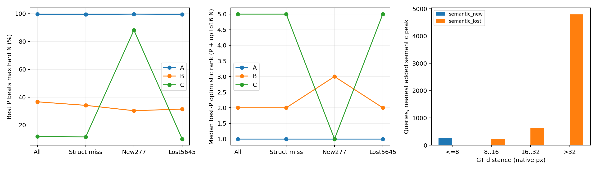
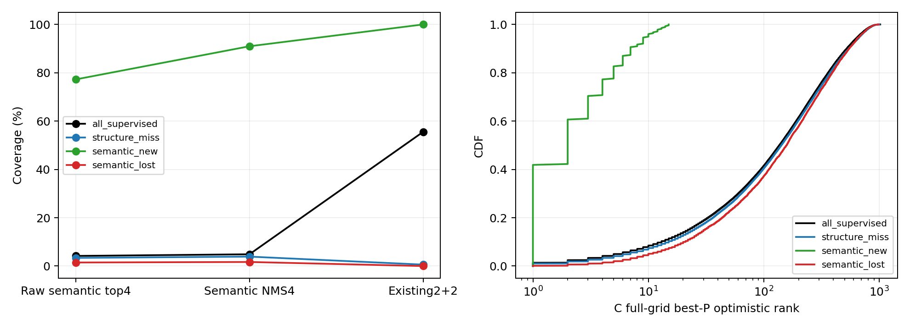

# 三层同位置诊断：277个新增和5,645个丢失的来源

本轮只增加诊断，没有更新参数或更改原型数、温度、相似度、lambda、1024目标网格、NMS、4候选及8 px门槛。**当前证据同时指向“32原型压缩加点积评分”和“实际SAR预测评分”两处区分能力落差，丢失查询的主要表现是远处高分峰与正位置排序靠后，不能主要解释为刚好未进8 px。** 这些是固定模型条件下的描述性定位，不是各模块因果贡献的分解。

同一套验证竞争位置上，最佳正分数胜过最高结构难负分数的比例为：A原始DINO **99.5143%**，B原型教师 **36.7071%**，C实际跨模态 **11.9005%**。5,645个丢失查询中，4,793个的新增语义峰最近距离超过32 px，229个位于8–16 px。**A/B使用GT逆映射到同一光学影像，具有明显的同图自相似优势，不是严格跨模态上界**；连续GT的A自余弦接近1也不用于证明定位足够。

**固定条件与诊断集合**

模型为第30轮结构checkpoint和已完成5000步的同一SAR语义头，两个模型均冻结、eval()、batch4。两侧依然为原固定952对/238个family：训练监测用于对照，验证用于未见来源组诊断。每侧原始144源点共137,088个查询，其中116,953个通过既有supervised掩码；20,135个GT图外查询依原规则屏蔽。零像素不自动判无效，没有新增真实可见性掩码。

每个源点只建立一次：P为距T(x)不超过8 px的原有效目标网格；N从P外的原有效网格按结构分数贪心提取最多16个24 px空间分离峰。抑制只在负峰之间顺序执行，既不以GT为抑制中心，也不重新生成P/N来适应某层评分。

三层共用P、N。A/B所需的T^-1(y_j)若越界，会记录该位置，并在三层竞争统计中共同排除，**不补选新的负峰**；C全网格排名和部署候选仍使用原target_valid，保持原评估口径。本次实际所有原有效目标网格的逆映射都在界内，全部有效查询的P/N均完整，因此没有因共同域筛查改变统计集合。

| 状态（验证） | 结果 |
| --- | ---: |
| 原始源查询 | 137,088 |
| 既有有效监督查询 | 116,953 |
| 未应用既有监督mask前，几何P为空 | 15,564 |
| 有效监督内P为空 | 0 |
| 负峰不足16（全部/有效监督） | 0 / 0 |
| 原有效目标网格逆映射越界 | 0 |
| 有效监督内P/N逆映射不完整 | 0 |
| 连续GT逆映射往返最大误差 | 约6.21e-5 px |

P为空的15,564个来自原始全部查询，不是从116,953有效监督中删掉的样本；其他未监督查询可能有网格落在图外GT的8 px圆内，但仍不通过原GT范围规则。全部状态和原始排除掩码保存在NPZ与[validation_status.json](validation_status.json)，没有按表现重新筛样本。

分组采用上一轮已冻结的候选输出：全部有效116,953、原结构漏检46,631、纯语义新增277、纯语义丢失5,645、保留命中64,677、两者均漏检46,354。新增/丢失分组与原查询ID精确复现，GT只参与本轮诊断采样和比较，未进入部署候选接口。

**三层评分及坐标链**

| 层次 | 具体实现 |
| --- | --- |
| A：原始DINO | 复用已缓存、归一化的18×18×384 DINO patch token；按原半像素规则插值至32×32并L2归一化，得到原型化之前的光学描述子场。在x和T^-1(y_j)采样，采样后L2归一化再算余弦 |
| B：32原型教师 | 在完全相同的光学位置x和T^-1(y_j)采样原冻结q_o，概率插值后归一化，计算q_o(x)^T q_o(T^-1(y_j)) |
| C：实际跨模态 | 原部署分数q_o(x)^T q_s(y_j)，不换相似度或温度 |

A保留384维DINO描述子，没有原型压缩；为了使A/B对应同一原型前坐标场，A也沿用18→32的既有插值。它不是额外提取高分辨率DINO，也不使用CLS。坐标仍为零起点原图像素中心：DINO token中心=(u+0.5)*256/18−0.5，结构中心=8k+3.5；grid_sample使用align_corners=False、border扩展。A/B的采样坐标先做GT逆变换，越界先显式记录，不能把border夹取当成有效对应。

P/N实际目标网格上的评分是主要比较；连续y*=T(x)只另列插值检查。A/B是GT辅助同图参照，既没有SAR外观困难，也有自相似优势。A→B差异包含“原型压缩、softmax概率表达和点积评分”的共同作用，不能全部归因于32个原型数量；B→C差异也不能只由单个损失值解释。

**名次、间隔与平局定义**

竞争集合为同一P∪N，通常包含数个正网格和16个难负峰。每层用最高正分数s_P与最高难负s_N比较，Delta=s_P−s_N；大于1e-6为胜，小于−1e-6为负，绝对差不超过1e-6为平局。另保存精确浮点相等计数。该容差在计算前固定，只处理数值平局，没有修改模型评分。

最佳正邻域位置的名次报告区间：最乐观名次=1＋严格高于s_P+tol的位置数；最悲观的“首个正位置”名次=1＋高于或平于s_P−tol的负位置数。其他正位置之间并列不会降低首个正位置的最差名次。不依赖数组顺序把平局算成有效区分。下表名次为两端各自的中位数；Delta为原始分数单位，**不同层分数尺度不同，其幅值不能直接跨层比较**。

| 验证分组 | 层 | 最佳正名次中位区间 | Delta中位数 | 胜 / 负 / 平（%） | 胜 / 负 / 平（查询数） |
| --- | --- | --- | ---: | --- | --- |
| 全部有效查询（116,953） | A | 1–1 | +0.033173 | 99.5143 / 0.4857 / 0.0000 | 116,385 / 568 / 0 |
| 全部有效查询（116,953） | B | 2–2 | -0.007191 | 36.7071 / 63.2921 / 0.0009 | 42,930 / 74,022 / 1 |
| 全部有效查询（116,953） | C | 5–5 | -0.021632 | 11.9005 / 88.0935 / 0.0060 | 13,918 / 103,028 / 7 |
| 原结构@4漏检（46,631） | A | 1–1 | +0.032081 | 99.4403 / 0.5597 / 0.0000 | 46,370 / 261 / 0 |
| 原结构@4漏检（46,631） | B | 2–2 | -0.009323 | 34.1725 / 65.8275 / 0.0000 | 15,935 / 30,696 / 0 |
| 原结构@4漏检（46,631） | C | 5–5 | -0.022749 | 11.4924 / 88.5055 / 0.0021 | 5,359 / 41,271 / 1 |
| 纯语义新增（277） | A | 1–1 | +0.031304 | 99.6390 / 0.3610 / 0.0000 | 276 / 1 / 0 |
| 纯语义新增（277） | B | 3–3 | -0.016343 | 30.3249 / 69.6751 / 0.0000 | 84 / 193 / 0 |
| 纯语义新增（277） | C | 1–1 | +0.013407 | 88.0866 / 11.9134 / 0.0000 | 244 / 33 / 0 |
| 纯语义丢失（5,645） | A | 1–1 | +0.032968 | 99.5040 / 0.4960 / 0.0000 | 5,617 / 28 / 0 |
| 纯语义丢失（5,645） | B | 2–2 | -0.011429 | 31.4969 / 68.5031 / 0.0000 | 1,778 / 3,867 / 0 |
| 纯语义丢失（5,645） | C | 5–5 | -0.023783 | 10.0266 / 89.9734 / 0.0000 | 566 / 5,079 / 0 |

全部有效验证中A无平局；B有1个、C有7个容差内平局，完整精确平局数另存。分布不只保留均值：[layer_group_comparison.csv](layer_group_comparison.csv)含Delta中位数/P5/P95、名次两端、胜负平及所有P×N比较比例；[validation_group_summary.json](validation_group_summary.json)含完整分位数。三层在每个查询使用完全相同竞争位置。

例如全验证所有P×N比较的胜率为A98.5488%、B81.5594%、C58.4999%；而“最佳正胜过最高难负”的比例低得多，B只有36.7071%、C只有11.9005%。这说明平均成对区分容易掩盖高分困难负位置，不能用平均对比结果代替候选覆盖。

同查询配对变化也已保存：A胜→B负为73,584个，A胜→B平为1个；B胜→C负为36,758个，B胜→C平为1个。也存在B非胜→C胜7,747个，因此不能把三层关系理解成每个查询单调退化。



**C层全网格名次与NMS前后覆盖**

这里原始top4仅是NMS前诊断；语义独立4峰是保持24 px NMS但不保留结构前缀的诊断参照；部署结果仍为原“2结构＋2语义”。后两者均没有改变4候选预算，不是本轮上线新配置。原始top4保留实际索引顺序结果，同时按平局块计算覆盖的保证/可能上下界，避免数组顺序产生虚假的区分。本次四个重点验证组的上下界与实际top4覆盖相等。

| 验证分组 | C全网格最佳正名次中位/P95 | NMS前语义top4覆盖 | NMS后语义独立4峰覆盖 | 原部署2结构＋2语义覆盖 |
| --- | --- | ---: | ---: | ---: |
| 全部有效查询 | 136 / 654 | 4.1906% | 4.8729% | 55.5385% |
| 原结构@4漏检 | 142 / 681 | 3.3754% | 3.9030% | 0.5940% |
| 纯语义新增 | 2 / 10 | 77.2563% | 90.9747% | 100.0000% |
| 纯语义丢失 | 158 / 674 | 1.4703% | 1.6829% | 0.0000% |

全验证NMS将2,330个原始top4漏检变为命中，同时使1,532个原始命中漏检，净增加798个；语义独立覆盖由4.1906%变为4.8729%。即使移除结构前缀干预，C层语义4峰覆盖仍很低，不能把主要问题全部归给NMS。

原部署55.5385%的覆盖不可当作语义独立覆盖：结构前2峰自身已覆盖64,533个查询，后2个语义峰只在这些之外增加421个。其余语义峰与已有结构命中重合不会增加覆盖。

另有31,532个原结构漏检查询的整个P被固定前2结构峰的24 px范围抑制，说明原2+2接口确有额外可达性约束。但**277个新增与5,645个丢失查询均至少有一个正位置在前缀抑制后保留**，两组全P抑制数量都是0，不能用前缀完全屏蔽解释这5,645个丢失。



**277个新增与5,645个丢失分别发生了什么**

将原结构命中拆开可得到精确账目：

| 原结构查询类型 | 数量 | 换成2结构＋2语义后的结果 |
| --- | ---: | --- |
| 前2结构峰已命中 | 64,533 | 全部保留 |
| 只有第3/4结构峰命中 | 5,789 | 语义补充只保住144个，丢失5,645个 |
| 原结构4峰都未命中 | 46,631 | 语义补救277个，其余46,354个仍漏检 |

新增277个是按实际覆盖结果定义的条件子集，因此C胜率88.0866%、最佳正名次中位2等只能解释这些既有新增案例，不能反推总体语义有效性。其中214个已在原始语义top4内、252个在语义独立NMS4峰内；其余25个需要固定结构前缀改变可用峰后才进入实际补充的2峰。新增并不要求语义top1准确：仅116个的全局语义top1在8 px内，122个的top1仍超过32 px，实际命中可能来自后续峰。

丢失5,645个中A胜5,617、B胜1,778、C胜566；C全网格最佳正名次中位158/P95 674。只有83个在原始语义top4仍有覆盖，语义独立NMS4也只覆盖95个。该组没有任何前2结构峰命中，且正集合未被前缀全部抑制；主要表现为当前C排序没有把可用正网格排到剩余预算中。

以下距离针对**实际新增的两个纯语义候选中最近一个**，不混入保留的结构峰。8–16、16–32、>32 px仅是事前固定的描述区间，不改变8 px命中门槛。

| 验证分组 | 最近新增语义峰中位/P95(px) | ≤8 | (8,16] | (16,32] | >32 |
| --- | --- | ---: | ---: | ---: | ---: |
| 全部有效查询 | 76.47 / 176.03 | 421 | 1,197 | 11,803 | 103,532 |
| 原结构@4漏检 | 73.05 / 167.71 | 277 | 968 | 4,764 | 40,622 |
| 纯语义新增 | 5.60 / 7.82 | 277 | 0 | 0 | 0 |
| 纯语义丢失 | 77.69 / 176.69 | 0 | 229 | 623 | 4,793 |

在丢失组里，8–16 px仅229个（4.06%），16–32 px623个（11.04%），>32 px4,793个（84.91%）。与“接近GT但没进8 px”相比，远处高分峰占主导，更符合实例辨识/排序不足的表现；但距离本身不能证明它们属于同类地物，也不能排除具体样本的标签或可见性问题。

为区分候选预算与全局峰，另外保存全局语义top1、语义独立4峰中最近者、实际新增2峰最近者及全部峰距离。丢失组全局语义top1距离中位102.91 px、独立4峰最近距离中位51.40 px、实际新增2峰最近距离中位77.69 px，均不支持把主要损失缩减为几像素精定位问题。

**连续GT检查与实际网格结果分开解释**

连续GT使用相同变换链：A比较x与T^-1(T(x))的DINO余弦；B比较该位置的教师概率；C在连续T(x)处采样SAR概率后归一化。A连续GT分数中位为1，连续分数减实际正网格最佳分数的中位差为0.003637；逆变换往返误差最大约6.21e-5 px，支持实现方向/插值链的数值检查，不能据此认证DINO定位能力或真实底图精度。

连续GT、实际P最佳分数、两者差值分布分别保存在各组summary和逐查询NPZ；主要判断始终来自实际目标网格与难负位置的名次/间隔。B的点积自相似不是归一化余弦，自点积不保证比其他位置大；因此不能将A的自相似性质直接套给B或C。

**同源组配对与不确定性**

[family_paired_diagnostics.csv](family_paired_diagnostics.csv)按split、group、family保存相同查询的A/B/C胜负平、Delta中位数、名次中位数以及C的NMS前后覆盖。全验证238个family的A→B、B→C胜率变化均为负；新增组覆盖155个family，丢失组覆盖238个family。

下表是2,000次整family配对重采样的胜率变化95%区间，单位为百分点；每次先汇总被抽中的family查询计数，再计算比率。分组按本次固定模型结果条件化，不代表独立抽出的失败总体。

| 验证分组 | 有该组查询的family数 | B−A胜率变化95%区间 | C−B胜率变化95%区间 |
| --- | ---: | --- | --- |
| 全部有效查询 | 238 | [-63.741, -61.842] | [-25.766, -23.902] |
| 原结构@4漏检 | 238 | [-66.333, -64.118] | [-23.833, -21.584] |
| 纯语义新增 | 155 | [-75.540, -63.513] | [50.680, 64.773] |
| 纯语义丢失 | 238 | [-69.496, -66.378] | [-23.282, -19.847] |

区间描述当前固定训练种子、来源组和合成标签下的样本不确定性，不能当成模块因果效应、多训练种子稳定性或地理独立泛化证据。新增组的C胜率高于B也受“按实际C命中定义新增”影响，不能用它推翻总体A→B→C区分能力下降的观察。

训练监测的对应胜率也一并保存，不与验证混合：

| 固定训练监测组 | A胜率 | B胜率 | C胜率 |
| --- | ---: | ---: | ---: |
| 全部有效查询（116,953） | 99.487% | 37.973% | 12.028% |
| 原结构@4漏检（34,952） | 99.336% | 36.659% | 11.384% |
| 纯语义新增（153） | 99.346% | 43.791% | 79.739% |
| 纯语义丢失（3,327） | 99.669% | 34.355% | 8.747% |

**瓶颈判断与边界**

本轮可以支持三点：第一，在这些固定结构难负位置上，同图DINO参照包含区分信息，但它享有GT与同图优势，不能证明真实跨模态定位足够。第二，当前32原型概率表达加点积评分相对原始描述子已出现显著排序落差，不能只检查SAR头。第三，实际SAR评分又进一步下降，完整网格排名及远距峰表明它尚未保留足够的实例排序能力；NMS与8 px网格量化不足以解释大多数丢失。

本轮没有分离“压缩”和“评分公式”各自原因，也没有用这些结果选择新温度、原型数、相似度或lambda，没有重训、增加可信度掩码或关系图。OS最终测试1,696对和UBCv2测试池1,625对继续封存，WHU重建暂停。所有诊断仍相对于底图名义对应加合成标签解释，不是现实可见性或精定位监督认证。

**核验、工程记录与文件**

全套**70项测试通过**，新增测试覆盖GT邻域外负峰与NMS、胜负平、名次区间对数组置换不敏感、空P/N状态、top4边界平局、多正位置平局对“首个正位置”的正确处理。源码compileall通过。

独立NumPy从每个查询保存的P/N分数重建两侧全部274,176个原始查询的三层名次、Delta及胜负平，均精确一致；固定每侧前4对的576个查询额外独立核验结构难负16峰及C全网格名次，共1,152个。277/5,645分组、原结构及纯语义部署候选与上一轮逐查询精确相等。模型、头、原型缓存、旧源码、固定样本与扰动及封存测试池前后哈希一致，见[verification.json](verification.json)、[frozen_provenance_before.json](frozen_provenance_before.json)、[frozen_provenance_after.json](frozen_provenance_after.json)。

工程过程中修复了argsort关键字兼容性，并在交付计算前明确了多个正位置并列时的最差名次定义；旧工程尝试留在服务器独立目录，没有用于本报告或配置选择，见[engineering_notes.json](engineering_notes.json)。这没有改变任何模型参数或部署候选规则。

- [同位置分层/分组统计表](layer_group_comparison.csv)
- [验证全部组summary](validation_group_summary.json)、[训练监测全部组summary](training_monitor_group_summary.json)
- [同源组配对汇总](family_paired_diagnostics.csv)
- [验证逐查询CSV](validation_per_query.csv.gz)、[训练监测逐查询CSV](training_monitor_per_query.csv.gz)
- [验证完整诊断NPZ](validation_query_diagnostics.npz)、[训练监测完整诊断NPZ](training_monitor_query_diagnostics.npz)
- [状态与排除计数](validation_status.json)、[预先固定协议](preregistered_protocol.json)、[测试日志](tests/pytest.log)
- [执行环境与源码摘要](implementation_environment.json)、[完成回执](completion.json)

NPZ保留所有原始源查询、supervised、分组mask、同一P/N位置与分数、逆映射坐标/越界状态、层级名次和间隔、全网格名次、连续GT检查、NMS前后候选及距离；无效槽位必须结合对应mask读取，不能把填充值0或无效inf混入统计。硬负峰只用于本诊断，不作为部署候选或训练样本回流。

两套诊断计算约35.32秒、峰值显存186.48 MiB，不含读取/缓存哈希校验、family重采样、独立核验和报告生成。原始数据、teacher大缓存及权重留在zzvr，诊断文件和代码同步归档。

```bash
cd /mnt/sda/zhushihao/Semantically-guided-disambiguation-matching
export PYTHONPATH=.
# 依赖原冻结模型/语义头/teacher缓存；不训练。新计算需新output，拒绝覆盖现有诊断。
.venv/bin/python scripts/diagnose_os_semantic_bottleneck.py --config configs/os_semantic_bottleneck.json
.venv/bin/python scripts/summarize_os_semantic_bottleneck.py --config configs/os_semantic_bottleneck.json
.venv/bin/python scripts/verify_os_semantic_bottleneck.py --config configs/os_semantic_bottleneck.json
PYTEST_DISABLE_PLUGIN_AUTOLOAD=1 .venv/bin/python -m pytest -q
```
