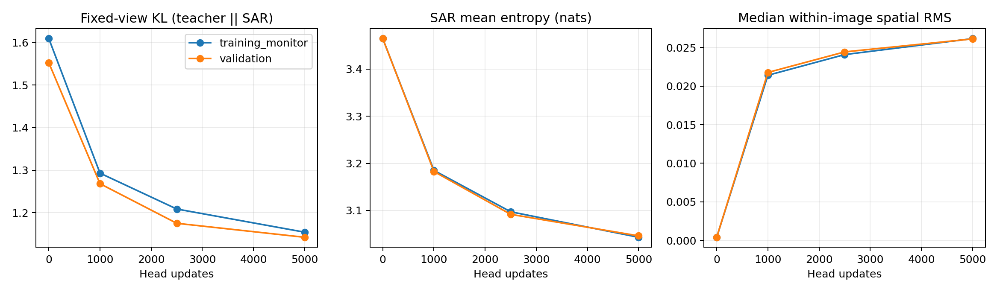
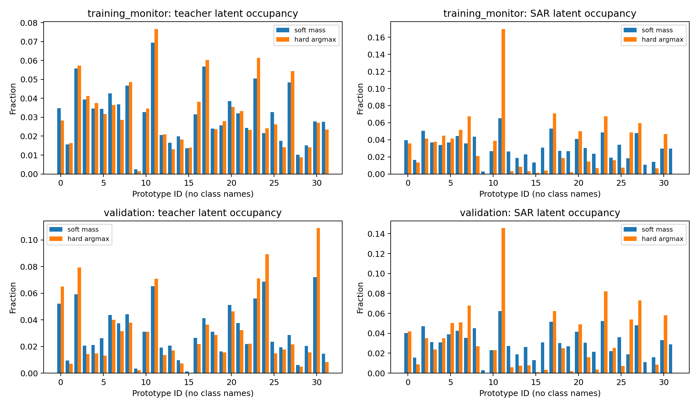
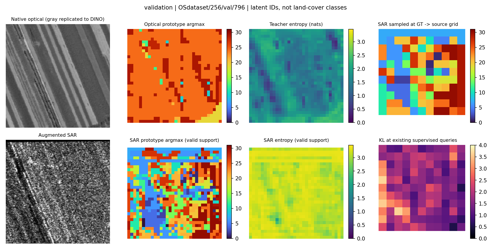
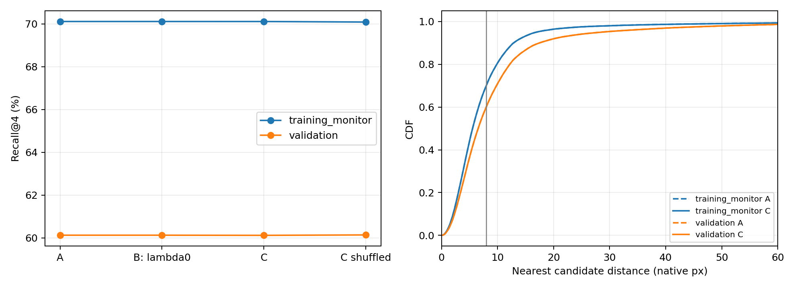
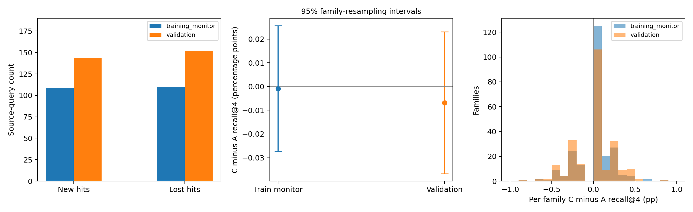

# 冻结结构前端后的潜在语义原型路由：固定预算试验

本轮完成预先固定的32对冒烟、5000步SAR语义头蒸馏，以及同一语义头的A/B/C和空间打乱诊断。**没有达到“固定4候选预算下稳定增加未见family覆盖”的成功标准。** 验证召回@4由A的60.1284%变为C的60.1216%，新增144个命中，同时丢失152个，净少8个。不能将KL下降宣布为语义路由成功，也不能据此否定所有后续语义方案。

结构起点固定为第30轮诊断结束点，不是验证最优checkpoint。OS原生256、family划分、验证样本与扰动均不变；结构前端全冻结。OS最终测试1,696对、UBCv2冻结测试池1,625对继续封存，WHU重建继续暂停。所有距离仍相对于发布者声称已对齐的底图加合成仿射解释，来源组隔离不等于地理独立或1–2 px精度认证。

**交付一：教师、原型与版本追溯**

| 项目 | 冻结设置 |
| --- | --- |
| 教师 | 官方DINOv2 ViT-S/14，LVD-142M预训练权重，float32推理，eval()，参数不训练 |
| 代码 | [facebookresearch/dinov2](https://github.com/facebookresearch/dinov2)，revision `7764ea0f912e53c92e82eb78a2a1631e92725fc8` |
| 权重 | [官方权重](https://dl.fbaipublicfiles.com/dinov2/dinov2_vits14/dinov2_vits14_pretrain.pth)，SHA-256 `b938bf1bc15cd2ec0feacfe3a1bb553fe8ea9ca46a7e1d8d00217f29aef60cd9` |
| 光学输入 | 原生uint8灰度/255，复制3通道仅作接口转换；Torch bicubic、antialias=True、align_corners=False缩放为252×252，截断到[0,1]后按ImageNet mean/std归一化，无裁剪 |
| 密集特征 | `forward_features()['x_norm_patchtokens']`，排除CLS；18×18个384维patch特征，逐位置L2归一化 |
| 原型 | 32个单位球面中心，cosine kmeans++单次初始化、固定40次球面聚类，seed=2026112608；T_sem=0.05 |
| 拟合范围 | 正式训练划分全部1,976个family，每family随机固定1对、每对64个不重复token，共126,464个token；验证影像和隔离RGB512不参与聚类或参数选择 |
| 含义 | 仅称“潜在语义原型/原型ID”；没有建筑、道路等类别名称，也没有类别准确率认证 |

验证DINO特征只用于冻结教师的标签缓存和评估，不进入聚类输入。没有通过随机、未训练投影头生成教师标签。模型权重、32个中心和预处理在SAR头训练之前冻结。

[prototype_samples.jsonl](teacher/prototype_samples.jsonl)逐条记录sample_id、family_id、原光学哈希、缓存行号及64个token索引。原型中心可直接下载：[prototype_centers.npy](teacher/prototype_centers.npy)。

- 原型中心SHA-256：`9e954a8dea76bfb42e27b694bce9c877550af16e032e53748ba802efbd2b0dad`。
- 聚类抽样清单SHA-256：`f1892346d26fe8bfd45ddb276fefdf10c7250a740fd21fe4cafa8cfcef358b94`。
- 教师缓存版本：`d8067dd69c317587bfcf7514d9e60e5262d0fd64af5add13d7c45ea4b27e10af`。

[teacher_identity.json](teacher/teacher_identity.json)记录官方源码树哈希、权重哈希、Torch版本及执行包装器哈希；[cache_receipt.json](teacher/cache_receipt.json)还记录原型、原图样本清单、预处理、完整教师变换链和缓存文件哈希。读取器检查版本、文件哈希、原始图像哈希和sample/family映射，拒绝混用。原始token与概率大缓存留在服务器；token与q采用float16存储，每次读q转float32重新归一化。重提取4个训练/验证位置后，归一化token误差约1.2e-4、q误差约2.4e-4，符合该存储量化范围。

**坐标约定**

原图采用零起点像素中心(x,y)。原生256经整幅252缩放后，token列u的中心对应

```text
x_native = (14*u + 7)*256/252 - 0.5
         = (u + 0.5)*256/18 - 0.5
结构网格列k的原图中心：x_native = 8*k + 3.5
原图点x映射到token坐标：(x+0.5)*18/256 - 0.5
原图点x映射到结构坐标：(x+0.5)*32/256 - 0.5 = (x-3.5)/8
```

token特征按上述半像素映射双线性插值到32×32结构网格，再L2归一化，与单位原型做cosine/T_sem后softmax。接近图边、超出token中心包络但仍在原图内的位置采用border扩展，并非额外可见性认证。教师当前所有光学变换均为identity；SAR使用原训练仿射，完整关系为A_s @ B_nominal @ inverse(A_o)，B_nominal=I，A_o=I。结构输入仍是原生256、uint8/127.5−1，没有被教师的252缩放或ImageNet归一化替换。

**交付二：蒸馏训练与区分性诊断**

结构前端SHA对应第30轮`last.pt`：`40aefd473566fa5c14557b9d9198bf26e8b2b753b35cb435bda589b28b6f19bc`。加载后全部参数requires_grad=False，整个前端始终eval()，优化器只包含20,640参数的SAR头：Conv1×1(128,128)→GELU→Conv1×1(128,32)→通道softmax。输入为原归一化的128维SAR描述子。

先在32个不同训练family各1对上做100步固定视图冒烟，KL由1.6218降至1.3505，梯度有效、结构哈希不变。随后重新初始化语义头与优化器，固定seed=2026112609，AdamW lr=1e-3、weight_decay=1e-4、batch16、梯度裁剪1.0、无scheduler，完整运行5000步；训练样本为全部7,912对，保留原±20°、0.9–1.1尺度、±16 px的逐样本/epoch确定性SAR仿射，约10个完整数据遍历加第11个部分遍历。没有提前停止或按验证选择checkpoint。

唯一训练目标为KL[sg(q_o(x)) || q_s(A_gt*x)]。SAR先输出概率，再在GT连续坐标处双线性采样，采样后检查并恢复通道和为1；没有插值logits替代概率。教师停止梯度，Omega严格沿用现有144源点的supervised mask。图外、空正邻域、原支持无效的处理不变；没有新增“可信可见”掩码，没有可信度门控、融合检索损失、区域关系或精定位分支。

固定训练监测和验证各952对/238个family、116,953个有效源点；每侧20,135个图外GT查询被屏蔽，其余三个既有无效状态为0。固定视图下的诊断如下，熵单位为nats，空间RMS在每图内部对概率变化计算后取图像中位数：

| 步数 | 集合 | KL | SAR平均熵 | SAR图内空间RMS中位数 | 硬分配出现的原型 |
| --- | --- | ---: | ---: | ---: | ---: |
| 0 | 训练监测 | 1.6089 | 3.4647 | 0.00040 | 12/32 |
| 0 | 验证 | 1.5520 | 3.4647 | 0.00040 | 11/32 |
| 1000 | 训练监测 | 1.2930 | 3.1849 | 0.02141 | 26/32 |
| 1000 | 验证 | 1.2682 | 3.1826 | 0.02177 | 26/32 |
| 2500 | 训练监测 | 1.2088 | 3.0971 | 0.02409 | 29/32 |
| 2500 | 验证 | 1.1753 | 3.0917 | 0.02444 | 31/32 |
| 5000 | 训练监测 | 1.1543 | 3.0430 | 0.02616 | 30/32 |
| 5000 | 验证 | 1.1424 | 3.0460 | 0.02612 | 31/32 |

最终验证光学教师平均熵1.9152、空间RMS中位数0.06392；SAR分别为3.0460和0.02612。SAR硬分配出现31/32个原型，但占比至少1%的只有19个，最大单原型占14.56%；不能仅凭“出现31个原型”声称覆盖充分。原型9、28、31等的硬占用很低，完整软/硬占用随诊断保存。

验证SAR的“边际熵−平均位置熵”为0.3227 nats，图内分布相对于本图均值的平均KL中位数为0.2435 nats，说明并非严格的全图常数输出。将训练监测教师均值固定成一个32维常向量时，验证KL为1.4604，高于头的1.1424；这也支持头学到了部分变化。但头仍比教师更平滑，区分性与跨模态对应能力不足，KL下降不能替代候选覆盖证据。此常向量只作诊断，不是额外训练模型；按每图教师均值得到的0.6428中位KL是使用光学内容的oracle诊断，不能当可部署的SAR方案。

增强一致性比较相同光学源点处的q_s(Ax)与未扰动底图q_s(x)，只取现有有效范围交集；最终训练/验证JS分别为0.02040/0.02012 nats。初始近均匀预测的JS更小，因而不能把“较小一致性误差”单独理解成语义更好。这只是合成变换一致性，不是真实可见性或类别理解证明。

[distillation_comparison.csv](distillation_comparison.csv)及[distillation_history.json](training/distillation_history.json)含全部固定检查点KL、占用、熵和变化统计，逐对KL保存在`training/stepNNNNN_*_distillation_per_pair.csv`。[additional_diagnostics.json](additional_diagnostics.json)保存常分布对照及候选集合变化。





空间图按固定首/中位置及此前失败81/796选取，不按语义增益筛选；SAR无效支持在图中留白。下图的颜色仅代表原型ID，argmax花纹还需结合概率熵阅读，不能把噪声状argmax当作高置信语义分割。



**交付三：同一最终语义头的A/B/C及空间打乱**

保留结构分数S_str=cosine/0.1，使用b=2*q_o(x_i)^T*q_s(y_j)−1，S_fuse=S_str+lambda*b。候选提取没有GT输入。先保留原结构前2个NMS峰，随后从融合分数补2个；对整个并集使用同一24 px NMS，候选不足记-1/invalid，不填无效点。lambda=0直接调用原4峰路径，逐元素精确回退。

lambda选择公式在训练前固定为min(1.0,0.10*std_str/std_b)，训练完成后仅在固定训练监测集校准一次。训练std_str=1.434693，std_b=0.057063，lambda=1.0触及预设上限；实际中心化偏置波动是结构分数的3.98%，理论绝对限幅±1。b均值约−0.9057，其常量部分不改变排序，不能用这个均值宣称强路由。未在验证上调整lambda、T_sem或其他设置，详见[routing_calibration.json](routing_calibration.json)。

A为原第30轮4结构峰；B为加载相同已训练语义头但lambda=0；C启用lambda=1的2+2软路由。C_shuffle使用同一头和lambda，按每个sample_id及固定seed打乱整张32×32 SAR语义图空间位置，结构分数、支持和候选数不变。该打乱包含原无效位置的预测，不能视为完全消除所有边界分布因素的类别理解检验。

| 集合 | 设置 | 召回@1 | 召回@4 | 最近距离中位数(px) | P95(px) |
| --- | --- | ---: | ---: | ---: | ---: |
| training_monitor | A | 61.6282% | 70.1145% | 5.5380 | 16.9022 |
| training_monitor | B | 61.6282% | 70.1145% | 5.5380 | 16.9022 |
| training_monitor | C | 61.6282% | 70.1136% | 5.5384 | 16.9033 |
| training_monitor | C_shuffle | 61.6282% | 70.0888% | 5.5396 | 16.9468 |
| validation | A | 47.8337% | 60.1284% | 6.5377 | 28.4306 |
| validation | B | 47.8337% | 60.1284% | 6.5377 | 28.4306 |
| validation | C | 47.8337% | 60.1216% | 6.5372 | 28.5561 |
| validation | C_shuffle | 47.8337% | 60.1413% | 6.5370 | 28.5226 |

A/B所有候选索引、坐标、有效性与分数逐元素一致，属于实现检查。由于C保留结构前2峰，C和打乱设置的@1按定义也与A相同，本轮问题是@4覆盖。打乱后验证@4为60.1413%，并没有出现“正确对齐语义带来收益、打乱后收益消失”的证据；它也不能单独验证或否定地物类别理解。

**数值口径修正记录：** 首次接入评估用了batch16，CUDA浮点运算使少量近似并列候选改变，A未逐点复现旧batch4基线。已恢复原batch4，保持结构checkpoint、已训练头和lambda不变，重评所有方法。现在A的有效点和原始逐点距离精确复现第30轮。旧batch16输出保留在`engineering_batch16_arithmetic_audit/`，修正依据见[evaluation_batch_correction.json](evaluation_batch_correction.json)，没有据此重训或搜索配置。所有最终结果均来自batch4；独立的KL诊断和lambda训练集校准使用batch16，并单独记录，不能把其浮点差异解释为模型学习。



**交付四：候选替换与family配对变化**

| 集合 | A未命中→C新增命中 | A命中→C丢失 | 净变化 | family改善/退化/不变 |
| --- | ---: | ---: | ---: | --- |
| 训练监测 | 109 | 110 | -1 | 59 / 54 / 125 |
| 验证 | 144 | 152 | -8 | 63 / 69 / 106 |

验证变化为−8/116,953，即−0.00684个百分点。2,000次整family重采样的C−A召回@4描述性95%区间为[-0.03675, 0.02305]个百分点，跨0。这是固定训练种子和当前来源组划分下的样本不确定性，不包含重新训练种子不确定性，也没有恢复未知地理相关性。不能借该区间宣称等效、显著改善或地理泛化稳定。

验证14,491个查询的有序候选数组发生变化，其中3,935个只是第3/4候选顺序变化，真正候选集合改变为10,556个；不能把全部数组变化当作覆盖替换。新增与丢失分别统计，未按表现差删除任何查询或图像对。训练相应集合变化11,102个，纯顺序变化3,858个。

[逐图像对对照](evaluation/validation_routing_per_pair.csv)、[逐family对照](evaluation/validation_routing_per_family.csv)、[配对变化与集合替换](paired_family_changes.csv)保留完整计数；[验证逐查询数组](evaluation/validation_routing_queries.npz)记录sample/family、supervised、四种设置的候选索引/有效性及top1/最近距离，读取分布必须应用supervised mask。训练对应文件保存在同目录。新命中/丢失示例按最终固定样本/查询顺序各取前2个，只作描述、不参与性能样本选择，见[replacement_example_selection.json](replacement_example_selection.json)。



**判断与后续边界**

本轮SAR头学到了非恒定的潜在原型变化，但未将其转化为固定候选预算下的净验证覆盖提升。现有证据优先指向需要继续核查蒸馏对应能力和路由分数的判别效果：SAR相对教师明显偏软，实际路由波动约4%，新增命中不足以抵消损失。几何方向、连续采样、概率归一化及A/B回退均已有测试与重载验证，当前没有发现坐标实现错误；这仍不认证底图原生残差或教师原型的地物正确性。

不据这一次负结果断言潜在语义无效，也不追加关系图或用验证搜索更大lambda来追求小增益。若后续研究更强蒸馏、任务联合损失或其他路由幅值，应作为新协议，并在需要作稳定性结论时重复训练种子；若解冻结构前端，须增加相同更新预算的无语义续训对照。本轮没有运行这些后续改动。

**验证、文件与复现**

全部62项测试通过（原54项加8项），涵盖原几何/数据工程及新增像素中心映射、仿射方向、教师停止梯度、插值归一化、无有效点处理、lambda0精确回退、2+2去重/NMS、候选不足、球面原型、训练family抽样、缓存混用拒绝和前端不可更新。源码compileall通过。最终执行环境与源码摘要见[implementation_environment.json](implementation_environment.json)。最终模型和头重新加载后，A/B/C/打乱的逐查询数组与原生支持全部精确复现，见[verification_summary.json](verification/verification_summary.json)与[pytest.log](tests/pytest.log)。

原网络、几何、有效性、来源组清单、固定验证计划及UBCv2冻结文件哈希前后一致，见[frozen_provenance_before.json](frozen_provenance_before.json)、[frozen_provenance_after.json](frozen_provenance_after.json)。状态见[completion.json](completion.json)。记录的正式训练及初次诊断约157.56秒、峰值显存306.60 MiB，不含教师预计算、冒烟、后续batch4重评和重载核验，不能直接当端到端系统成本。

服务器根目录：`/mnt/sda/zhushihao/Semantically-guided-disambiguation-matching`。最终头含优化器/RNG状态，保存于`reports/os_semantic_routing_20261126/training/semantic_head.pt`，SHA-256为`3f4c346c035eae7149c8f3a33fd43b1ab7420ae126e508b80df0819d0dbd2d4c`。原始DINO权重、2.7GB教师缓存及头权重留在服务器；Git归档代码、原型中心、完整抽样及缓存回执、诊断统计、逐查询数组、图像和测试日志，不上传原始数据。

```bash
cd /mnt/sda/zhushihao/Semantically-guided-disambiguation-matching
export PYTHONPATH=.
# 需当前冻结数据/第30轮checkpoint。新训练用新output，已有协议及训练目录拒绝覆盖。
# 教师代码和权重位置及官方revision在configs/os_semantic_routing.json中明确；权重必须核对上述SHA。
.venv/bin/python scripts/build_os_semantic_teacher.py --config configs/os_semantic_routing.json
.venv/bin/python scripts/train_os_semantic_routing.py --config configs/os_semantic_routing.json
# 现有最终头直接复核/出图，无新增训练或模型选择。
.venv/bin/python scripts/evaluate_os_semantic_routing.py --config configs/os_semantic_routing.json
.venv/bin/python scripts/verify_os_semantic_routing.py --config configs/os_semantic_routing.json
.venv/bin/python scripts/summarize_os_semantic_routing.py --config configs/os_semantic_routing.json
.venv/bin/python scripts/analyze_os_semantic_routing.py --config configs/os_semantic_routing.json
PYTEST_DISABLE_PLUGIN_AUTOLOAD=1 .venv/bin/python -m pytest -q
```
