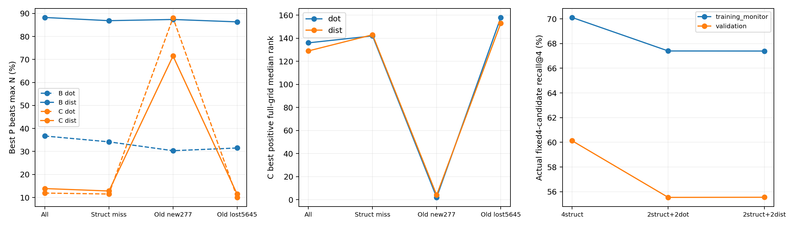

# 只改评分：点积与负平方距离的固定表示对照

本轮没有训练、没有更改光学/SAR原型分布或坐标链，仅比较点积与负半平方欧氏距离。**B层同图参照中，现有分布确实保留了大量被点积评分掩盖的对应排序信息；C层实际跨模态改善较小，未转化为固定候选预算下可靠的净覆盖收益。**

验证P/N胜率：B由36.7071%升至88.2337%，C由11.9005%升至13.8645%。但实际2结构＋2距离语义@4为55.5480%，点积为55.5385%，仅净多11个命中，family配对区间跨0，仍低于原4结构60.1284%。本轮不把名次改善宣布为方案成功，也不把B的同图改善当作跨模态精度证明。

**固定内容与唯一变化**

继续使用第30轮结构checkpoint、同一5000步SAR头、32个冻结原型、T_sem=0.05及原光学/SAR概率场。模型均冻结、eval()、batch4；原生OS256、固定family划分、源点、扰动、有效性与8 px门槛均不变。两套固定评估集合各952对/238个family、116,953个有效源查询。OS最终测试1,696对、UBCv2测试池1,625对继续封存，WHU重建继续暂停。

P/N直接读取上一轮固定诊断文件：P为距GT目标≤8 px的原有效目标网格；N为P外16个结构NMS峰。没有重新挑负位置或补选有利查询。逆映射共同有效域、连续概率插值及既有概率归一化与上轮相同，没有新加归一化，也不改平局容差1e-6。原277新增、5,645丢失等查询组按上一轮点积结果固定，不因距离结果重新划分。

两个评分为：

```text
s_dot(p,q)  = p^T q
s_dist(p,q) = p^T q − 0.5*||q||² − 0.5*||p||²
            = −0.5*||p−q||²
```

对同一查询p固定，候选相关变化只有−0.5*||q||²。实现保留完整距离分数，便于验证等式；不在此函数里重新softmax、L2归一化、调整温度或乘权重。

B层仍在同一光学影像的x和GT逆映射T^-1(y_j)处取教师分布；C层使用q_o(x)和实际q_s(y_j)。**B具有GT辅助的同图自相似优势，不是严格跨模态上界。** 此实验能揭示当前评分对信息读取的影响，不能恢复已经压缩丢失的内容，也不能从结果推断已分离所有表示/蒸馏原因。

**先看同位置P/N排序**

每层每种评分都重新取max_P与max_N，Delta=max_P−max_N。胜为Delta>1e-6、负为Delta<−1e-6、平为其余；同时保存精确相等次数。名次区间沿用上轮首个正位置的乐观/悲观定义，不靠数组顺序把平局算成有效排序。

| 层 | 评分 | 胜 / 负 / 平（%） | 胜 / 负 / 平（查询数） | Delta中位数 | Delta P5 / P95 |
| --- | --- | --- | --- | ---: | --- |
| B | dot | 36.7071 / 63.2921 / 0.0009 | 42,930 / 74,022 / 1 | -0.007191 | -0.083483 / +0.055057 |
| B | dist | 88.2337 / 11.7081 / 0.0581 | 103,192 / 13,693 / 68 | +0.003688 | -0.001520 / +0.027028 |
| C | dot | 11.9005 / 88.0935 / 0.0060 | 13,918 / 103,028 / 7 | -0.021632 | -0.093375 / +0.008708 |
| C | dist | 13.8645 / 86.1337 / 0.0017 | 16,215 / 100,736 / 2 | -0.013755 | -0.068560 / +0.006025 |

B点积的Delta中位数为−0.007191，距离改为+0.003688；C从−0.021632变为−0.013755，仍为负。B在固定P∪N中的最佳正名次中位数2→1，C为5→4。该评分变化有明确的受控解释，但各层分数尺度不同，不应把Delta幅值直接当成不同层的可比精度量。

B有63,130个查询由点积负转距离胜，2,847个由点积胜转距离负；C对应为6,202和3,908。原来接近或被点积排错的部分位置确实被重排，但变化并非对所有查询有利，完整胜/负/平转移也已保存。

| 固定验证查询组 | B胜率：dot→dist | C胜率：dot→dist | C全网格最佳正名次中位：dot→dist |
| --- | --- | --- | --- |
| 全部有效（116,953） | 36.707% → 88.234% | 11.901% → 13.865% | 136 → 129 |
| 原结构漏检（46,631） | 34.173% → 86.844% | 11.492% → 12.805% | 142 → 143 |
| 原点积新增（277） | 30.325% → 87.365% | 88.087% → 71.480% | 2 → 4 |
| 原点积丢失（5,645） | 31.497% → 86.324% | 10.027% → 11.444% | 158 → 153 |

原点积新增组按“已被dot选中且命中”条件定义，改分后C胜率下降或名次变差不应被误读成独立采样结果；所有分组都保留原ID，方便与此前277/5,645问题对照。

**尖锐程度检查**

固定原点积的最高正、最高难负位置，比较它们的候选分布平方范数：

| 验证层 | 最高正候选||q||²中位数 | 最高难负||q||²中位数 | 难负比正候选更尖锐的比例 |
| --- | ---: | ---: | ---: |
| B | 0.228608 | 0.288305 | 73.7963% |
| C | 0.061256 | 0.082269 | 77.7988% |

概率向量平方范数越大，分布越集中。距离分数对候选的平方范数加固定惩罚，与B显著恢复排序相符。这支持“当前点积受候选集中程度影响，掩盖部分对应信息”，不证明越平滑越好，也不代表应该将所有尖锐分布判为错误。

只看原点积的那一对正负位置会夸大恢复：B有7,620个、C有10,058个原点积负查询，原先那对位置加范数惩罚后已翻成正间隔，但**重新在全部固定N中取最高距离负分数后仍未胜**。因此所有正式排序表都使用重选后的max_N，不拿固定对翻转替代真实排序结果。具体范数和配对变化见两套group_summary的sharpness部分。

**C全1024目标网格排名与独立语义四峰**

全网格仍从全部原有效目标位置搜索，没有结构候选池预筛。先单独报告C的语义NMS四峰：依原24 px半径贪心选四个纯语义峰，此项是中间排序/覆盖参照，不与实际2结构＋2语义混淆。

| 评分 | 最佳正名次P25 | 中位数 | P75 | P95区间 | NMS前top4覆盖保证/可能界 | 独立语义NMS四峰覆盖 |
| --- | ---: | ---: | ---: | --- | --- | ---: |
| dot | 46 | 136 | 306 | 654–654 | 4.1906%–4.1906% | 4.8729% |
| dist | 40 | 129 | 316 | 670–671 | 4.7472%–4.7506% | 5.2987% |

名次只出现局部改善：中位136→129，但P95由654变为670–671，原结构漏检子组中位142→143。不能用一个中位数宣布完整排序分布改善。NMS前距离评分有4个查询跨top4边界容差块，因此保证覆盖与可能覆盖分开列；不按索引先后把它们归为有效区分。

独立语义NMS四峰从4.8729%升至5.2987%，增加约0.4258个百分点；family配对95%区间约[0.3162,0.5430]个百分点。该中间参照有提高，绝对覆盖仍低，且不直接等于实际固定2+2候选收益。



**再看固定4候选预算的实际价值**

三种候选组成严格为：原4结构；相同前2结构＋2点积语义；相同前2结构＋2距离语义。后两者都在全部有效1024目标网格按原顺序NMS、去重规则补2个峰，不足记invalid，不填无效点；本次未出现候选不足。源点、掩码、8 px门槛均不变。

**没有将距离分数放入结构融合，也没有重设lambda。** 结构只提供相同前2峰作为旁路，后2峰纯按对应语义评分排序。所有方法top1仍是原结构top1，因而@1按设计不变；本轮关注@4。

补救率=新增命中/原结构漏检数，验证分母46,631、训练监测34,952；丢失数以原结构命中为基准统计。

| 集合 | 设置 | 召回@4 | 新增命中 | 丢失命中 | 净变化vs结构 | 结构漏检补救率 |
| --- | --- | ---: | ---: | ---: | ---: | ---: |
| 训练监测 | 4结构 | 70.1145% | 0 | 0 | +0 | 0.0000% |
| 训练监测 | 2结构＋2点积语义 | 67.4006% | 153 | 3,327 | -3,174 | 0.4377% |
| 训练监测 | 2结构＋2距离语义 | 67.3946% | 143 | 3,324 | -3,181 | 0.4091% |
| 验证 | 4结构 | 60.1284% | 0 | 0 | +0 | 0.0000% |
| 验证 | 2结构＋2点积语义 | 55.5385% | 277 | 5,645 | -5,368 | 0.5940% |
| 验证 | 2结构＋2距离语义 | 55.5480% | 266 | 5,623 | -5,357 | 0.5704% |

验证距离方案相对点积仅多11个命中：原点积新增277个中保住163个、丢失114个；在原两者均漏检中又补救103个，所以对原结构的新增由277减为266。原点积丢失5,645个中救回71个，同时从原保留命中中又丢49个，故丢失由5,645降至5,623。新增少11、丢失少22，合计净多11，不能描述成显著覆盖提升。

原结构前2峰仍保留64,533个验证命中。替换原第3/4结构峰的不足没有被这一次评分修正解决；距离方案仍相对4结构净少5,357个命中。全部238个验证family相对4结构均净退化。

最近候选距离中位/P95：验证dot为7.0522/47.3288 px，dist为7.0512/47.1249 px，原结构为6.5377/28.4306 px。完整分位数保留于summary，未通过放宽半径来追求收益。

**family配对变化与区间**

按相同family配对，进行2,000次整family有放回重采样，seed=2026112702；每次先合并所抽family的有效查询计数再重算比率。不同子组沿用原dot固定分组，其区间只描述该条件子集。

| 集合 | dist−dot实际@4变化（百分点） | 95%配对区间（百分点） | family改善/退化/不变（dist vs dot） |
| --- | ---: | --- | --- |
| 训练监测 | -0.00599 | [-0.02742, 0.01625] | 51 / 52 / 135 |
| 验证 | +0.00941 | [-0.02228, 0.03925] | 74 / 71 / 93 |

验证dist−dot区间[−0.02228,+0.03925]个百分点跨0；训练监测点估计为负且区间也跨0。本轮没有显示稳定实际覆盖收益。验证dist−结构下降4.58047个百分点，配对区间[−4.82498,−4.34338]个百分点。

排序层面的family配对区间也单独保存：B胜率dist−dot增加51.5267个百分点，95%区间[50.8525,52.1712]；C增加1.9640个百分点，95%区间[1.7663,2.1647]。这再次说明排序改变量与实际覆盖改变量不是同一个量。区间均条件于当前冻结模型、单个训练种子、来源组和合成标签，不包含多训练种子或未知地理相关性的不确定性，不能声称地理独立泛化。

**对本轮问题的结论**

在B的GT辅助同图参照中，原型分布保留了大量可被负平方距离评分读出的对应信息，上轮不能把B的点积失败全解释为“原型已经压缩掉了信息”。但本轮也不能推断全部压缩信息都已恢复：距离评分下B仍有11.7081%负、0.0581%平，并存在同图优势。

C仅获得较小P/N胜率和独立语义四峰覆盖改善，全网格尾部、原结构漏检排名及实际2+2覆盖均未出现一致收益。当前结果支持评分是一个可解释影响因素，却没有证明仅修正评分就能解决实际SAR对应/排序不足。本轮不继续搜索其他相似度、温度或lambda，也不以微小验证增益宣布成功。

**验证、文件与复现**

全部**73项测试通过**，新增3项测试覆盖：完整距离与直接向量平方差恒等式、函数不变更分布/不偷偷归一化、候选集中度能使dot/dist排序反转，以及全网格距离补峰保留结构前缀和4候选预算。源码compileall通过。

独立NumPy对全部保存P/N位置重建分差、胜负平、名次区间及范数代数，均精确相等；B/C点积统计及原dot候选也逐查询精确复现。固定每侧前4对共1,152个查询的距离补峰由独立NumPy全网格顺序NMS复核，索引全部相同。

直接按向量差平方求和与dot−norm展开的最大Float32差异为训练侧B约3.20e-7、C约2.90e-7，验证侧B约1.79e-7、C约1.19e-7。初次审计使用2e-7容差，对Float32消去误差过严，后按1e-6核对并保留实际误差；**模型评分、排名平局容差、候选与指标从未因此改变**。完整记录见[verification.json](verification.json)、[engineering_notes.json](engineering_notes.json)、[测试日志](tests/pytest.log)。

权重、原型、teacher缓存、旧表示与几何代码、原固定P/N文件、扰动和封存池哈希前后一致，见[frozen_provenance_before.json](frozen_provenance_before.json)、[frozen_provenance_after.json](frozen_provenance_after.json)。所有结果仍相对于名义底图对应加合成标签解释，不认证真实可见性、地物类别或精定位监督精度。

- [B/C点积与距离的P/N分组表](PN_score_comparison.csv)
- [固定预算候选结果表](candidate_budget_comparison.csv)
- [验证全部分组、排名、范数与区间](validation_group_summary.json)、[训练监测全部结果](training_monitor_group_summary.json)
- [family配对记录](family_paired_score_control.csv)、[逐图像对记录](per_pair_score_control.csv)
- [验证逐查询CSV](validation_per_query.csv.gz)、[训练监测逐查询CSV](training_monitor_per_query.csv.gz)
- [验证完整分数/候选NPZ](validation_score_queries.npz)、[训练监测NPZ](training_monitor_score_queries.npz)
- [预先固定协议](preregistered_protocol.json)、[执行环境与源码摘要](implementation_environment.json)、[完成回执](completion.json)

NPZ包含原同一P/N索引与有效槽位、两层两评分的正/负分数、分差与名次、全C网格正位置名次、目标平方范数、固定dot极值位置范数、独立NMS四峰、实际两种补峰候选、supervised与旧固定分组。读取时必须应用原supervised及槽位有效mask；无效填充值不能加入分布。

两套评分计算约33.26秒、峰值显存91.09 MiB，不含数据/缓存哈希加载、汇总重采样、独立核验和报告。代码与诊断归档，权重及原始数据留在zzvr。

```bash
cd /mnt/sda/zhushihao/Semantically-guided-disambiguation-matching
export PYTHONPATH=.
# 复用原模型/概率缓存/P-N集合，无训练；新计算使用新output，已有输出拒绝覆盖。
.venv/bin/python scripts/evaluate_os_semantic_score_control.py --config configs/os_semantic_score_control.json
.venv/bin/python scripts/summarize_os_semantic_score_control.py --config configs/os_semantic_score_control.json
.venv/bin/python scripts/verify_os_semantic_score_control.py --config configs/os_semantic_score_control.json
PYTEST_DISABLE_PLUGIN_AUTOLOAD=1 .venv/bin/python -m pytest -q
```
