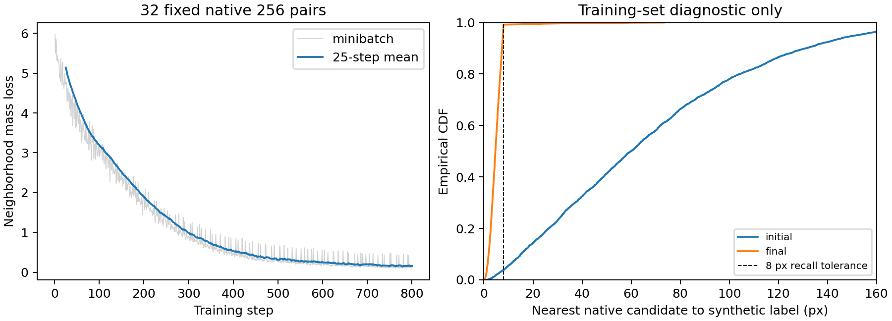
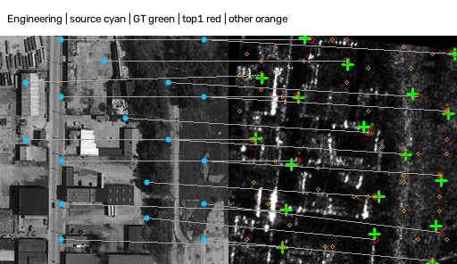

# OS-dataset / UBCv2 原生数据审计与检索工程实验

核查批次：2026-11-26。计算服务器：zzvr。**WHU重建已按本轮要求暂停。OS原生数据读取和32对无语义检索小样本拟合完成；UBCv2仅做原始文件审计与评估池冻结，没有运行新模型，也没有用于选择超参数。**

**交付结论**

| 对象与用途 | 结论 | 适用边界 |
| --- | --- | --- |
| OS作为合成扰动的粗检索训练来源 | 可使用，前提是明确采用发布者“已配准底图”的假设 | 发布与质控证据可追溯；人工仿射精确不代表底图残差为零；本轮指标仅是工程诊断 |
| OS域内独立验证与测试 | 仍待核查 | 已有官方样本划分，完整父场景映射缺失；本轮未开展独立验证 |
| UBCv2冻结后的跨域测试 | 原始影像与文件级评估池已准备；正式配准评测协议仍待固定 | 已接触的跨域基准，不是盲测；预处理、扰动或点位评价协议须在运行冻结模型前确定；不以UBC结果调参 |
| 两套数据的1–2 px精定位精度认证 | 仍待核查 | 无逐裁块误差标定，已配准/精细配准的发布声明不能替代定量精度界限 |

主训练、域内评估候选保持OS；UBCv2保持冻结后的跨域用途；SRIF和SpaceNet9保留为补充外部验证，本轮未新增评估。

**一、两套数据清单与原生信息**

完整未压缩清单与本报告同目录，服务器也保留原件。便于GitHub归档另提供无损压缩版本：

- OS：[manifest.jsonl.gz](os/manifest.jsonl.gz)，17,168条裁块配对记录；全景影像、GT和身份单独记录在[scene_metadata.json](os/scene_metadata.json)及[scene_file_identities.json](os/scene_file_identities.json)。
- UBCv2：[manifest.jsonl.gz](ubcv2/manifest.jsonl.gz)，7,314条配对记录。

每对保留原路径、文件及像素SHA-256、尺寸、通道、类型、逐通道有效范围、非有限数、有效像素、零比例、CRS/地理变换/覆盖、配对状态、官方split、地区或城市信息和未知项。解压方式为`gzip -dk manifest.jsonl.gz`。原始图像没有被放大、裁改或覆盖。

| 数据部分 | 实际配对数 | 原生尺寸 W×H | 光学 / SAR通道 | 类型与有效范围 |
| --- | ---: | --- | --- | --- |
| OS内嵌旧版256 | 10,692 | 256×256 | 1 / 1 | 均为uint8，0–255 |
| OS内嵌旧版512 | 2,673 | 512×512 | 1 / 1 | 均为uint8，0–255 |
| OS新增13个国家/地区 | 3,803 | 512×512 | RGB 3 / 1 | 均为uint8，0–255 |
| OS全景 | 1 | 光学35,783×35,873；SAR35,507×27,298 | 3 / 1 | 光学uint16，有效0–255，NoData=256；SAR float32，有效约0.0286–10516.8877，另有NoData哨兵 |
| UBCv2原始多模态影像 | 7,314 | 均512×512 | RGB 3 / 1 | RGB uint8；SAR float32，不能按uint8解释 |

OS裁块配对规则为同目录`opt<ID>.png`与`sar<ID>.png`，ID必须包含所在子集和split。UBC按每个官方split中`rgb/`与`sar/`的同名TIFF配对，名称还保留传感器token、城市和经纬度。未把本地`generated/`或GDROS已扰动派生包当作原始输入。

本轮完整解码检查：OS裁块和UBC均**缺失配对0、损坏配对0、非有限值问题配对0**；全景也完成分块解码与数值统计。零像素不被自动视为NoData。OS共17,168对含两种尺度的同源裁块，不能解释为17,168个独立原始场景。

UBC原始SAR数值：train为0–503.6003，val为0–255，test为0–257.2906；RGB总体0–255。它的物理振幅/强度单位没有由本轮证据充分确定，未采用旧派生版的uint8转换或使用UBC结果选归一化参数。UBC全部7,314对拥有可读的投影信息且两侧网格一致，涉及13个UTM CRS；这只证明网格元数据一致，不证明影像内容达到特定配准精度。

预览按OS的19个子目录各取一个中间编号样本，UBC按17城市×3个官方split取51对，共70对；没有根据模型表现挑选。均显示原生像素，UBC的SAR预览仅作`log1p + P2/P98`显示拉伸，不进入模型或筛选规则。索引：[OS](os/previews/index.json)、[UBC](ubcv2/previews/index.json)。完整预览保留在本地outputs和服务器reports，Git归档选存若干例。

**二、监督来源与生成说明**

OS正式发布入口为[ScienceDB DOI](https://doi.org/10.57760/sciencedb.radars.00061)，当前页面元数据已直接保存为[os2_metadata_0.json](source/os2_metadata_0.json)。它说明局部图像由多方法匹配结合人工核验生成。内嵌旧OS包的`ReadMe.docx`明确称为“co-registered optical and SAR patch-pairs”，介绍GF-3 Spotlight SAR、Google Earth光学、1 m地面分辨率、从地理编码影像裁取。原文提取及文档哈希见[OS_ReadMe_extracted.txt](source/OS_ReadMe_extracted.txt)与[身份记录](source/OS_ReadMe_identity.json)。这是发布方生成/质控依据，本轮没有要求全量重新标点。

旧OS裁块目录没有逐对矩阵、flow或配准控制点。采用的情况是：**发布者提供已对齐图像，无逐裁块GT；对SAR副本施加已知仿射形成监督。** 底图光学→SAR近似单位关系来自发布假设，底图残余误差未知。并未认证每个原始对应都是精确真值。

OS全景提供72×4个有限浮点坐标，格式由包内`Evaluation.py`核对为`x_optical y_optical x_sar y_sar`，单位为两侧各自原图像素，x为列、y为行。72对点均在各自影像范围内。代码说明零起点XY并提供offset配置，默认不加偏移；本轮未独立认证其采点工具的半像素/一起点细节。ScienceDB说明这些点利用路灯杆在两种成像机制中的一致结构采集，称为高精度GT，但没有提供可直接使用的逐点不确定性或数值精度界限。**它们属于全景，不可按相同数字套给任意裁块。** 本轮没有用其拟合、预对齐或训练。GT与评估脚本快照随来源材料保留。

UBC来源为[作者UBCv2分支](https://github.com/AICyberTeam/UBC-dataset/tree/UBCv2)，README称20城市中17城市提供“finely aligned”光学–SAR对；其[官方README](source/ubcv2_official_readme.md)本轮直接核取。论文DOI [10.1109/TGRS.2023.3311093](https://doi.org/10.1109/TGRS.2023.3311093)题名和元数据经[Crossref](source/ubcv2_crossref.json)核对。当前公开README没有给出逐裁块配准矩阵、点位表或可用的数值精度界限，完整生成/质控细节未据此补写。Semantic Scholar记录没有给出开放全文，本轮没有将未读取的论文内容当成已核实证据。

UBC本地保存的是官方多模态影像包对应内容。建筑屋顶COCO/分割/矢量标注属于建筑任务，既没有被当作配准GT，也没有用于当前训练；本地原始影像目录没有与每对配套的配准点标签。UBC适用同样的“发布方对齐底图 + 预先固定人工扰动”思路，未来若采用，指标仍需相对于这一标签来源解释。

需保留两项官方页面与文件差异：页面称局部512裁块6,343对，实际包中旧版2,673+新增3,803=6,476对；页面写光学全景35,783×35,783，实际为35,783×35,873。均按实测记录，不猜测差异成因。这不自动否定数据发布身份，也不证明其底图精度。当前每个本地文件的SHA-256是身份记录，未与发布者独立内容摘要完成密码学认证。

**三、划分依据、父图关系与未知项**

| 数据部分 | 已有划分 | 当前处理 |
| --- | --- | --- |
| OS 256 | train 8,044 / val 952 / test 1,696 | 保留官方样本划分；当前只使用train固定32对 |
| OS 512 | train 2,011 / val 238 / test 424 | 不与256作为独立样本混合 |
| OS新增地区 | 13地区目录，无内置train/val/test | 保留地区ID，本轮未自行随机划分 |
| OS全景 | 单对影像和72控制点 | 不进裁块训练，不创建虚构scene划分 |
| UBCv2 | train 4,008 / val 1,681 / test 1,625 | 原官方划分保留；未来跨域池仅采用官方test |

已用光学与SAR**联合像素哈希**核对全部10,692个256裁块，均匹配到512裁块的一个256象限；264个裁块存在多个完全相同的父裁块候选，不能强行指定唯一父图。没有检出跨官方split的这种精确对应关系。完整映射见[cross_resolution_mapping.csv](os/cross_resolution_mapping.csv)。这是裁块父子关系，不是卫星采集父场景信息。

另外检出165个联合像素完全重复组，均为两份，包含256层面的132份冗余、512层面的33份冗余；两种尺度同源，不能把它们再当作独立地理重复数累加。训练256的8,044条中有7,912种不同的联合像素内容。本轮选择32对前固定去除精确像素别名，不按模型表现筛选。[exact_duplicates.json](os/exact_duplicates.json)给出统计与示例。未检出跨split精确重复，**不能证明地理独立**。README的“non-overlapping”描述也不能替代独立分组清单。

OS仍缺完整采集父场景ID、原始裁块窗口到地理区域的映射和官方split生成规则；新增地区名称也不能自动补回旧版父场景。域内独立地理验证等待这些依据或明确的新评估协议，本轮不以随机划分掩盖缺口。

UBC可从名称提取17个城市，也拥有实际GeoTIFF覆盖范围。本轮按相同CRS中的光学足迹检查官方不同split，发现**88组正面积相交**（边界相触不计），并保留例子；官方划分不是城市隔离或严格地理隔离。[spatial_split_check.json](ubcv2/spatial_split_check.json)记录城市数量、各split计数和交叠。完整卫星采集父场景ID仍未知。OS与UBC之间的真实地理互斥也未证明，因此“跨域”指数据集/成像域外部评估，不额外宣称地理盲区测试。

**四、UBCv2冻结规则**

在OS新模型运行前，已保存[frozen_policy.json](ubcv2/frozen_policy.json)、全体[frozen_exclusions.csv](ubcv2/frozen_exclusions.csv)、未来官方测试池[frozen_evaluation_pool.csv](ubcv2/frozen_evaluation_pool.csv)及其SHA-256[冻结回执](ubcv2/freeze_receipt.json)。训练前另核对回执和文件摘要，见[preregistered_context.json](structure_smoke/preregistered_context.json)。

硬排除仅限：缺少对侧、解码失败、非有限值、无有效像素、两侧空间尺寸不兼容。实际排除0，未来官方测试池1,625对。云遮挡状态本轮为“未全量判定”，**没有按云筛样，也没有声称所有图像无云**；如后续需要云筛，必须先保存与模型表现无关的固定列表，再运行新模型。本轮没有把既有本地generated样本的筛法或SAR转换继承为新协议。

UBC此前已被前期分析接触，明确`blind_test=false`、`prior_analysis_exposure=true`、`hyperparameter_selection_allowed=false`。本轮只检查原生文件和预览；不执行新模型推理，不形成UBC性能选择信号。冻结模型后的SAR预处理和配准评价标签协议仍需提前固定。

**五、原生256的32对工程拟合**

复用当前已通过测试的几何、共享结构编码器、稠密邻域概率质量损失、空间NMS及召回函数，新增OS读取器和原生尺寸支持。没有同时加入DINO、关系图或精定位模块。旧512默认接口和参数量保持兼容；测试验证了原生256的坐标与梯度。

```text
OS原生256×256单波段光学 / 单波段SAR
 -> 各自输入适配器 -> 共享编码器
 -> [B,128,32,32]归一化描述子
 -> 12×12=144源点 × 32×32=1024目标位置
 -> 稠密GT邻域概率质量损失
 -> 空间NMS -> 每源点4个原生候选
```

通道保持1/1，没有复制成伪RGB。输入为`uint8/127.5-1`，无缩放。3次2×平均池化后的原图中心为`8*i+3.5`。源点数按原生特征大小保持近似采样密度：256使用12×12，原512默认24×24；不是把256放大后再查询576点。候选由全部有效目标分数提取，GT不进入候选API，NMS无梯度。

固定种子20261126，仅从官方256/train的去重候选中选32对；它们对应31个可识别的512裁块父候选，完整地理场景仍未知。选择前要求两模态不是常数图，实际8,044条都满足；再按联合像素去重至7,912候选。没有根据训练表现换样。

每对只生成一次固定仿射：绕原生中心旋转±20°、尺度0.9–1.1、x/y平移±16 px；SAR用OpenCV双线性插值、常数0填充，训练epoch不再随机变换。保存每对种子、参数、完整矩阵、输入哈希、SAR输出像素哈希及底图假设，见[fixed_training_subset.json](structure_smoke/fixed_training_subset.json)。监督方向为光学原生像素→扰动SAR，标签为`A_s @ B_nominal`，其中`B_nominal=I`只代表发布者对齐前提。两侧没有额外裁剪或缩放。

正邻域和召回半径固定8个**原生像素**，NMS半径24像素，候选4个。目标有效性来自实际插值支持掩码；源掩码来自原生有效范围，零值保留。GT图外、无有效正邻域及源/目标支持异常均显式处理。

批量4，AdamW，学习率3e-4，800步，共享编码器等可学习参数485,536。中间检查仅在同一32对训练样本上开展；没有OS val/test或UBC模型评估。

| 指标（固定训练样本，工程诊断） | 初始 | 800步后 |
| --- | ---: | ---: |
| 全训练子集邻域质量损失 | 5.9329 | 0.1388 |
| 原生候选召回@1，8 px | 1.37% | 98.80% |
| 原生候选召回@4，8 px | 3.84% | 99.19% |
| 最近候选到标签距离中位数 | 59.97 px | 4.68 px |
| 距离P95 | 151.61 px | 7.72 px |
| 最大距离 | 246.16 px | 73.36 px |

4,608个源查询中3,933个可监督，675个GT在图外；空正邻域0，源无效0，GT支持无效0。前后向、梯度、分数与距离均通过有限值检查。检查点重载后损失、召回、距离分布和屏蔽计数完整相等，见[重载验证](structure_smoke/checkpoint_reload_verification.json)。召回不是最终仿射成功率，最近候选距离也不是真实底图配准误差。

RTX5090、batch4的GPU驻留计时：前向约1.73 ms / 峰值71.11 MiB；前向+损失+反向约9.96 ms / 峰值404.07 MiB，不含数据加载、NMS和optimizer.step。实际800步循环约17.19秒，峰值410.53 MiB，包含定期训练集评估及optimizer.step。GPU环境和计时口径见[environment.json](structure_smoke/environment.json)及[performance.json](structure_smoke/performance.json)，NumPy/OpenCV/rasterio等完整版本见[审计环境](environment.json)。





上述高召回仅证明当前32对上能拟合所用合成标签，不证明真实配准精度、泛化或方法提升。输入尺寸、源点数和标签来源已经改变，不能与旧WHU单波段512结果直接归因比较。独立验证仍待划分依据明确后开展。

**六、复现与测试**

44项测试通过；新增覆盖原生256的前向/反向与像素中心、实际支持掩码和图外点、OS固定样本/变换/训练成员限制、源文件篡改、原生非方形文件读取、缺失/损坏/尺寸不配对，以及空间交叠计数的边界相触处理、冻结评估池防覆盖。原有几何及512行为测试继续通过。`compileall`与Black检查通过。证据：[pytest.log](tests/pytest.log)、[junit.xml](tests/junit.xml)。

```bash
ssh zzvr
cd /mnt/sda/zhushihao/Semantically-guided-disambiguation-matching
export PYTHONPATH=.
.venv/bin/python scripts/audit_os_ubc.py --config configs/os_ubc_audit.json
# UBC排除清单和评估池必须先冻结；本轮训练前的摘要回执已保存。
.venv/bin/python scripts/train_structure_smoke.py --config configs/structure_os_native_smoke.json
.venv/bin/python scripts/verify_structure_checkpoint.py --run reports/structure_os_native_20261126
.venv/bin/python scripts/summarize_os_ubc.py
PYTEST_DISABLE_PLUGIN_AUTOLOAD=1 .venv/bin/python -m pytest -q
```

重新审计或训练须在配置中使用新输出目录，已有冻结审计回执和训练日志均拒绝覆盖。当前checkpoint保留在服务器`reports/structure_os_native_20261126/last.pt`，不上传Git；OS/UBC原始影像也保留服务器。两个manifest的无损压缩版、冻结清单、源说明、代码、测试和选定预览随Git归档。完整未压缩清单和70对预览位于当前outputs目录及服务器`reports/os_ubc_20261126`。
