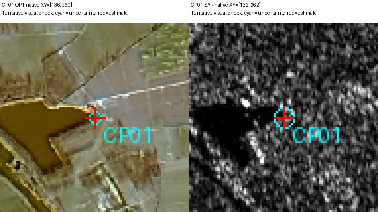

# 原始 WHU 数据链、底图筛查和生成器交付

本轮按“识别覆盖及关联场景 → 地理分组 → 划分 → 底图审计 → 准入后裁图”推进。结果是：**试点清单已建立、底图目视筛查已完成、生成器已实现并通过合成测试；正式数据准入尚未通过，因此没有生成真实训练裁块，没有运行新数据32对拟合或地理验证。** 现有单波段编码器、检索、损失、NMS、候选数及召回口径均未修改。路径中的 `20261125` 是本批次开始时的标识。

| 工作 | 本轮实际状态 |
| --- | --- |
| 1. 原始影像到裁块追溯 | 原始文件清单、覆盖证据、暂定地理组与划分完成；裁块清单因准入未通过保持为空 |
| 2. 两种用途的底图审计 | 完成初筛，登记8个暂定点；粗检索监督与1–2 px精定位均未认证 |
| 3. 可复现生成器 | 实现并用合成夹具验证；真实文件生成被准入检查阻止 |
| 4. 迁移现有检索工程 | 条件尚未满足，未执行；没有新召回结果或性能提升结论 |

**一、范围与来源**

官方目录收录100个父影像，每个父影像对应光学、SAR和分类标签，共300个文件。本轮服务器实际有39个完整解码的发布版文件：光学13、SAR14、标签12；涉及14个父影像，完整光学–SAR配对13个。逐父影像的本地可用情况见 [catalog_availability.csv](catalog_availability.csv)。这是下载试点，不能称为原始发布全集完整。

来源为[发布者仓库](https://github.com/AmberHen/WHU-OPT-SAR-dataset)、[官方Drive根目录](https://drive.google.com/drive/folders/1W3iMpkehng7ADXmhz9pPvmgFQBayq22t)及其模态文件夹，原始论文DOI为[10.1016/j.jag.2021.102638](https://doi.org/10.1016/j.jag.2021.102638)。保留了官方README、覆盖图的本地副本与哈希；每个文件的Drive ID、URL、原文件名、本地SHA-256均进入清单。原始发布以独立TIFF获取，本轮没有原版压缩包名称或发布者提供的校验值可核对。哈希是本地解码后计算的身份记录，不能替代发布者数字认证。源文件目录见仓库 `configs/raw_whu_catalog.json`，[source_evidence.json](source_evidence.json)记录来源口径。

这里的“原始”指发布者5556×3704全尺寸TIFF，**不是GF-1/GF-3卫星原始采集产品**。采集产品ID、原始处理链、严格配准残差仍未恢复。官方将该数据定位为土地利用分类集，分类像素标签不能作为光学–SAR精确对应真值。

原始文件保存在zzvr：`/mnt/sda/zhushihao/data/vis_sar/WHU_OPT_SAR_original`。光学为4波段uint8，SAR为单波段uint8，均为5556×3704。光学TIFF前三波段color interpretation为red/green/blue，第四波段为undefined；结合发布者RGB+NIR说明保留第四波段，第一版不使用。未来RGB读取明确为波段1/2/3，检索计划归一化为`uint8/127.5-1`；DINO尚未启用，预留方案为RGB/255后使用其指定均值标准差，见冻结配置。物理波段身份未做独立光谱检验。原始四波段和SAR文件均未被覆盖为灰度。

**二、四份清单与地理分组**

| 文件 | 内容和当前条数 |
| --- | --- |
| [raw_manifest.jsonl](raw_manifest.jsonl) | 39条；文件ID/哈希、模态、波段/类型/尺寸、值域/无效值、NoData、空间参考、像素范围、配对来源ID及本地对侧是否存在、附属文件哈希 |
| [scene_groups.csv](scene_groups.csv) | 14个父影像；名义覆盖、外部证据、地理组、理由、不确定项、暂定划分状态 |
| [splits.csv](splits.csv) | 9个暂定地理组和1个未分配集合；所有已分配划分均为`provisional_assignment_only` |
| [tile_manifest.jsonl](tile_manifest.jsonl) | 0条；没有把计划窗口伪装成已生成训练裁块 |

已检查TIFF没有CRS、地理变换、GCP或RPC，NoData为None。清单中地理变换及地理边界为null，保留像素范围。零强度不能自动解释成无效值。地理范围来自外部证据，未写成虚假的像素地理变换。

覆盖恢复采用两步：图幅编号只提出名义1:50000范围；再把每张原始RGB缩略内容与**独立发布的覆盖图全部可见图格**比较。灰度化仅用于覆盖图匹配，不改原始数据。搜索图格内±2图像像素偏移，要求预期图格为第一名、NCC≥0.70、相对其他图格的差≥0.15。13张本地图学中10张得到支持，另外3张加1个只有SAR的父影像不强行分配。详细分数、对照负例和参考图哈希见 [coverage_evidence.json](coverage_evidence.json)。SAR的近似覆盖继承发布者同父ID配对及“同区域”描述，并非恢复了独立SAR地理定位。

将有支持的名义范围投影到局部AEQD，在各边界增加3 km假设缓冲，用相交关系的传递连通分量分组；不同文件名也可以归在同组。整个组按预定经度带暂分：中心经度<112.5训练，112.5至114.75验证，≥114.75测试，无随机补位，也没有用模型结果选划分。

**地图未说明大地基准，WGS84只是分组计算的近似假设；3 km是声明的图上定位余量，不是实测误差上界。** 在这些假设下，暂定跨划分缓冲范围最小间隔约41.25 km，这个几何计算不能消除证据缺口。本轮所有地理独立性仍为“未认证”，覆盖图匹配不能认证像素对齐。生成器要求另有明确地理准入，不能把暂定划分当作正式独立验证集。

| 暂定划分 | 地理组 | 父影像 |
| --- | --- | --- |
| training | G-bba194d9cc28 | NH49E001014 |
| training | G-ca250e89bf6f | NH49E001017、NH49E002016 |
| training | G-c6a703ed7012 | NH49E002012 |
| training | G-60218bf11cc9 | NH49E003014 |
| validation | G-f8ca61c9a617 | NH49E003024 |
| validation | G-403698c4aef1 | NH49E006022 |
| validation | G-88f1db0bd728 | NH50E006001 |
| testing | G-eda7d31d64fb | NH50E012008 |
| validation | G-54cf283838a9 | NI49E024020 |
| unassigned | GEOGRAPHY_UNCONFIRMED | NH49E001013、NH49E002014、NH49E004011、NH49E010022 |

未确认的4个父影像保持`GEOGRAPHY_UNCONFIRMED/unassigned`。其中`NH49E004011`仅有SAR，本地对侧缺失与官方目录存在对侧分开记录。[exceptions.jsonl](exceptions.jsonl)汇总缺项。

**三、原生底图两种用途的审计**

为10个有覆盖支持的父影像生成3个分散512×512检查窗口，共30个；优先利用土地类别选择空间分散的地物层，其余用空间位置补足。分类标签只用于分层抽样。预留测试组的3个窗口只生成质量预览，不挑点、不参与模型评估。其余27个窗口完成目视筛查，逐窗是否可判读及未选点理由见 [region_reviews.jsonl](base_audit/region_reviews.jsonl)，位置见 [inspection_rois.json](base_audit/inspection_rois.json)。

山地存在明显侧视形变、阴影、压缩和纹理歧义；道路、屋顶也经常不能在SAR中定位同一物理位置。没有强制为这些地物生成点。4个父影像的池塘上保留8个暂定同名结构，记录两侧窗口/原图坐标、单侧判读半径、歧义及放大复核。观察者是Codex目视筛查；复核是同一观察者的再次放大检查，**没有独立人工复核**。同一池塘的两个角也不构成独立样本。

以名义同网格关系计算`d=||p_s-p_o||`，筛查量为`d+u_o+u_s`。判读半径不是校准的统计置信区间，这个量不是实测真误差上界；点对应本身仍为暂定。表内坐标为原始512窗口内零起点(x,y)，全图坐标另见记录文件。

| 点 | ROI | 光学(x,y) → SAR(x,y) | d(px) | 两侧判读半径(px) | d+u_o+u_s(px) |
| --- | --- | --- | ---: | --- | ---: |
| CP01 | NH49E002016/roi1 | [136, 260] → [132, 262] | 4.47 | 3 / 5 | 12.47 |
| CP02 | NH49E002016/roi1 | [113, 285] → [112, 281] | 4.12 | 4 / 6 | 14.12 |
| CP03 | NH49E003024/roi0 | [354, 136] → [350, 139] | 5.00 | 3 / 5 | 13.00 |
| CP04 | NH49E003024/roi0 | [367, 102] → [366, 103] | 1.41 | 4 / 6 | 11.41 |
| CP05 | NH50E006001/roi0 | [15, 119] → [15, 116] | 3.00 | 3 / 5 | 11.00 |
| CP06 | NH50E006001/roi0 | [45, 117] → [43, 114] | 3.61 | 3 / 5 | 11.61 |
| CP07 | NH49E006022/roi0 | [104, 27] → [106, 29] | 2.83 | 2 / 4 | 8.83 |
| CP08 | NH49E006022/roi0 | [124, 55] → [127, 56] | 3.16 | 2 / 4 | 9.16 |

| 用途 | 本轮结论 |
| --- | --- |
| 固定8 px粗候选检索监督 | 未准入。8个暂定点的筛查量8.83–14.12 px；即使个别点更接近，也不足以认证整窗、整景的密集监督 |
| 1–2 px精定位监督及精度结论 | 未认证。点位判读半径2–6 px且无独立复核，无法分辨该目标级别；系统偏差也尚未充分评估 |

这不证明所有原始底图实际误差都超过8 px，更不能把8.83–14.12 px写成实际配准误差分布。当前证据只支持“不足以认证”。未估计全局平移/仿射，也未进行预对齐；`fit_points=[]`，全部点仅用于审计。未来若发现可修正偏差，仍需分离拟合点和独立检查点，修正监督标为伪标签。

完整点位：[checkpoint_records.csv](base_audit/checkpoint_records.csv)及[JSONL](base_audit/checkpoint_records.jsonl)。准入状态：[admission.json](base_audit/admission.json)。下图红色为估读位置，青色圈为单侧判读半径，仅作初筛。



**四、生成器与变换链**

代码为`sdgm/raw_tiles.py`及`scripts/generate_raw_tiles.py`。生产入口在写任何真实样本前核对：地理独立性准入、冻结配置与清单哈希、训练及验证同时有已准入区域、组与划分一致、原始TIFF及GDAL附属文件哈希。已有冻结目标目录拒绝覆盖。先写临时目录，再整体提交；失败清理临时产物。当前固定配置计划32训练+32验证，但没有执行真实裁块。

每条生成样本记录父影像/源文件身份、地理组、原图窗口、预处理、底图关系及精度状态、完整变换链、插值/填充、有效掩码、种子、输出哈希。四波段光学窗口逐值保留，SAR底图单独保留，仅对SAR副本施加合成仿射。未缩放原始裁块、未转灰、未预对齐。

统一坐标为零起点像素中心、列向量，方向为光学→扰动SAR：

```text
C_o = optical original -> optical crop
C_s = SAR original -> SAR crop
B   = native optical original -> native SAR original (accuracy qualified separately)
A_s = SAR crop -> synthetically perturbed SAR
H   = A_s @ C_s @ B @ inverse(C_o)
```

当前未认证的名义单位B不能用作已认证精确标签。合成矩阵系数精确已知，也不代表B准确。图像插值仍有离散化误差。参数为512窗口中心旋转±20°、尺度0.9–1.1、x/y平移±32 px，OpenCV双线性插值、常数0填充。有效性由GDAL掩码、有限值和插值支持定义；SAR有效区域要求全部双线性权重来自有效输入，零灰度本身仍有效。

种子由`SHA256(master_seed|split|ROI_ID|repeat)`确定，验证样本离线生成后冻结，不随epoch变化。多个扰动可共享同一原始窗口，清单保留`raw_window_id`及重复标记；32对扰动不等于32个独立原始窗口或地理样本。

实际尝试命令的准入拒绝、退出码和零产物证据见[generation_attempt.json](generation_attempt.json)及[generation_gate.log](generation_gate.log)。它不是运行故障，也不是外部授权阻塞，而是本轮数据质量和独立性条件未满足。`tile_manifest.jsonl`为空是有意结果。

**五、工程验证与第4项状态**

zzvr既有仓库`.venv`运行全部38项测试通过，新增11项围绕真实风险验证：跨父影像的传递重叠分组、未知覆盖不分配、暂定地理不能用作独立验证、稀疏点不能自动认证整窗、原图与局部坐标、完整前向链与实际warp、RGB/NIR逐值保留、有效零像素、显式掩码及分数边缘、验证种子/矩阵/输出哈希复现、对侧目录与本地配对区分、源文件/外部掩码篡改、陈旧审计、验证无准入时写前拒绝，以及零点审计导出。若干测试覆盖多个检查点。日志中无地理参考提示来自刻意无CRS的合成夹具，与待审数据状态一致。

测试证据：[pytest.log](tests/pytest.log)、[junit.xml](tests/junit.xml)。`compileall`及Black检查通过。环境版本见[environment.json](environment.json)：Python3.10.20、PyTorch2.11.0+cu128、OpenCV5.0.0.93、rasterio1.4.4、pyproj3.7.1、shapely2.1.2。原环境保留，仅在仓库venv补充本轮所需依赖。

现有`sdgm/coarse.py`、`scripts/train_structure_smoke.py`及原单波段配置相对上一提交没有修改。尚未接通RGB适配器和新读取器，没有启动GPU训练，没有使用暂定验证组反复调参。因此本轮**没有新的原生召回@1/@4、距离分布、显存耗时或泛化结论**；此前派生灰度数据的结果也没有被重新包装成新数据结果。

后续必须先补足地理覆盖依据和有足够定位精度、空间覆盖及复核的底图检查点。获得正式准入后，才生成32对固定训练样本和冻结独立地理验证样本；随后只迁移读取器、RGB输入通道及必要归一化，维持8 px正邻域/召回半径、24 px NMS、4候选和其他检索定义。RGB与旧单波段差异只用于数据链验证，不归因为方法提升。当前正式路线仍为`training_ready=false`。

**六、复现与文件位置**

服务器代码：`/mnt/sda/zhushihao/Semantically-guided-disambiguation-matching`；完整报告及所有原尺寸预览位于其`reports/raw_rebuild_20261125/`。GitHub归档只包含元数据、代码、测试和选定预览，不上传原始TIFF、训练裁块或checkpoint。

```bash
cd /mnt/sda/zhushihao/Semantically-guided-disambiguation-matching
export PYTHONPATH=.
# 原始TIFF目录需与configs/raw_rebuild.json一致。
# 新克隆先将artifacts/raw_rebuild_20261125/source复制到reports/raw_rebuild_20261125/source。
.venv/bin/python scripts/build_raw_manifests.py
.venv/bin/python scripts/prepare_raw_audit.py
.venv/bin/python scripts/audit_raw_alignment.py
.venv/bin/python scripts/summarize_raw_rebuild.py
# 当前数据预期被拒绝，不能删掉准入检查以运行训练。
.venv/bin/python scripts/generate_raw_tiles.py
PYTEST_DISABLE_PLUGIN_AUTOLOAD=1 .venv/bin/python -m pytest -q
```

机器可读阶段状态见[round_status.json](round_status.json)。新机器依赖安装为`pip install -e '.[raw,smoke,test]'`；服务器继续使用已有专用venv。
