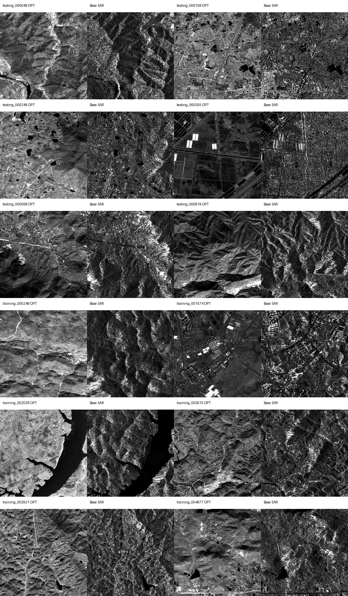
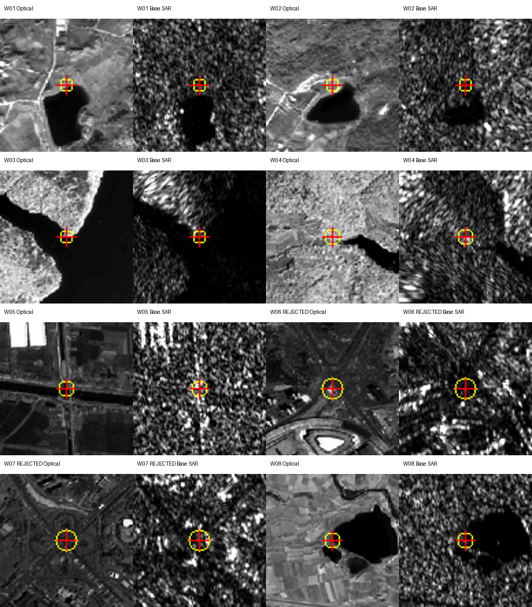

# zzvr 数据与几何检查报告

本次执行了任务表中的数据自动校验、WHU 底图精度初筛和几何单元测试。代码与复现命令见仓库 README。

执行环境为 `/mnt/sda/zhushihao/Semantically-guided-disambiguation-matching/.venv/bin/python`，服务器 `ubuntu`，Python `3.10.20`。运行时间记录为 `2026-11-25T12:53:46.387586+00:00`，该字段使用 UTC。数据路径和种子见 `environment.json`。本阶段使用 CPU 进行数据读取、图像诊断和单元测试。

## 数据检查结果

| 数据 | 实际检查范围 | 结果 |
| --- | --- | --- |
| WHU 派生包 | 5600 训练、700 测试，共 6300 个四文件样本 | 6300 全部解码，文件对应完整，原 ZIP 索引的 25200 个文件名及解压尺寸相符 |
| SRIF 光学–SAR | 200 对图像、200 个矩阵，共 600 文件 | 全部解码，矩阵有限、可逆，未发现缺件 |
| SpaceNet 9 | 3 对训练、2 对公开测试，10 张影像、3 份 CSV | 全部解码，416 行同名点坐标有效，含 1 行重复记录 |

阻断级错误共 0 个。完整清单保存在各目录 `manifest.jsonl`，异常保存在 `anomalies.jsonl`。Git 中清单使用 `.jsonl.gz` 压缩。

WHU 每张光学和 SAR TIFF 均为 512×512、单波段 uint8。现有文件为配准派生包，原版 100 景 RGB/NIR 光学、多景 SAR 和土地利用标签未在该包内确认。全部裁块缺少 CRS 和地理变换，真实地理覆盖无法恢复，当前覆盖检查限于像素范围和 flow 的有效重叠。零像素比例与 NoData/有效掩码分别记录。原始父场景编号、生成脚本和来源说明缺失，训练测试的场景独立性及空间泄漏情况无法确认。

SRIF 按 `pair1` 至 `pair200` 核验两张图及对应 2×3 矩阵。作者演示程序将矩阵用于 image 1 → image 2，7 个抽查预览中的第一张为光学、第二张为 SAR。每个矩阵的行列式和条件数均在清单中记录。该子集以配准测试样本提供，未从现有文件确认官方训练/验证划分。

SpaceNet 9 全部影像为 uint8，光学 3 波段、SAR 1 波段，CRS 均为 EPSG:32637。两侧尺寸和像元网格不同，边界框的较小区域覆盖率约为 99.95%–100%。

| 场景 | 光学尺寸 W×H | SAR 尺寸 W×H | CSV 行数 |
| --- | --- | --- | --- |
| 02_publictest | 10155×2661 | 7477×1986 | 官方保留 |
| 03_publictest | 3826×10998 | 2617×7520 | 官方保留 |
| 02_train_01 | 10155×3208 | 7477×2293 | 151 |
| 02_train_02 | 10155×3990 | 7477×2929 | 104 |
| 03_train_01 | 7740×10998 | 5292×7520 | 161 |

`03_tiepoints_train_01.csv` 的第 146、158 行完全重复，已列入异常。原始 CSV 保留，评估时是否去重需作为实验协议明确记录。公开测试的 CSV 和最终私测影像/标注由官方保留，现有目录覆盖完整的公开影像范围。

## WHU 底图初筛

从两个现有 split 的分散编号中选择 12 个裁块，覆盖山地、森林、道路、村庄、工业区、农田、池塘及大河。每个裁块生成光学/底图 SAR 对照、边缘叠加、扰动前后与 flow 恢复图，以及全局和 3×3 局部梯度相位相关代理结果。源场景 ID 仍未恢复，12 个裁块的父影像独立性未验证。

目视检查保留 6 个初步同名结构点，分布于 4 个裁块，另有 2 个工业区候选因放大复核后仍无法独立定位而弃用。全部点均有标记图、放大图、结构描述和不确定性记录。

保留点的单侧估读半径为 5–6 像素。粗估偏移约为 1–4.1 像素，处于估读不确定性范围内，只支持“所检查的部分清晰结构在粗尺度上对应”的判断。山地/森林中的局部错位仍难以判定，现有证据不足以确认亚像素底图精度。

相位相关结果标记为位移代理，相关峰受跨模态外观、重复结构和地形影响。初步目视点的用途是筛查，后续精度评估应另行独立复核控制点。

## 几何验证

自动测试共 18 项，其中 16 项覆盖几何约定与求解，2 项验证重复点和越界处理。失败和错误共 0 项。真实 WHU 裁块的附加几何检查为 12 个，全部通过。

- 光学 → SAR 方向使用真实 OpenCV warp 的非对称平移检查。
- 双侧裁剪、缩放和翻转后验证 `H_new = A_s @ H @ inverse(A_o)`。
- 用实际 PyTorch `grid_sample` 检查 `(x,y)`、半像素变换及 `align_corners=False`，覆盖奇数尺寸和非方形网格。
- 检查完整六自由度仿射、权重、零权重离群点、大坐标稳定性、点数不足、重合点、共线、近共线及目标坍缩。

全量 WHU 的 flow 与 metadata 正向矩阵的最大差异为 `1.53e-05` 像素。附加真实样本验证还比较了矩阵角点位移、底图 SAR 的正向 warp，以及正向/反向取样的重建误差，正确方向在 12 个样本中均得到较低误差。

这些检查验证合成扰动几何与实现约定。光学与底图 SAR 之间的原生对齐质量仍受初步检查点证据限制。

## 交付索引

- 三份清单分别位于 `whu/manifest.jsonl`、`srif/manifest.jsonl` 和 `spacenet9/manifest.jsonl`。
- 三份异常表位于各数据目录的 `anomalies.jsonl`。
- WHU ZIP 对照记录位于 `whu/archive_index.json`。
- 全部诊断图、结构判读和初步检查点 CSV 位于 `whu/diagnostics/`。
- SRIF 和 SpaceNet 9 的预览位于各自的 `sample_preview.png`。
- 单元测试日志、JUnit 和真实样本验证位于 `geometry/`。

方法网络的训练、消融和最终精度实验属于后续阶段。本次代码为这些实验建立数据及几何基础。
